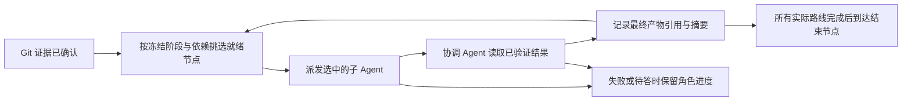
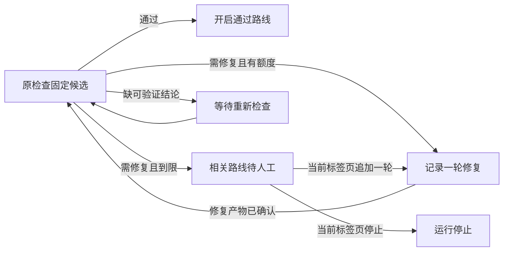
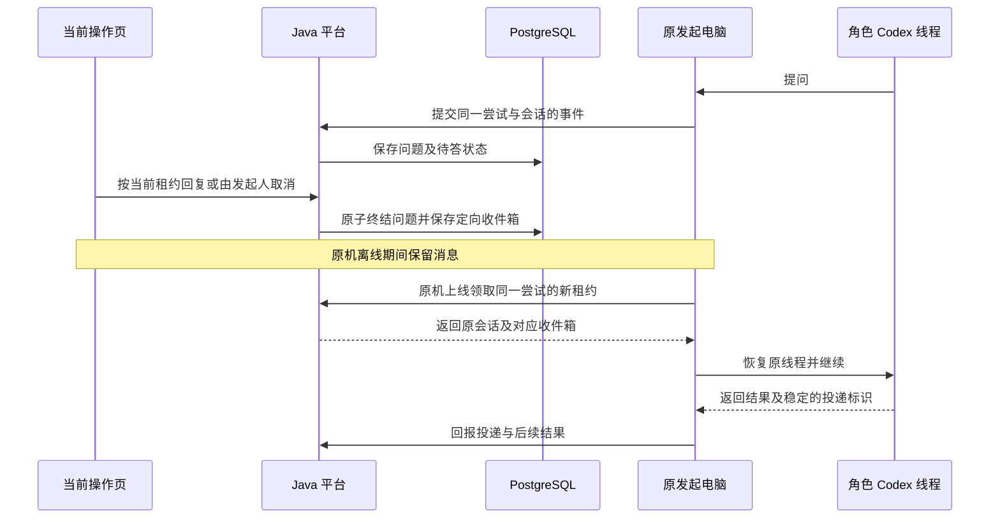
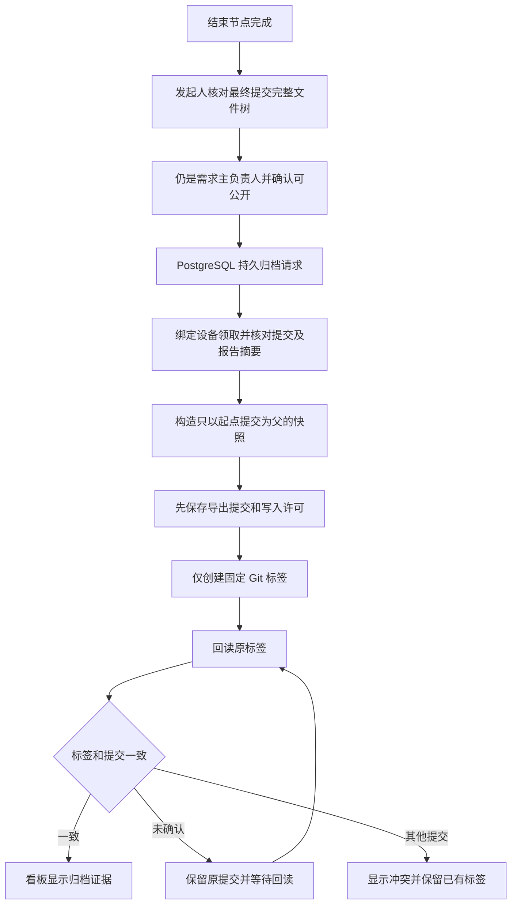

## Context

当前文档采用 BRD v0.57、PRD v0.8、[SA v0.5](../../../output/SA/SA-AgentShip.md)、[SD v0.5](../../../output/SD/SD-AgentShip-index.md) 和 [API v1.0.0-draft.13](../../../output/SD/contracts/agentship-v1.json)。现有原型提供历史行为参考。目标技术栈为 React + TypeScript、Java Spring Boot、PostgreSQL 和 Java 本机执行程序。用户已授权按现有文档实施首批 1.1～1.4。

2026-11-09 用户进一步授权下一批阶段、节点、依赖、多 Agent 配置与 Logo 调整，覆盖 2.1 及 2.6 的流程编辑器部分。本批不改变运行、设备与真实供应商验收的后续范围。

## Goals / Non-Goals

前一批完成 2.2 的授权选择、启动条件、四类分支计划及启动去重，同时实现 3.1 的配对/同机证明前置部分、2.6 的启动与运行详情、3.5 的设备页面。本批用户继续授权 2.3：接入 Git 任务领取、租约、授权和结果回报，Java worker 的 Git 适配及前端证据。Git 准备后等待 Agent；节点任务派发、Codex 会话与聊天仍按后续任务验收，真实 GitHub 验收仍归 4.2。

- 一次运行可追溯需求修订、流程快照、角色及尝试、Git 引用、节点产物、开发测试与人工操作。
- 通过平台与单台发起电脑的分工，保证浏览器关闭、设备中断和原电脑恢复时仍识别同一次运行。
- 首期使用 GitHub、macOS 与 Chrome 在开发环境验收。正式发布、生产放行和回退进入后续范围。试点对象和具体环境权限待落实。

## Decisions

| 决策 | 实施约束与理由 | 权威 |
|---|---|---|
| 平台和本机分离 | Spring Boot 平台与 PostgreSQL 部署在独立于发起电脑的环境，提供鉴权、状态查询、任务与证据记录。Java worker 负责本机 Codex、Git 与外部执行。设备关机时平台仍可供其他获授权浏览器读取。 | SD-B01、SD-B05、SD-I02～04 |
| Web | React + TypeScript 打包为静态资源，浏览器经同源接口使用平台。组件按配置、启动、运行和聊天划分，以服务端权限和状态为准。交付运行时由浏览器和 Java 组成，构建与分发以 SD-F01 为准。 | SD-F01、SD-F02、SD-I01 |
| 权限与一致性 | 提交时在事务中验证当前身份、授权和版本。用户名按忽略大小写的键判重，支持数字且最长 100 字符，需求名称全平台唯一。密码为 15～128 个字符，允许空格和符号，两次输入须完全一致。注册后账号待验证，邮箱和手机号都验证成功才激活并允许登录。同一个邮箱、同一个手机号各只能绑定一个账号。邮箱不区分大小写，手机号统一带国家区号判重。注册受理后待验证状态保留 24 小时。未完成双渠道验证而到期时，原验证码失效，释放用户名、邮箱和手机号，允许重新注册。首批开发和验收使用本地模拟邮件和短信，真实发送待供应商确定后接入。三类负责人按用户名选人。移除与转交原子生效，原角色授予的编辑及使用权立即失效。列表、候选和提交按当前权限裁决，转交重放不返回对象详情。 | SD-B02、SD-I01 |
| 运行与调度 | 保存启动时流程快照、节点及角色配置。跨阶段修复回到原检查。达到自动上限后，在同一运行锁下判断受影响路线的阻塞、任务领取及外部写入授权，无关路线按原条件推进。失败 Agent 可重试或跳过。协调者先汇总冲突，无法解决时等人工，节点仍须有可用最终产物。 | SD-B03、SD-B04、SD-Q01 |
| 设备和消息 | 发起时校验同机证明，每次运行仅允许发起设备执行，旧回报不得覆盖当前结果。原会话可用时沿用，否则从最近保存的进度恢复。普通消息默认协调 Agent，`@Agent` 指定当前节点角色。问题回复固定到发问会话，普通执行消息用明确的 Worker 事件返回。 | SD-B04、SD-B05、SD-I02、SD-I03、SD-C03 |
| 聊天与人工操作 | 发起人可授权及撤销运行聊天用户，需求副负责人仍禁止聊天。操作权绑定用户和标签页，撤权立即失效。收到关闭通知即释放，未送达时沿用断连五分钟宽限。人工操作按当前角色与操作权校验并留痕。 | SD-B02、SD-B05、SD-F02、SD-I01 |
| 需求修订与历史 | 活动 BRD 节点内只由发起人确认。原需求及本次运行修订同事务更新，首次成功领取时在运行锁内固定节点输入修订。仅排队的节点尚未固定。在途节点按旧修订完成并标记，未启动节点采用新修订，旧尝试保留角色展示名。重跑的下游影响仍待定。 | SD-B04、SD-D02～03、SD-F02、SD-I03、SD-C04 |
| 外部操作与资料 | 校验先于 Git 准备。GitHub 未知结果先以原引用核对。可公开交付物归档至需求仓库，账号资料、聊天原文及原始日志留平台。开发环境真实操作与演练证据分开。 | SD-B04、SD-B05、SD-I04 |

### 本批流程配置实现约定

配置的 `version` 用于编辑和负责人变更的乐观锁；新增只读 `workflowVersion` 表示最近封存的流程图版本，后续启动引用该值。负责人变更不生成新图版本。存量仅有基本资料的流程返回空阶段和 `workflowVersion: null`，补齐并保存前不进入可使用候选。新保存须有唯一的末尾结束节点，图、依赖、检查路线及所选 Agent 版本在同一事务中封存。

多 Agent 仅保存用户选中的角色，不自动使用全部目录。普通与检查节点须选一名协调 Agent，子 Agent 默认并行，也可选择串行并调整顺序。本批依现有可选子 Agent 契约允许只选协调 Agent，这是实施默认值，SA-D05 仍保留待复核状态。结束节点不执行 Agent。图保存和展示已实现，真实派发与结束判定由后续运行任务验证。

### 本批启动与设备实现约定

平台与 Java 本机程序暂共用一个构建包，由 `--worker` 进入独立进程模式，不启动 Spring 或数据库连接。本机桥固定默认监听 `127.0.0.1:4781`，只接受配对时的平台精确来源。首期回环验证使用演练设备；不得把设备在线或排队状态解释为 Codex、Git 或研发执行成功。

配对码有效期 5 分钟，挑战有效期 2 分钟，本机每 10 秒心跳，超过 30 秒未心跳显示离线；均为可后续调整的实现默认。Ed25519 签名正文依次为 `agentship-device-proof-v1`、设备 ID、挑战 ID、Base64URL 随机数、规范化平台来源，以换行连接，UTF-8 编码，末尾无换行。消费挑战与创建运行同事务；同键相同输入重放返回原收据，重新验证当前身份与访问权，不再次消费挑战。

Git 计划与已完成 Git 证据分开：新增 `gitPlan` 只描述待执行步骤，未验证前不返回 `git` 成功字段。沿用原型的固定标识命名作为实现默认，新仓库计划名为 `<namespace>/agentship-<requirementId>`，工作分支为 `<workType>/<runId>`。非 hotfix 使用 dev，并在执行时检查是否需从真实默认分支补建；hotfix 等待读取真实默认分支。计划不猜测 main/master，不触发外部请求。正式 Git 接入仍需完成 SA-D02 的异常恢复细化。

### Git 准备批次边界（2026-11-09）

用户「继续」授权在原技术栈中接入任务 2.3，并实现其必要的 Git 领取、租约和结果回报。此次不扩展到 Codex 会话、节点派发、聊天操作权或发布。API draft.11 记录逐步 `gitPreparation`；Git 成功后运行进入 `waiting / AGENT_EXECUTION_PENDING`，不得标记流程完成。

Java worker 默认仅连接；`--execute-git` 显式启用 Git。演练执行真实本地 Git 操作，结果标记 `demo`，不关联需求的真实仓库。GitHub 模式使用 `--mode codex --git-provider github`，凭据只从进程环境取；本批自动验收用回环 HTTP 替身，不访问真实 GitHub。Codex 可用性探测仅检查程序版本，不代表会话或登录已验证。

新仓库采用 GitHub 初始化参数创建公开仓库，读取服务实际默认分支；非 hotfix 从 dev 开始，缺失时从实际默认分支补建。hotfix 直接使用实际默认分支。仓库标识、分支和提交经回读确认后保存；已有工作分支必须匹配预期提交，不覆盖冲突分支。空仓库与身份冲突返回可读失败，不能伪造基础提交。

启动时针对选定仓库和工作分支保存有限授权。当前实现默认授权有效期 24 小时、任务租约 60 秒、未知结果间隔 30 秒核对。这些是实施默认值，不表述为用户确认。每次外部操作仍重检当前需求权限、绑定设备、任务世代、授权范围及期限。先持久保存意图，再授予短时执行许可。`dispatch` 只用于首次执行；`reconcile` 和 `already_succeeded` 只能读取结果。网络超时或重启保留原操作标识和事件正文，先查结果，不能重复提交不确定的写入。

仓库操作按需求及模式共用标识，基础和工作分支按运行及模式区分。演练与真实证据隔离。真实仓库关联会同步递增需求配置版本；运行另存当时默认分支，避免后续仓库设置改变历史。旧租约回报被拒绝，同键同正文的已接收事件只重放原收据；同键不同正文冲突。明确失败暂停，未知结果允许自动只读核对。人工重试入口待聊天操作权完成后提供。

GitHub 适配依据官方 [仓库 API](https://docs.github.com/en/rest/repos/repos) 与 [Git references API](https://docs.github.com/en/rest/git/refs)。目标栈的实际结果以批次验收为准，真实账号、双设备与 Codex 验收仍归任务 4.2。

### 节点调度与 Codex 批次边界

本批实施 2.4 的常规调度和本机产物门槛、3.2 的角色派发与 Codex 会话执行，以及 2.6、3.1 的相应看板与恢复分区。使用已有流程、角色版本、运行节点、尝试和产物表。全局就绪状态与已有上游待决项继续跟踪。

本机使用 `--execute-git --execute-agents` 显式启用角色领取。协调者等已选子角色的结果，按配置串行的子角色也能读取前序报告。阶段约束执行时序，工作区只合入显式前置节点及所选检查路线的提交。默认允许最多四个角色任务同时执行，超出容量继续排队。领取与回报复用同设备、尝试和租约世代校验，节点首次执行固定输入修订。结束标记不派发 Agent。

Codex 适配使用本机 App Server 的 stdio 协议，每个角色的尝试拥有自己的会话和受限工作目录。子角色读取任务和证据，协调 Agent 产出汇总。角色结果以工作区 Git 提交、路径和 SHA-256 核对，并以 `local-git:` 引用在看板标明来源。正式归档到 GitHub 需完成限定目标的写入授权、内容筛选和回读。聊天操作权、回复或取消、需求修订与失败重试由 3.3～3.5 接续。

演练检查的结论须与候选匹配才可放行路线。真实 Codex 的检查证据先保留待确认，由 2.5 接入必测项、跨阶段自动修复、复查和限次处置。真实 Codex 账号及双设备仍由 4.2 验收。

### 检查修复和运行操作批次

同一运行保存原检查波次和对应修复轮。V4 的 `check_wave.recheck_of_round` 将复查和修复产物来源绑定。每个检查独立累计自动及人工轮数，使用冻结流程的上限。受限路线的依赖闭包在运行锁内裁决，其他路线按原阶段与依赖继续。修复路线含多个独立产物时，合并后的提交与预绑定候选不匹配则待确认。可配置显式汇合节点形成单一候选。

检查协调 Agent 可通过说明中的 `[check:git-diff]` 启用固定 Git 检查。Worker 核对实际工作区提交和候选引用，以参数数组运行 `git diff --check`。结果只覆盖空白和冲突标记。任意模型自报通过、候选不匹配或未配置检查时均不能放行。应用必测项按 PRD Q-07 接续。演练 `[demo:repair-until=N]` 用于可重复验证波次。

人工操作沿用会话、精确 Origin 和 CSRF 校验，获取租约后还须持有当前账号、登录会话、标签页和世代的签名凭据。窗口 30 秒，前端每 10 秒续租，窗口届满后保留五分钟宽限。持有页正常离开以带 CSRF 的 keepalive 请求释放，退出登录清除占用。发起人按用户名授权，撤权同步释放。人工命令绑定当前检查波次，同一请求键重放返回原收据。申请聊天操作权和发送聊天消息是不同能力，消息和回答在后续任务接入。

### 设计图、数据及运行依赖

- [逐功能图索引](../../../output/SD/AgentShip-Function-Diagrams.md) 覆盖全部 39 项 PRD 功能。规格和 TA 行中的 `FR-*` 对应索引中的 `SA-FR-*` 与 `SD-FR-*`。用前者复核业务前置与结果，用后者定位实现触点，再按相应 SA/SD 段落和契约处理边界。
- [数据设计 SD-D01～03](../../../output/SD/SD-AgentShip-data.md) 负责 ERD、访问路径、事务顺序和迁移目录。[DDL](../../../output/SD/data/agentship-postgresql-ddl.sql)、[DML](../../../output/SD/data/agentship-postgresql-dml.sql) 和 [断言](../../../output/SD/data/agentship-postgresql-assertions.sql) 作为实现与隔离验证输入。涉及授权、租约、快照、外部结果或发布证据的落库规则，随关联任务核对设计和证据。
- [中间件设计 SD-M01～02](../../../output/SD/SD-AgentShip-middleware.md) 负责入口、身份、数据库连接、迁移、任务队列、可观测性和运行环境边界。环境参数、支持矩阵与真实验证权限从对应权威文档取得。

## Risks / Trade-offs

- 两个请求争夺占用、同名写入或同一待答问题时，按事务与版本解决竞争，测试记录成功方和被拒绝方。
- 重连与外部响应乱序可能形成旧任务回报或未知结果。用当前租约、尝试和外部引用核对，未确认时保持可见的待处理状态。
- 可视化流程、角色容量和厂商契约各自有边界。用领域层测试固定调度规则，用独立设备和获准环境验证真实能力。
- 原型记录与新栈结果的证据不可混用；测试目录和真实验收数据分别配置。

## Migration Plan

按 SD-D01～03 的访问与迁移目录，在隔离 PostgreSQL 验证初始化、适用升级路径、关键事务、恢复和回退。用合成数据核对行为与 v1 契约；运行时数据导入范围、映射和留存需独立决策。保存迁移版本、数据库版本、执行及失败证据。部署拓扑、环境批准与真实接入以 SD-B05、SD-M01～02 和任务 4.2 为准。

## Verification Approach

[任务清单](tasks.md) 与 [补充测试分析](test-analysis.md) 连接规格、逐功能图、数据约束与验证。任务 4.1 汇集目标栈的隔离数据库、契约、浏览器、故障与回归证据。任务 4.2 汇集获准的双设备、macOS/Chrome、真实 Codex、GitHub 和开发交付结果。结构校验、设计 SQL 断言、应用测试和真实验收分别记录在 [验证记录](evidence.md)。

## Open Questions

剩余决策以 [补充测试分析](test-analysis.md) 第 8 节、PRD Q-01～Q-09 及 SA 待决表为准。首批 1.1～1.4 核对账号模拟验证、本人资料读取、负责人授权、迁移与接口验收。完整变更的适用上游批准、独立评审、SD-Ready、Contract-Ready、TA-Ready 和实施授权仍按剩余范围跟踪。

## 网页协作、开发验证和归档

本机 Worker 按冻结流程启动配置所选的角色，使用独立 Codex App Server 线程来保持可寻址的角色、同一提问会话及失败角色粒度。节点可选择超过两名子 Agent，本机同时运行的角色任务默认最多四项，超出容量排队。原生 `spawn_agent` 保留为兼容性验证选项。当前执行适配使用独立线程。

回复或取消只终结一个问题。无法证明已投递时，保留未知状态并等待处理。已保存的结果或检查点可在同一设备恢复；原会话不可用且执行结果已无法确认时，保留已提交进度并停在待处理。成功角色无需重跑。普通消息默认发给当前节点协调 Agent，可指定所选角色。发起人确认活动 BRD 节点的修订后，原需求与运行同步更新。旧节点结果保留，运行中的显式重跑仅在尚未启动后续检查且没有下游正在使用原产物时开放。

开发检查可选固定 Git 差异检查和可信 Maven 项目的离线测试。报告关联受检候选提交。Maven 缺离线依赖、没有实际执行测试或退出与汇总无法核对时，保留待人工。具体试点必测项和 Maven 项目仍由真实环境验收确定。

归档记录固定运行、产物和发起设备。写入前明确失败的重新确认绑定原审批时间，旧确认请求重放不再次排队。公开材料需审阅候选完整文件树。目录规则可拦截已知私密文件路径，文件中的内容需由负责人确认。账号、对话及原始日志使用各自的受限存储。开发验收与正式发布分别管理。
