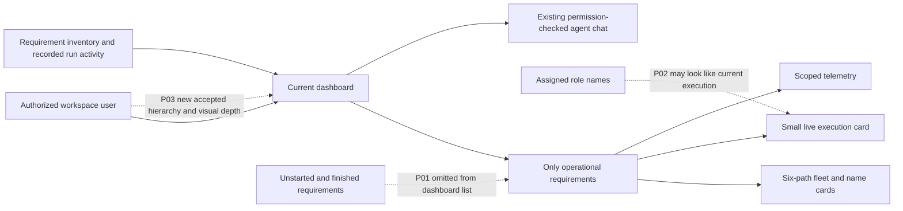
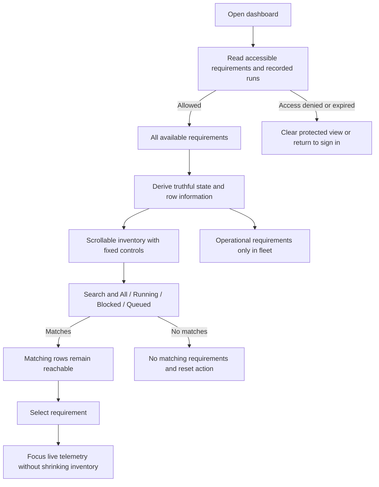
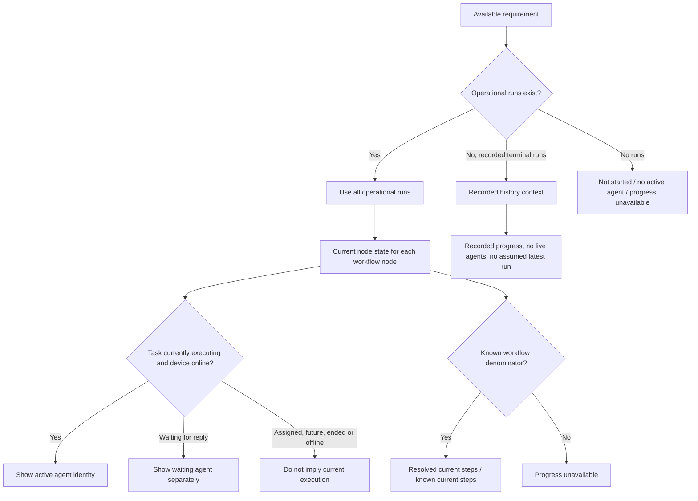
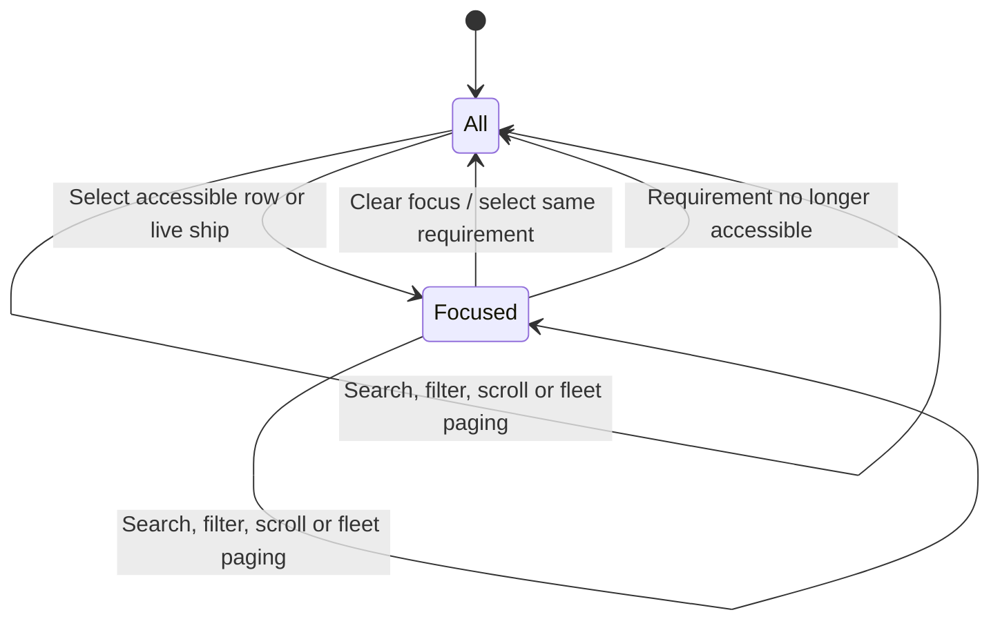
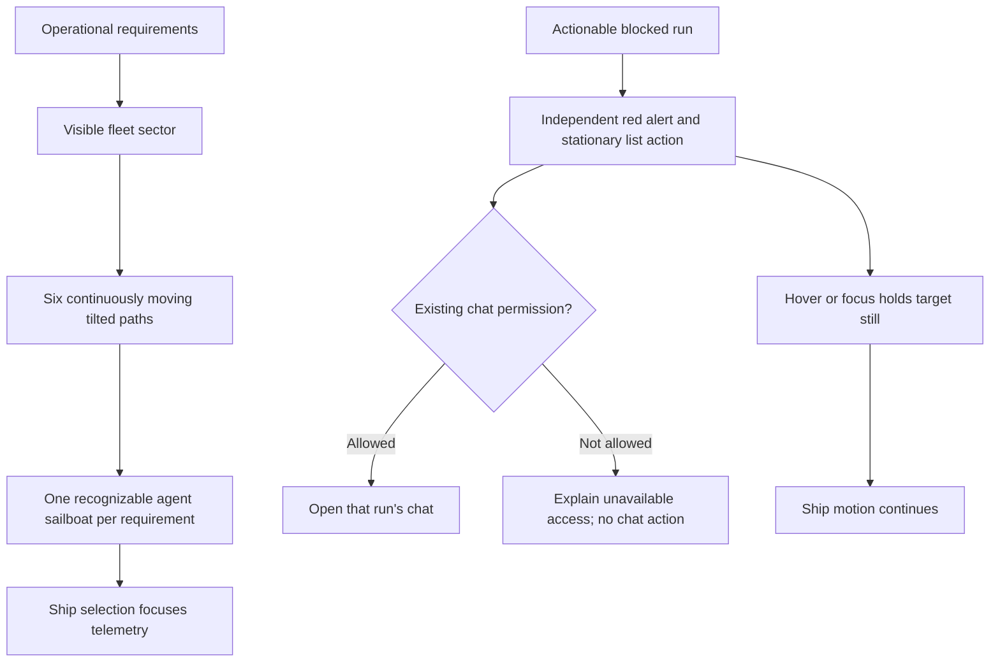
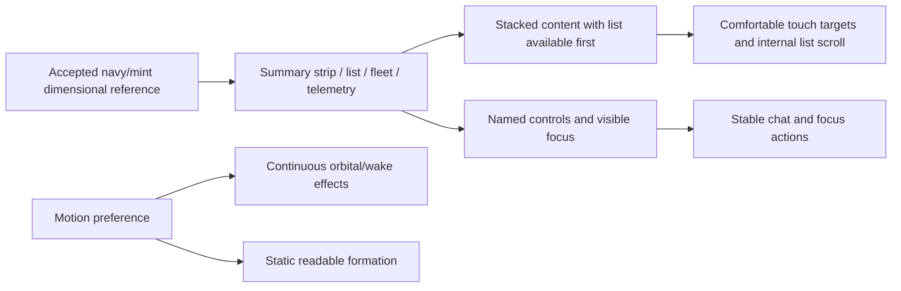
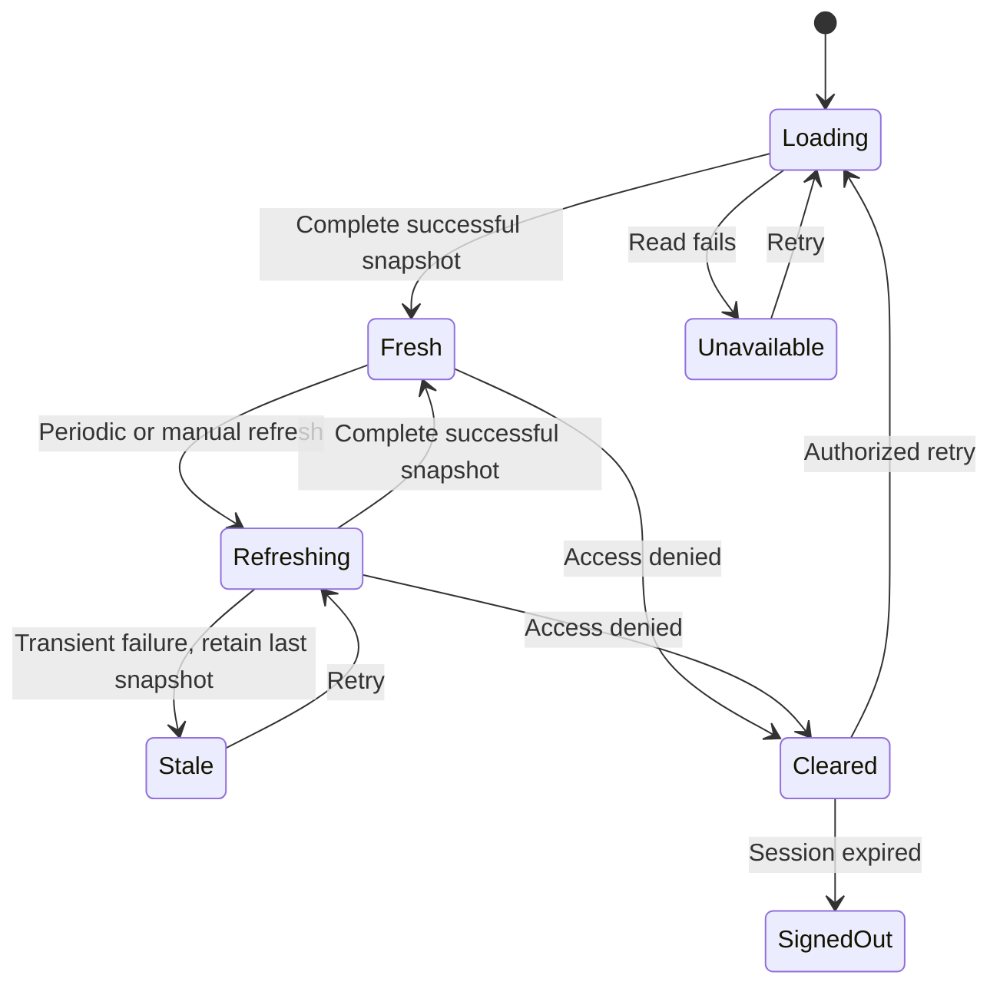
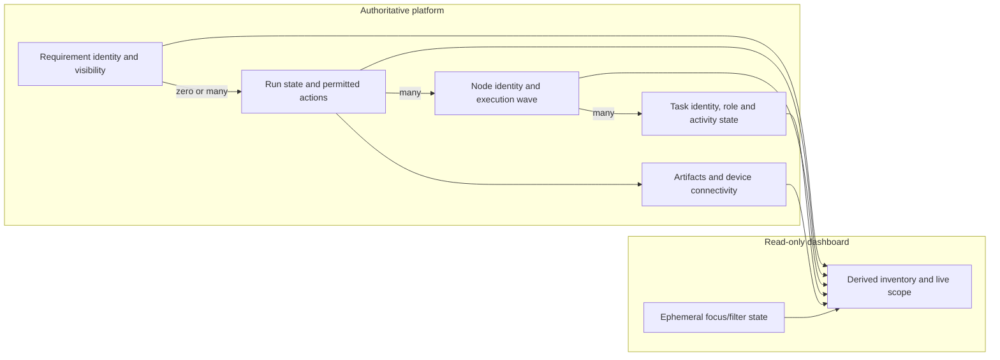

# System Analysis — Dashboard command center

Version 1.0 · 2026-11-16 · Brownfield increment · Owner: dashboard design contributor
Scope authority: the user's approved visual and explicit instruction to progress through testing. Sources: [BRD v1.0](../BRD/AgentShip-Dashboard/BRD-AgentShip-Dashboard.md), [PRD v1.0](../PRD/PRD-AgentShip-Dashboard.md), [SRS v1.0](../SRS/SRS-AgentShip-Dashboard.md), [FRS v1.0](../FRS/FRS-AgentShip-Dashboard.md), and [accepted visual](../dashboard-command-center/approved-dashboard.jpg). Readiness is for this increment, not approval of unrelated historical MVP proposals. Technical decisions follow in the [scoped SD](../SD/dashboard-command-center/index.md).

## SA-D00 — Current context and problems

As-Is evidence: `frontend/src/dashboard.tsx` selects only live fleet rows, `live-execution.tsx` renders current execution in a secondary rail, and `dashboard-model.ts` initially derives assigned names and counts every node wave. P01 is discovery loss, P02 is current-versus-assigned ambiguity, P03 is the user-approved visual change, and P04 is potential historical repair-wave inflation. Existing server authority and chat permission are retained.

## Feature reconciliation and diagram coverage

All features belong to the dashboard presentation/derivation responsibility. The user is the only new interaction actor; existing platform/run access owners remain authoritative.

| Feature | Source | Change / disposition | Current problems | Target view | Verification |
|---|---|---|---|---|---|
| SA-F01 Inventory discovery | BR-D01,02 | Logic; include entire accessible catalog | P01 | SA-D01 | UAT-D01,02 |
| SA-F02 Activity and progress | BR-D03,07 | Logic; distinguish actual tasks and current node state | P02,P04 | SA-D02 | UAT-D03 |
| SA-F03 Shared focus | BR-D04 | Logic; preserve inventory while focusing telemetry | P01 | SA-D03 | UAT-D04 |
| SA-F04 Fleet and blocker entry | BR-D05,06 | No Change to paths/permissions; Logic removal of duplicate name grid | P03 | SA-D04 | UAT-D05 |
| SA-F05 Presentation/input | BR-D08,09 | Logic; accepted dimensional UI and responsive hierarchy | P03 | SA-D05 | UAT-D06 |
| SA-F06 Freshness/access | BR-D10,11 | No Change to refresh/server authority; explicit view states | Existing path retained | SA-D06 | UAT-D07 |

Legend: Logic changes observable dashboard derivation/presentation; No Change reuses verified existing behavior. No business capability is silently deleted. Backend mutations, scheduling, durable retention, registration and external execution are outside this increment.

## SA-D01 — Target inventory and main flow

SA-F01 actor/trigger: an authorized user opens or filters the dashboard. Precondition: readable inventory. Postcondition: every accessible requirement is reachable in All. Filtering is read-only and never changes workflow state. Unstarted and terminal requirements are included only in All unless a matching lifecycle filter is explicitly offered; they are not mislabeled queued. Stable order prevents polling from reordering equal names unpredictably. Empty catalog differs from no search results. Data reads and local derivation are the only operations.

## SA-D02 — Truthful row activity and progress

SA-F02 rules: concurrent operational runs contribute to one requirement's current aggregate; terminal runs do not dilute that aggregate. Parallel active agents and stage/node branches remain inspectable. Current state of a workflow node supersedes previous repair waves. Resolved includes recorded completion and skipped disposition, with UI language “steps resolved” rather than claiming skipped work executed. History is explicitly labeled; mixed terminal states do not imply an invented most-recent run. No workflow or denominator yields `—`, not synthetic zero. Token usage without evidence remains Not reported.

## SA-D03 — Focus and visibility state

SA-F03: selection affects summary and telemetry scope, never the inventory's universe. The selected requirement may have no operational runs; show No live run and zero live activity rather than silently restoring aggregate metrics. Default requirement summary counts available inventory; focused requirement summary is one. A selected row hidden by a filter keeps a visible scope/reset affordance. No server state changes or durable preference are introduced.

## SA-D04 — Fleet and blocker journey

SA-F04: operational preparation/queueing is distinguished from execution. Empty paths do not fabricate ships or wake data. Six paths remain visible even with fewer requirements. Stable list controls replace the duplicate grid beneath the sphere. Red/rose color has text or an exclamation symbol, and targets stay above glass depth. Navigation opens the existing chat route and does not auto-connect an operator, send a message, or change run execution.

## SA-D05 — Presentation and input

SA-F05: readable content takes precedence over literal mockup numbers, shortened labels and decorative intensity. Use the existing approved ship artwork. All source text remains plain text; user-controlled names are not trusted markup. Status is never communicated by color alone. Full names and parallel activity must remain available without depending solely on moving labels. Narrow and zoomed views allow page scrolling without horizontal overflow; list scrolling is independently operable.

## SA-D06 — Refresh, failure and authorization

SA-F06: partial data must not replace a successful full snapshot. Stale names/progress are labeled as last-known; no live claim is made from an interrupted refresh, and direct-chat shortcuts remain disabled until a fresh capability snapshot succeeds. Access failures clear protected state, unlike transient failure. Existing visibility-aware refresh cadence is retained. Navigation/unmount cancels obsolete work; no background mutations or independent retry storm is added. No-live-fleet and no-inventory are distinct states.

## SA-D07 — Logical data ownership and trust

The platform owns access, data lifecycle and persistence. Dashboard owns only read/derive and ephemeral UI state. No data creation/update/deletion/publication is introduced. Protected assets are requirement titles, run/task details and chat entry rights. Threats in scope are stale revoked information, cross-requirement association, unescaped names, and client controls misleadingly offering unauthorized actions. Required outcomes are visible-data clearing on denied reads, requirement-ID joins, safe text rendering, and retained server authorization. Cryptography, new identities, external sharing, retention changes, new middleware and durable data design are Not Applicable.

## Handoff, risks and quality gate

| Decision | Meaning / design input | Verification |
|---|---|---|
| SA-A01 | Separate available inventory from operational fleet and telemetry | Mixed-lifecycle fixture |
| SA-A02 | Use current node state and actual task activity; preserve parallel branches | Duplicate-wave and parallel-agent tests |
| SA-A03 | Preserve focus while accessible, independent of search and polling | Selection/filter/refresh UI cases |
| SA-A04 | Reuse existing chat rights and read-only navigation | Allowed/denied action cases |
| SA-A05 | New visual hierarchy has readable responsive and motion variants | Desktop/mobile/keyboard visual checks |
| SA-A06 | Successful full snapshots, explicit stale state, clear on access denial | Failure/recovery and revoked-access cases |

Remaining risks: very large histories increase read fan-out (retain existing bounded concurrency; no new capacity commitment); active task naming may be absent (truthful fallback, no invented name); generated mockup appearance is a review target, not a pixel-perfect contract for illustrative data. Implementation/test contributors own verification. No material unresolved source decision remains after product reconciliation. No deployment approval is claimed.

Quality gate: source/scope Pass; BR-D01–11 reconciliation Pass; feature and failure diagrams Pass; ownership/trust/data/state Pass; logical-versus-physical boundary Pass; verification traceability Pass. Mermaid sources are inline by parent-authorized notation; no external renderer or rendered-diagram validation was run. Version 1.0 is ready for scoped technical design under the user's lifecycle authorization, subject to implementation/testing evidence later.
