# AgentShip 逐功能系统分析 v0.5

基线为 [BRD v0.57](../BRD/AgentShip/BRD-AgentShip.md) 与 [PRD v0.8](../PRD/PRD-AgentShip.md)。[返回 SA](SA-AgentShip.md) · [SD 技术图入口](../SD/AgentShip-Function-Diagrams.md)。

以 39 条可独立验收的 PRD 功能作为清册粒度，UC-01～08 是阅读分组。现状取本地原型与历史证据。目标均为 Proposed。责任列表示系统逻辑责任。材料的审批与正式环境见 SA 第 5 节。

## 功能对账与图覆盖

| 功能 | BRD 来源 | 变更与去向 | 责任 | 现状路径 | 问题 | 目标逻辑 | 状态 | 概念数据 | 集成 | 验证 |
|---|---|---|---|---|---|---|---|---|---|---|
| [FR-ACC-01](#fr-acc-01) | BR-18、BR-19 | Logic／首期 | 身份与配置 | [现状](diagrams/sa-fr-acc-01.svg) | SA-P01 | [SA-FR-ACC-01](diagrams/sa-fr-acc-01.svg) | [角色和访问关系](diagrams/sa-role-config.svg) | [SA-L01](diagrams/sa-logical-data.svg) | N/A（平台内） | UAT-12、15 |
| [FR-ACC-02](#fr-acc-02) | BR-20、BR-21 | Contract／首期 | 身份与配置 | [现状](diagrams/sa-fr-acc-02.svg) | SA-P01 | [SA-FR-ACC-02](diagrams/sa-fr-acc-02.svg) | [角色和访问关系](diagrams/sa-role-config.svg) | [SA-L01](diagrams/sa-logical-data.svg) | N/A（平台内） | UAT-13、15 |
| [FR-OWN-01](#fr-own-01) | BR-22、BR-23、BR-24 | Logic／首期 | 身份与配置 | [现状](diagrams/sa-fr-own-01.svg) | SA-P01 | [SA-FR-OWN-01](diagrams/sa-fr-own-01.svg) | [角色和访问关系](diagrams/sa-role-config.svg) | [SA-L01](diagrams/sa-logical-data.svg) | N/A（平台内） | UAT-14、28 |
| [FR-OWN-02](#fr-own-02) | BR-25 | Logic／首期 | 身份与配置 | [现状](diagrams/sa-fr-own-02.svg) | SA-P01 | [SA-FR-OWN-02](diagrams/sa-fr-own-02.svg) | [角色和访问关系](diagrams/sa-role-config.svg) | [SA-L01](diagrams/sa-logical-data.svg) | N/A（平台内） | UAT-18 |
| [FR-OWN-03](#fr-own-03) | BR-26 | Logic／首期 | 身份与配置 | [现状](diagrams/sa-fr-own-03.svg) | SA-P01 | [SA-FR-OWN-03](diagrams/sa-fr-own-03.svg) | [角色和访问关系](diagrams/sa-role-config.svg) | [SA-L01](diagrams/sa-logical-data.svg) | N/A（平台内） | UAT-19、29 |
| [FR-REQ-01](#fr-req-01) | BR-01、BR-33 | Logic／首期 | 身份与配置 | [现状](diagrams/sa-fr-req-01.svg) | SA-P01 | [SA-FR-REQ-01](diagrams/sa-fr-req-01.svg) | [角色和访问关系](diagrams/sa-role-config.svg) | [SA-L01](diagrams/sa-logical-data.svg) | N/A（平台内） | UAT-07、28、29 |
| [FR-REQ-02](#fr-req-02) | BR-50 | Logic／首期 | 身份与配置 | [现状](diagrams/sa-fr-req-02.svg) | SA-P01 | [SA-FR-REQ-02](diagrams/sa-fr-req-02.svg) | [角色和访问关系](diagrams/sa-role-config.svg) | [SA-L01](diagrams/sa-logical-data.svg) | N/A（平台内） | UAT-54 |
| [FR-REQ-03](#fr-req-03) | BR-13 | Logic／首期 | 运行发起 | [现状](diagrams/sa-fr-req-03.svg) | SA-P03 | [SA-FR-REQ-03](diagrams/sa-fr-req-03.svg) | [启动与 Git 准备](diagrams/sa-state-run.svg) | [SA-L01](diagrams/sa-logical-data.svg) | N/A（平台内） | UAT-10、51、53 |
| [FR-REQ-04](#fr-req-04) | BR-34 | Logic／首期 | 运行发起 | [现状](diagrams/sa-fr-req-04.svg) | SA-P03 | [SA-FR-REQ-04](diagrams/sa-fr-req-04.svg) | [启动与 Git 准备](diagrams/sa-state-run.svg) | [SA-L01](diagrams/sa-logical-data.svg) | [SA-I01](diagrams/sa-integration.svg)（发起设备） | UAT-30、52 |
| [FR-RUN-01](#fr-run-01) | BR-13、BR-14、BR-15 | Contract／首期 | 运行发起 | [现状](diagrams/sa-fr-run-01.svg) | SA-P03 | [SA-FR-RUN-01](diagrams/sa-fr-run-01.svg) | [启动与 Git 准备](diagrams/sa-state-run.svg) | [SA-L01](diagrams/sa-logical-data.svg) | [SA-I01](diagrams/sa-integration.svg)（发起设备） | UAT-01、09、10、16、52 |
| [FR-FLOW-01](#fr-flow-01) | BR-12、BR-38 | Logic／首期 | 流程配置 | [现状](diagrams/sa-fr-flow-01.svg) | SA-P02 | [SA-FR-FLOW-01](diagrams/sa-fr-flow-01.svg) | [版本与关系](diagrams/sa-uc03.svg) | [SA-L01](diagrams/sa-logical-data.svg) | N/A（平台内） | UAT-08、35 |
| [FR-FLOW-02](#fr-flow-02) | BR-17、BR-44 | No Change／首期 | 流程配置 | [现状](diagrams/sa-fr-flow-02.svg) | SA-P02 | [SA-FR-FLOW-02](diagrams/sa-fr-flow-02.svg) | [版本与关系](diagrams/sa-uc03.svg) | [SA-L01](diagrams/sa-logical-data.svg) | N/A（平台内） | UAT-08、42 |
| [FR-FLOW-03](#fr-flow-03) | BR-16、BR-41、BR-43 | Logic／首期 | 运行编排 | [现状](diagrams/sa-fr-flow-03.svg) | SA-P04 | [SA-FR-FLOW-03](diagrams/sa-fr-flow-03.svg) | [角色和任务状态](diagrams/sa-state-run.svg) | [SA-L01](diagrams/sa-logical-data.svg) | [SA-I01](diagrams/sa-integration.svg)（本机任务执行） | UAT-38、40、41 |
| [FR-FLOW-04](#fr-flow-04) | BR-38 | Logic／首期 | 运行编排 | [现状](diagrams/sa-fr-flow-04.svg) | SA-P04 | [SA-FR-FLOW-04](diagrams/sa-fr-flow-04.svg) | [角色和任务状态](diagrams/sa-state-run.svg) | [SA-L01](diagrams/sa-logical-data.svg) | N/A（平台内） | UAT-35、39 |
| [FR-FLOW-05](#fr-flow-05) | BR-42 | Logic／首期 | 流程配置 | [现状](diagrams/sa-fr-flow-05.svg) | SA-P02 | [SA-FR-FLOW-05](diagrams/sa-fr-flow-05.svg) | [版本与关系](diagrams/sa-uc03.svg) | [SA-L01](diagrams/sa-logical-data.svg) | N/A（平台内） | UAT-04、11 |
| [FR-FLOW-06](#fr-flow-06) | BR-45、BR-46 | Logic／首期 | 交付与验收 | [现状](diagrams/sa-fr-flow-06.svg) | SA-P07 | [SA-FR-FLOW-06](diagrams/sa-fr-flow-06.svg) | [检查轮次](diagrams/sa-uc07.svg) | [SA-L01](diagrams/sa-logical-data.svg) | [SA-I01](diagrams/sa-integration.svg)（本机检查） | UAT-43、44、50 |
| [FR-FLOW-07](#fr-flow-07) | BR-49 | Logic／首期 | 交付与验收 | [现状](diagrams/sa-fr-flow-07.svg) | SA-P07 | [SA-FR-FLOW-07](diagrams/sa-fr-flow-07.svg) | [检查轮次](diagrams/sa-uc07.svg) | [SA-L01](diagrams/sa-logical-data.svg) | [SA-I01](diagrams/sa-integration.svg)（本机检查） | UAT-50 |
| [FR-FLOW-08](#fr-flow-08) | BR-46、BR-47 | Logic／首期 | 交付与验收 | [现状](diagrams/sa-fr-flow-08.svg) | SA-P07 | [SA-FR-FLOW-08](diagrams/sa-fr-flow-08.svg) | [检查轮次](diagrams/sa-uc07.svg) | [SA-L01](diagrams/sa-logical-data.svg) | [SA-I01](diagrams/sa-integration.svg)（本机修复与检查） | UAT-45、46、47、49 |
| [FR-FLOW-09](#fr-flow-09) | BR-48 | Logic／首期 | 交付与验收 | [现状](diagrams/sa-fr-flow-09.svg) | SA-P07 | [SA-FR-FLOW-09](diagrams/sa-fr-flow-09.svg) | [检查轮次](diagrams/sa-uc07.svg) | [SA-L01](diagrams/sa-logical-data.svg) | [SA-I01](diagrams/sa-integration.svg)（本机修复） | UAT-48 |
| [FR-AG-01](#fr-ag-01) | BR-09、BR-27，2026-11-09 对话 | Logic／首期 | 运行编排 | [现状](diagrams/sa-fr-ag-01.svg) | SA-P04 | [SA-FR-AG-01](diagrams/sa-fr-ag-01.svg) | [角色和任务状态](diagrams/sa-state-run.svg) | [SA-L01](diagrams/sa-logical-data.svg) | [SA-I01](diagrams/sa-integration.svg)（本机 Agent） | UAT-04、20、EXT-01 |
| [FR-AG-02](#fr-ag-02) | BR-27、BR-35，2026-11-09 对话 | Logic／首期 | 运行编排 | [现状](diagrams/sa-fr-ag-02.svg) | SA-P04 | [SA-FR-AG-02](diagrams/sa-fr-ag-02.svg) | [角色和任务状态](diagrams/sa-state-run.svg) | [SA-L01](diagrams/sa-logical-data.svg) | [SA-I01](diagrams/sa-integration.svg)（本机 Agent） | UAT-20、31、EXT-01 |
| [FR-AG-03](#fr-ag-03) | BR-27、BR-28 | Contract／首期 | 运行编排 | [现状](diagrams/sa-fr-ag-03.svg) | SA-P04 | [SA-FR-AG-03](diagrams/sa-fr-ag-03.svg) | [角色和任务状态](diagrams/sa-state-run.svg) | [SA-L01](diagrams/sa-logical-data.svg) | [SA-I01](diagrams/sa-integration.svg)（本机 Agent） | UAT-05、20、21、22 |
| [FR-AG-04](#fr-ag-04) | BR-40，2026-11-09 对话 | Logic／首期 | 运行编排 | [现状](diagrams/sa-fr-ag-04.svg) | SA-P04 | [SA-FR-AG-04](diagrams/sa-fr-ag-04.svg) | [角色和任务状态](diagrams/sa-state-run.svg) | [SA-L01](diagrams/sa-logical-data.svg) | [SA-I01](diagrams/sa-integration.svg)（本机 Agent） | UAT-37 |
| [FR-AG-05](#fr-ag-05) | BR-39 | Logic／首期 | 运行编排 | [现状](diagrams/sa-fr-ag-05.svg) | SA-P04 | [SA-FR-AG-05](diagrams/sa-fr-ag-05.svg) | [角色和任务状态](diagrams/sa-state-run.svg) | [SA-L01](diagrams/sa-logical-data.svg) | [SA-I01](diagrams/sa-integration.svg)（本机 Agent） | UAT-36、EXT-02 |
| [FR-AG-06](#fr-ag-06) | BR-27、BR-35，Q-05、Q-08 | Logic／首期 | 运行编排 | [现状](diagrams/sa-fr-ag-06.svg) | SA-P04 | [SA-FR-AG-06](diagrams/sa-fr-ag-06.svg) | [角色和任务状态](diagrams/sa-state-run.svg) | [SA-L01](diagrams/sa-logical-data.svg) | [SA-I01](diagrams/sa-integration.svg)（本机执行） | EXT-01 |
| [FR-RUN-02](#fr-run-02) | BR-02 | Logic／首期 | 运行发起 | [现状](diagrams/sa-fr-run-02.svg) | SA-P03 | [SA-FR-RUN-02](diagrams/sa-fr-run-02.svg) | [启动与 Git 准备](diagrams/sa-state-run.svg) | [SA-L01](diagrams/sa-logical-data.svg) | [SA-I01](diagrams/sa-integration.svg)（Git 托管） | UAT-01、02、09、16、17 |
| [FR-RUN-03](#fr-run-03) | BR-01、BR-08、BR-27、BR-39、NFR-02 | Contract／首期 | 运行证据与恢复 | [现状](diagrams/sa-fr-run-03.svg) | SA-P08 | [SA-FR-RUN-03](diagrams/sa-fr-run-03.svg) | [运行状态](diagrams/sa-state-run.svg) | [SA-L01](diagrams/sa-logical-data.svg) | [SA-I01](diagrams/sa-integration.svg)（共享状态） | UAT-01、06、11、27 |
| [FR-RUN-04](#fr-run-04) | BR-29、BR-32 | Logic／首期 | 设备恢复 | [现状](diagrams/sa-fr-run-04.svg) | SA-P06 | [SA-FR-RUN-04](diagrams/sa-fr-run-04.svg) | [运行状态](diagrams/sa-state-run.svg) | [SA-L01](diagrams/sa-logical-data.svg) | [SA-I01](diagrams/sa-integration.svg)（本机执行） | UAT-22、27、EXT-02 |
| [FR-RUN-05](#fr-run-05) | BR-11 | Logic／首期 | 运行证据与恢复 | [现状](diagrams/sa-fr-run-05.svg) | SA-P08 | [SA-FR-RUN-05](diagrams/sa-fr-run-05.svg) | [运行状态](diagrams/sa-state-run.svg) | [SA-L01](diagrams/sa-logical-data.svg) | [SA-I01](diagrams/sa-integration.svg)（Git 或发布服务） | UAT-02、06、EXT-03 |
| [FR-CHAT-01](#fr-chat-01) | BR-10、BR-29、BR-36 | Contract／首期 | 运行协作 | [现状](diagrams/sa-fr-chat-01.svg) | SA-P05 | [SA-FR-CHAT-01](diagrams/sa-fr-chat-01.svg) | [聊天与待答状态](diagrams/sa-state-chat.svg) | [SA-L01](diagrams/sa-logical-data.svg) | [SA-I01](diagrams/sa-integration.svg)（本机 Agent） | UAT-05、22、32 |
| [FR-CHAT-02](#fr-chat-02) | BR-28 | Contract／首期 | 运行协作 | [现状](diagrams/sa-fr-chat-02.svg) | SA-P05 | [SA-FR-CHAT-02](diagrams/sa-fr-chat-02.svg) | [聊天与待答状态](diagrams/sa-state-chat.svg) | [SA-L01](diagrams/sa-logical-data.svg) | [SA-I01](diagrams/sa-integration.svg)（本机 Agent） | UAT-21、33、EXT-02 |
| [FR-CHAT-03](#fr-chat-03) | BR-37 | Logic／首期 | 运行协作 | [现状](diagrams/sa-fr-chat-03.svg) | SA-P05 | [SA-FR-CHAT-03](diagrams/sa-fr-chat-03.svg) | [聊天与待答状态](diagrams/sa-state-chat.svg) | [SA-L01](diagrams/sa-logical-data.svg) | [SA-I01](diagrams/sa-integration.svg)（本机 Agent） | UAT-33、34、EXT-02 |
| [FR-CHAT-04](#fr-chat-04) | BR-30 | Logic／首期 | 运行协作 | [现状](diagrams/sa-fr-chat-04.svg) | SA-P05 | [SA-FR-CHAT-04](diagrams/sa-fr-chat-04.svg) | [聊天与待答状态](diagrams/sa-state-chat.svg) | [SA-L01](diagrams/sa-logical-data.svg) | [SA-I01](diagrams/sa-integration.svg)（浏览器连接） | UAT-23、24、26、32 |
| [FR-CHAT-05](#fr-chat-05) | BR-31 | Logic／首期 | 运行协作 | [现状](diagrams/sa-fr-chat-05.svg) | SA-P05 | [SA-FR-CHAT-05](diagrams/sa-fr-chat-05.svg) | [聊天与待答状态](diagrams/sa-state-chat.svg) | [SA-L01](diagrams/sa-logical-data.svg) | [SA-I01](diagrams/sa-integration.svg)（浏览器连接） | UAT-25、EXT-02 |
| [FR-CHAT-06](#fr-chat-06) | BR-51 | Logic／首期 | 运行协作 | [现状](diagrams/sa-fr-chat-06.svg) | SA-P05 | [SA-FR-CHAT-06](diagrams/sa-fr-chat-06.svg) | [聊天与待答状态](diagrams/sa-state-chat.svg) | [SA-L01](diagrams/sa-logical-data.svg) | [SA-I01](diagrams/sa-integration.svg)（本机任务） | UAT-05 |
| [FR-DEL-01](#fr-del-01) | BR-03 | Logic／首期 | 运行编排 | [现状](diagrams/sa-fr-del-01.svg) | SA-P04 | [SA-FR-DEL-01](diagrams/sa-fr-del-01.svg) | [角色和任务状态](diagrams/sa-state-run.svg) | [SA-L01](diagrams/sa-logical-data.svg) | [SA-I01](diagrams/sa-integration.svg)（本机 Agent） | UAT-01、37 |
| [FR-DEL-02](#fr-del-02) | BR-04、BR-05 | Logic／首期 | 运行编排 | [现状](diagrams/sa-fr-del-02.svg) | SA-P04 | [SA-FR-DEL-02](diagrams/sa-fr-del-02.svg) | [角色和任务状态](diagrams/sa-state-run.svg) | [SA-L01](diagrams/sa-logical-data.svg) | [SA-I01](diagrams/sa-integration.svg)（Git 托管） | UAT-01、09 |
| [FR-DEL-03](#fr-del-03) | BR-06 | Logic／首期 | 交付与验收 | [现状](diagrams/sa-fr-del-03.svg) | SA-P07 | [SA-FR-DEL-03](diagrams/sa-fr-del-03.svg) | [检查轮次](diagrams/sa-uc07.svg) | [SA-L01](diagrams/sa-logical-data.svg) | [SA-I01](diagrams/sa-integration.svg)（本机测试） | UAT-01、03、45 |
| [FR-DEL-04](#fr-del-04) | BR-07、BR-46 | Logic／后续 | 交付与验收 | [现状](diagrams/sa-fr-del-04.svg) | SA-P07 | [SA-FR-DEL-04](diagrams/sa-fr-del-04.svg) | [检查轮次](diagrams/sa-uc07.svg) | [SA-L01](diagrams/sa-logical-data.svg) | [SA-I01](diagrams/sa-integration.svg)（发布服务） | UAT-01、03、45、EXT-03 |

当前与目标使用独立分区。各项图源及其证据紧随对应功能。

## 逐功能逻辑及 SD 交接

### FR-ACC-01

**注册校验、判重和资料保护** · UC-01 · P0 / Confirmed · Logic · 身份与配置

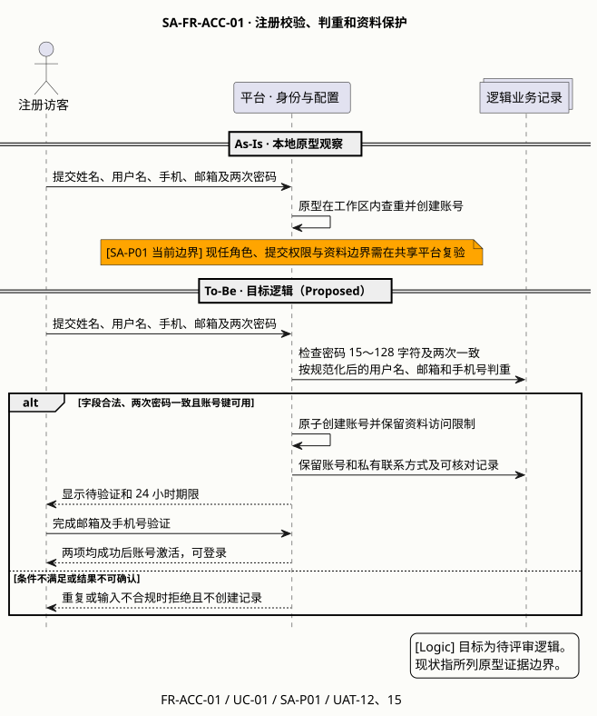

[图源](diagrams/sa-fr-acc-01.puml) · [原型证据 src/server.mjs:58](../../src/server.mjs#L58) · SA-P01

| 审阅项 | 口径 |
|---|---|
| 来源与责任 | BR-18、BR-19。触发角色为注册访客，平台责任为身份与配置。 |
| 前置与完成 | 用户名最多 100 字符且忽略大小写判重。密码为 15～128 个字符，允许空格和符号，两次输入须完全一致。注册后账号待验证，邮箱和手机号都验证成功才激活并允许登录。同一个邮箱、同一个手机号各只能绑定一个账号。邮箱不区分大小写，手机号统一带国家区号判重。注册受理后待验证状态保留 24 小时。未完成双渠道验证而到期时，原验证码失效，释放用户名、邮箱和手机号，允许重新注册。首批开发和验收使用本地模拟邮件和短信，真实发送待供应商确定后接入。 |
| 当前边界 | 原型在工作区内查重并创建账号。现任角色、提交权限与资料边界需在共享平台复验。 |
| 例外与禁止效果 | 重复或输入不合规时拒绝且不创建记录。 |
| 状态、数据、集成 | [角色和访问关系](diagrams/sa-role-config.svg)。创建／读取账号和私有联系方式。N/A（平台内）。所需能力为授权与持久记录。 |
| 验证和 SD 输入 | UAT-12、15。确认唯一性、激活及联系方式访问边界（SA-D07）。[专属 SD 技术图](../SD/diagrams/sd-fr-acc-01.svg) |

### FR-ACC-02

**邮箱或用户名登录与受限页面** · UC-01 · P0 / Confirmed · Contract · 身份与配置

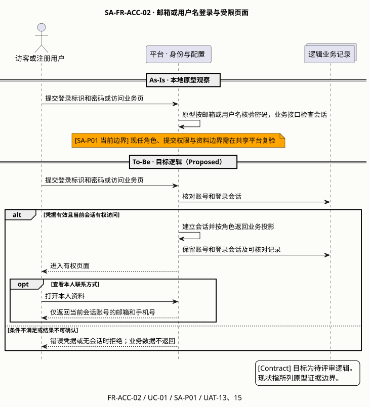

[图源](diagrams/sa-fr-acc-02.puml) · [原型证据 src/server.mjs:75](../../src/server.mjs#L75) · SA-P01

| 审阅项 | 口径 |
|---|---|
| 来源与责任 | BR-20、BR-21。触发角色为访客或注册用户，平台责任为身份与配置。 |
| 前置与完成 | 凭据有效且当前会话有权访问。完成后进入有权页面。 |
| 当前边界 | 原型按邮箱或用户名核验密码，业务接口检查会话。现任角色、提交权限与资料边界需在共享平台复验。 |
| 例外与禁止效果 | 错误凭据或无会话时拒绝；业务数据不返回。 |
| 状态、数据、集成 | [角色和访问关系](diagrams/sa-role-config.svg)。创建／读取账号和登录会话。N/A（平台内）。所需能力为授权与持久记录。 |
| 验证和 SD 输入 | UAT-13、15。登录结果、会话撤销与错误边界。[专属 SD 技术图](../SD/diagrams/sd-fr-acc-02.svg) |

### FR-OWN-01

**三类配置主副负责人、添加和移除** · UC-02 · P0 / Confirmed · Logic · 身份与配置

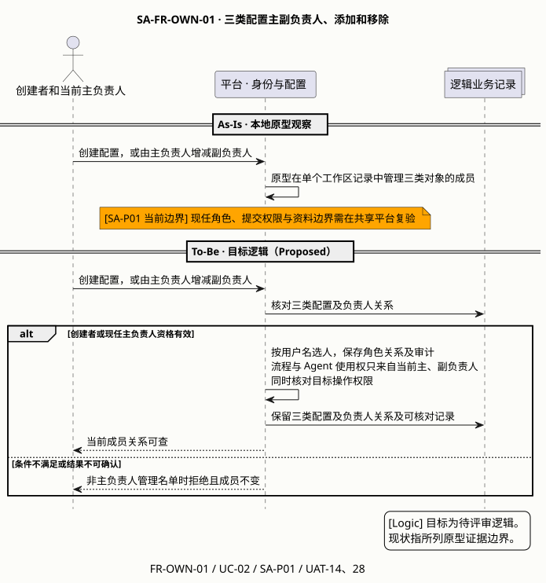

[图源](diagrams/sa-fr-own-01.puml) · [原型证据 src/server.mjs:125](../../src/server.mjs#L125) · SA-P01

| 审阅项 | 口径 |
|---|---|
| 来源与责任 | BR-22、BR-23、BR-24。触发角色为创建者和当前主负责人，平台责任为身份与配置。 |
| 前置与完成 | 创建者或现任主负责人资格有效。完成后当前成员关系可查。 |
| 当前边界 | 原型在单个工作区记录中管理三类对象的成员。现任角色、提交权限与资料边界需在共享平台复验。 |
| 例外与禁止效果 | 非主负责人管理名单时拒绝且成员不变。 |
| 状态、数据、集成 | [角色和访问关系](diagrams/sa-role-config.svg)。创建／读取三类配置及负责人关系。N/A（平台内）。所需能力为授权与持久记录。 |
| 验证和 SD 输入 | UAT-14、28。权限和成员变更的原子边界。[专属 SD 技术图](../SD/diagrams/sd-fr-own-01.svg) |

### FR-OWN-02

**撤权与旧页面保存** · UC-02 · P0 / Confirmed · Logic · 身份与配置

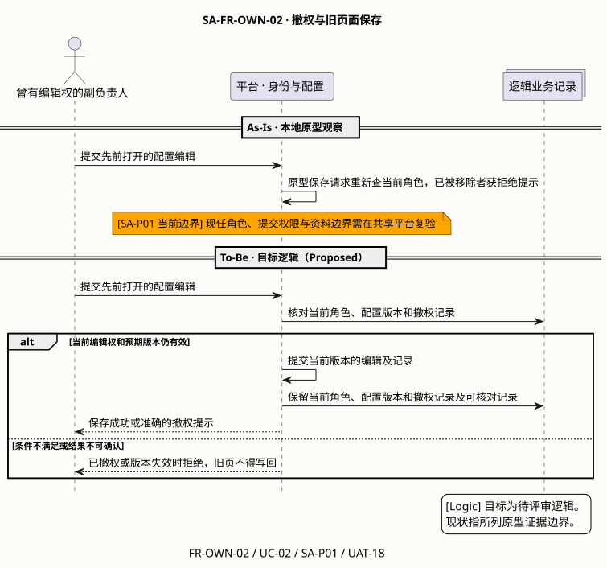

[图源](diagrams/sa-fr-own-02.puml) · [原型证据 src/server.mjs:434](../../src/server.mjs#L434) · SA-P01

| 审阅项 | 口径 |
|---|---|
| 来源与责任 | BR-25。触发角色为曾有编辑权的副负责人，平台责任为身份与配置。 |
| 前置与完成 | 当前编辑权和预期版本仍有效。完成后保存成功或准确的撤权提示。 |
| 当前边界 | 原型保存请求重新查当前角色，已被移除者获拒绝提示。现任角色、提交权限与资料边界需在共享平台复验。 |
| 例外与禁止效果 | 已撤权或版本失效时拒绝，旧页不得写回。 |
| 状态、数据、集成 | [角色和访问关系](diagrams/sa-role-config.svg)。读取／更新当前角色、配置版本和撤权记录。N/A（平台内）。所需能力为授权与持久记录。 |
| 验证和 SD 输入 | UAT-18。撤权与提交竞争的裁决。[专属 SD 技术图](../SD/diagrams/sd-fr-own-02.svg) |

### FR-OWN-03

**向注册用户转交并即时生效** · UC-02 · P0 / Confirmed · Logic · 身份与配置

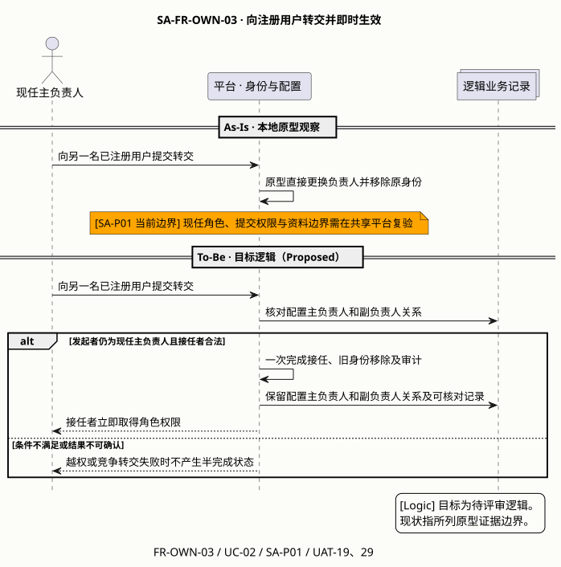

[图源](diagrams/sa-fr-own-03.puml) · [原型证据 src/server.mjs:156](../../src/server.mjs#L156) · SA-P01

| 审阅项 | 口径 |
|---|---|
| 来源与责任 | BR-26。触发角色为现任主负责人，平台责任为身份与配置。 |
| 前置与完成 | 发起者仍为现任主负责人且接任者合法。完成后接任者立即取得角色权限。 |
| 当前边界 | 原型直接更换负责人并移除原身份。现任角色、提交权限与资料边界需在共享平台复验。 |
| 例外与禁止效果 | 越权或竞争转交失败时不产生半完成状态。 |
| 状态、数据、集成 | [角色和访问关系](diagrams/sa-role-config.svg)。读取／更新配置主负责人和副负责人关系。N/A（平台内）。所需能力为授权与持久记录。 |
| 验证和 SD 输入 | UAT-19、29。转交、撤权和版本变更的事务。[专属 SD 技术图](../SD/diagrams/sd-fr-own-03.svg) |

### FR-REQ-01

**需求私有、分享和可见范围** · UC-02 · P0 / Confirmed · Logic · 身份与配置

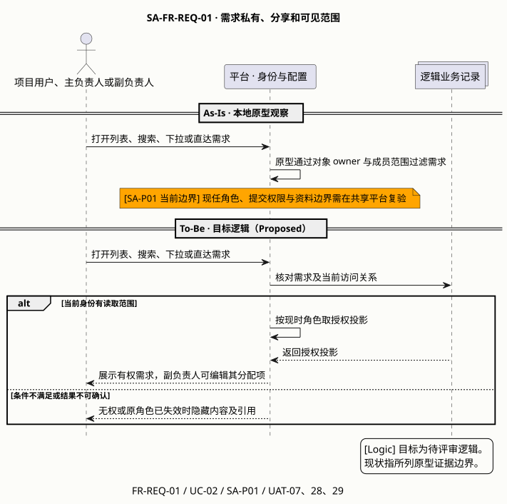

[图源](diagrams/sa-fr-req-01.puml) · [原型证据 src/server.mjs:99](../../src/server.mjs#L99) · SA-P01

| 审阅项 | 口径 |
|---|---|
| 来源与责任 | BR-01、BR-33。触发角色为项目用户、主负责人或副负责人，平台责任为身份与配置。 |
| 前置与完成 | 当前身份有读取范围。完成后展示有权需求，副负责人可编辑其分配项。 |
| 当前边界 | 原型通过对象 owner 与成员范围过滤需求。现任角色、提交权限与资料边界需在共享平台复验。 |
| 例外与禁止效果 | 无权或原角色已失效时隐藏内容及引用。 |
| 状态、数据、集成 | [角色和访问关系](diagrams/sa-role-config.svg)。读取需求及当前访问关系。N/A（平台内）。所需能力为授权与持久记录。 |
| 验证和 SD 输入 | UAT-07、28、29。项目与需求范围、投影及敏感字段。[专属 SD 技术图](../SD/diagrams/sd-fr-req-01.svg) |

### FR-REQ-02

**需求全局唯一、同名选择或安全提示** · UC-02 · P0 / Confirmed · Logic · 身份与配置

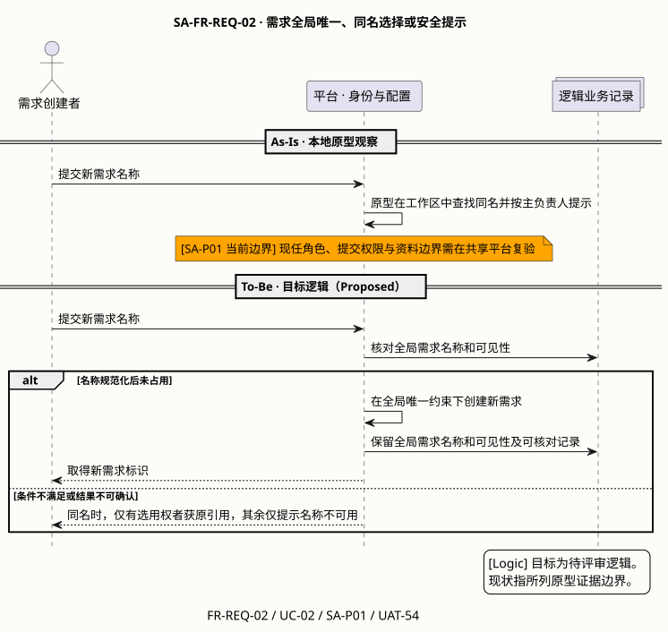

[图源](diagrams/sa-fr-req-02.puml) · [原型证据 src/server.mjs:125](../../src/server.mjs#L125) · SA-P01

| 审阅项 | 口径 |
|---|---|
| 来源与责任 | BR-50。触发角色为需求创建者，平台责任为身份与配置。 |
| 前置与完成 | 名称规范化后未占用。完成后取得新需求标识。 |
| 当前边界 | 原型在工作区中查找同名并按主负责人提示。现任角色、提交权限与资料边界需在共享平台复验。 |
| 例外与禁止效果 | 同名时，仅有选用权者获原引用，其余仅提示名称不可用。 |
| 状态、数据、集成 | [角色和访问关系](diagrams/sa-role-config.svg)。创建／读取全局需求名称和可见性。N/A（平台内）。所需能力为授权与持久记录。 |
| 验证和 SD 输入 | UAT-54。规范化、并发唯一性及无泄露提示。[专属 SD 技术图](../SD/diagrams/sd-fr-req-02.svg) |

### FR-REQ-03

**新建或选择需求、描述校验和补录** · UC-04 · P0 / Confirmed · Logic · 运行发起

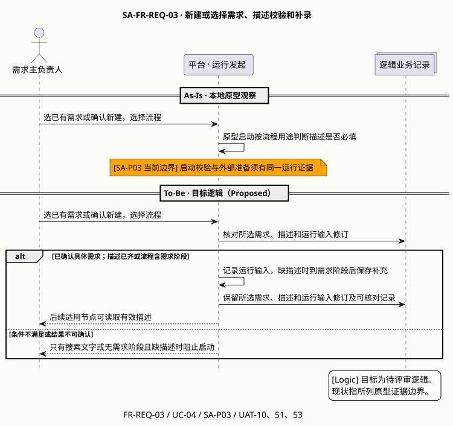

[图源](diagrams/sa-fr-req-03.puml) · [原型证据 src/server.mjs:185](../../src/server.mjs#L185) · SA-P03

| 审阅项 | 口径 |
|---|---|
| 来源与责任 | BR-13。触发角色为需求主负责人，平台责任为运行发起。 |
| 前置与完成 | 已确认具体需求；描述已齐或流程含需求阶段。完成后后续适用节点可读取有效描述。 |
| 当前边界 | 原型启动按流程用途判断描述是否必填。启动校验与外部准备须有同一运行证据。 |
| 例外与禁止效果 | 只有搜索文字或无需求阶段且缺描述时阻止启动。 |
| 状态、数据、集成 | [启动与 Git 准备](diagrams/sa-state-run.svg)。创建／读取所选需求、描述和运行输入修订。N/A（平台内）。所需能力为授权与持久记录。 |
| 验证和 SD 输入 | UAT-10、51、53。描述条件和输入修订。[专属 SD 技术图](../SD/diagrams/sd-fr-req-03.svg) |

### FR-REQ-04

**主负责人启动权限** · UC-04 · P0 / Confirmed · Logic · 运行发起

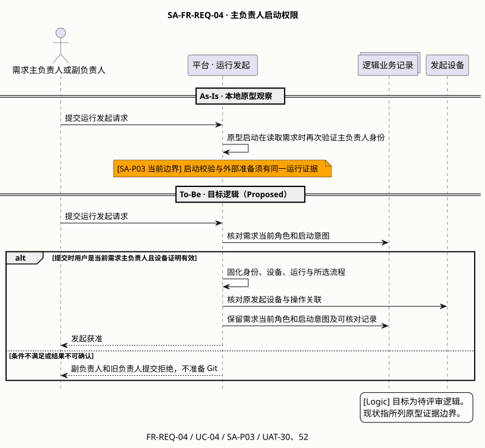

[图源](diagrams/sa-fr-req-04.puml) · [原型证据 src/server.mjs:185](../../src/server.mjs#L185) · SA-P03

| 审阅项 | 口径 |
|---|---|
| 来源与责任 | BR-34。触发角色为需求主负责人或副负责人，平台责任为运行发起。 |
| 前置与完成 | 提交时用户是当前需求主负责人且设备证明有效。完成后发起获准。 |
| 当前边界 | 原型启动在读取需求时再次验证主负责人身份。启动校验与外部准备须有同一运行证据。 |
| 例外与禁止效果 | 副负责人和旧负责人提交拒绝，不准备 Git。 |
| 状态、数据、集成 | [启动与 Git 准备](diagrams/sa-state-run.svg)。创建／读取需求当前角色和启动意图。[SA-I01](diagrams/sa-integration.svg)（发起设备）。所需能力为可恢复任务、消息或证据。 |
| 验证和 SD 输入 | UAT-30、52。当前授权与设备证明的共同校验。[专属 SD 技术图](../SD/diagrams/sd-fr-req-04.svg) |

### FR-RUN-01

**工作类型和已有流程选择** · UC-04 · P0 / Confirmed · Contract · 运行发起

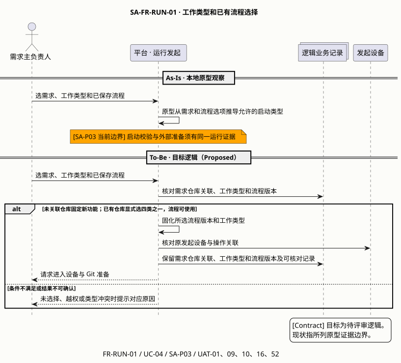

[图源](diagrams/sa-fr-run-01.puml) · [原型证据 web/app.mjs:219](../../web/app.mjs#L219) · SA-P03

| 审阅项 | 口径 |
|---|---|
| 来源与责任 | BR-13、BR-14、BR-15。触发角色为需求主负责人，平台责任为运行发起。 |
| 前置与完成 | 未关联仓库固定新功能；已有仓库显式选四类之一，流程可使用。完成后请求进入设备与 Git 准备。 |
| 当前边界 | 原型从需求和流程选项推导允许的启动类型。启动校验与外部准备须有同一运行证据。 |
| 例外与禁止效果 | 未选择、越权或类型冲突时提示对应原因。 |
| 状态、数据、集成 | [启动与 Git 准备](diagrams/sa-state-run.svg)。创建／读取需求仓库关联、工作类型和流程版本。[SA-I01](diagrams/sa-integration.svg)（发起设备）。所需能力为可恢复任务、消息或证据。 |
| 验证和 SD 输入 | UAT-01、09、10、16、52。候选、版本和启动请求契约。[专属 SD 技术图](../SD/diagrams/sd-fr-run-01.svg) |

### FR-FLOW-01

**阶段、节点及唯一结束标记** · UC-03 · P0 / Confirmed · Logic · 流程配置

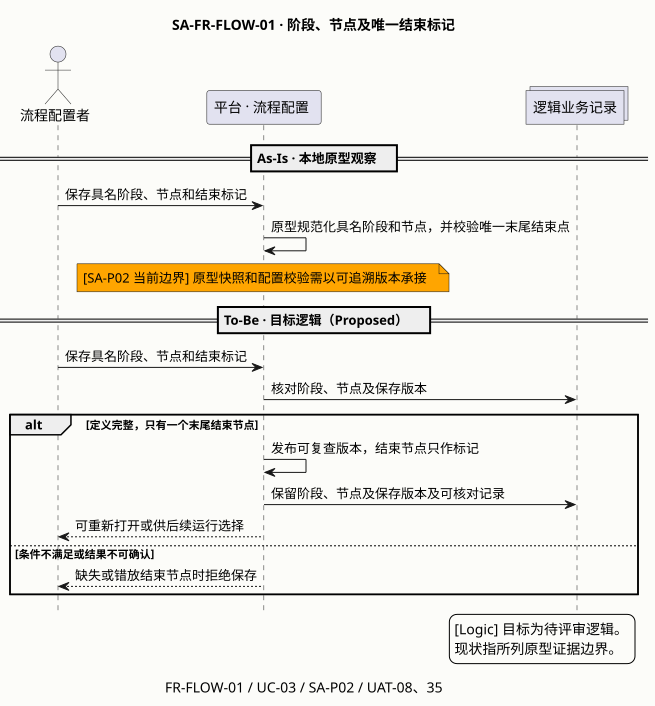

[图源](diagrams/sa-fr-flow-01.puml) · [原型证据 src/model.mjs:130](../../src/model.mjs#L130) · SA-P02

| 审阅项 | 口径 |
|---|---|
| 来源与责任 | BR-12、BR-38。触发角色为流程配置者，平台责任为流程配置。 |
| 前置与完成 | 定义完整，只有一个末尾结束节点。完成后可重新打开或供后续运行选择。 |
| 当前边界 | 原型规范化具名阶段和节点，并校验唯一末尾结束点。原型快照和配置校验需以可追溯版本承接。 |
| 例外与禁止效果 | 缺失或错放结束节点时拒绝保存。 |
| 状态、数据、集成 | [版本与关系](diagrams/sa-uc03.svg)。创建／读取阶段、节点及保存版本。N/A（平台内）。所需能力为授权与持久记录。 |
| 验证和 SD 输入 | UAT-08、35。节点类型约束、保存错误和历史版本。[专属 SD 技术图](../SD/diagrams/sd-fr-flow-01.svg) |

### FR-FLOW-02

**跨阶段依赖和循环校验** · UC-03 · P0 / Confirmed · No Change · 流程配置

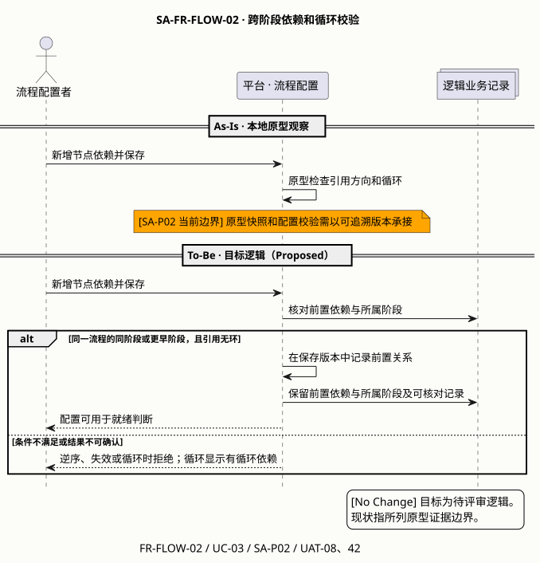

[图源](diagrams/sa-fr-flow-02.puml) · [原型证据 src/model.mjs:130](../../src/model.mjs#L130) · SA-P02

| 审阅项 | 口径 |
|---|---|
| 来源与责任 | BR-17、BR-44。触发角色为流程配置者，平台责任为流程配置。 |
| 前置与完成 | 同一流程的同阶段或更早阶段，且引用无环。完成后配置可用于就绪判断。 |
| 当前边界 | 原型检查引用方向和循环。原型快照和配置校验需以可追溯版本承接。 |
| 例外与禁止效果 | 逆序、失效或循环时拒绝；循环显示有循环依赖。 |
| 状态、数据、集成 | [版本与关系](diagrams/sa-uc03.svg)。读取／派生／更新前置依赖与所属阶段。N/A（平台内）。所需能力为授权与持久记录。 |
| 验证和 SD 输入 | UAT-08、42。服务端验证规则和定位错误。[专属 SD 技术图](../SD/diagrams/sd-fr-flow-02.svg) |

### FR-FLOW-03

**阶段屏障、共同前置与顺序** · UC-05 · P0 / Confirmed · Logic · 运行编排

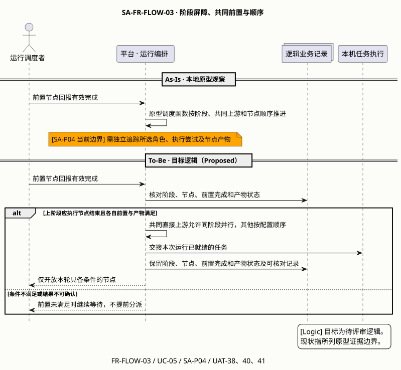

[图源](diagrams/sa-fr-flow-03.puml) · [原型证据 src/engine.mjs:124](../../src/engine.mjs#L124) · SA-P04

| 审阅项 | 口径 |
|---|---|
| 来源与责任 | BR-16、BR-41、BR-43。触发角色为运行调度者，平台责任为运行编排。 |
| 前置与完成 | 上阶段应执行节点结束且各自前置与产物满足。完成后仅开放本轮具备条件的节点。 |
| 当前边界 | 原型调度函数按阶段、共同上游和节点顺序推进。需独立追踪所选角色、执行尝试及节点产物。 |
| 例外与禁止效果 | 前置未满足时继续等待，不提前分派。 |
| 状态、数据、集成 | [角色和任务状态](diagrams/sa-state-run.svg)。读取／派生／更新阶段、节点、前置完成和产物状态。[SA-I01](diagrams/sa-integration.svg)（本机任务执行）。所需能力为可恢复任务、消息或证据。 |
| 验证和 SD 输入 | UAT-38、40、41。确定性调度和事务中派发。[专属 SD 技术图](../SD/diagrams/sd-fr-flow-03.svg) |

### FR-FLOW-04

**并行路线汇合和完成判定** · UC-08 · P0 / Confirmed · Logic · 运行编排

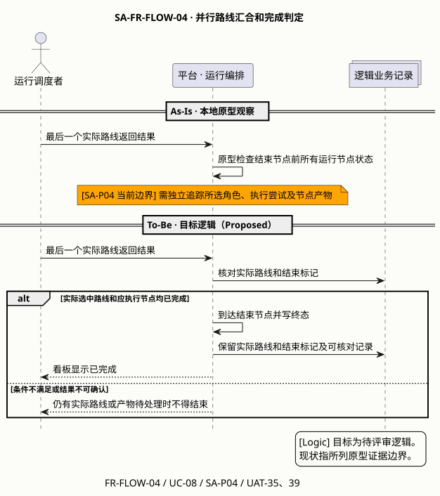

[图源](diagrams/sa-fr-flow-04.puml) · [原型证据 src/engine.mjs:124](../../src/engine.mjs#L124) · SA-P04

| 审阅项 | 口径 |
|---|---|
| 来源与责任 | BR-38。触发角色为运行调度者，平台责任为运行编排。 |
| 前置与完成 | 实际选中路线和应执行节点均已完成。完成后看板显示已完成。 |
| 当前边界 | 原型检查结束节点前所有运行节点状态。需独立追踪所选角色、执行尝试及节点产物。 |
| 例外与禁止效果 | 仍有实际路线或产物待处理时不得结束。 |
| 状态、数据、集成 | [角色和任务状态](diagrams/sa-state-run.svg)。读取／派生／更新实际路线和结束标记。N/A（平台内）。所需能力为授权与持久记录。 |
| 验证和 SD 输入 | UAT-35、39。结束条件、未选路线与终态。[专属 SD 技术图](../SD/diagrams/sd-fr-flow-04.svg) |

### FR-FLOW-05

**流程修改与运行快照** · UC-03 · P0 / Confirmed · Logic · 流程配置

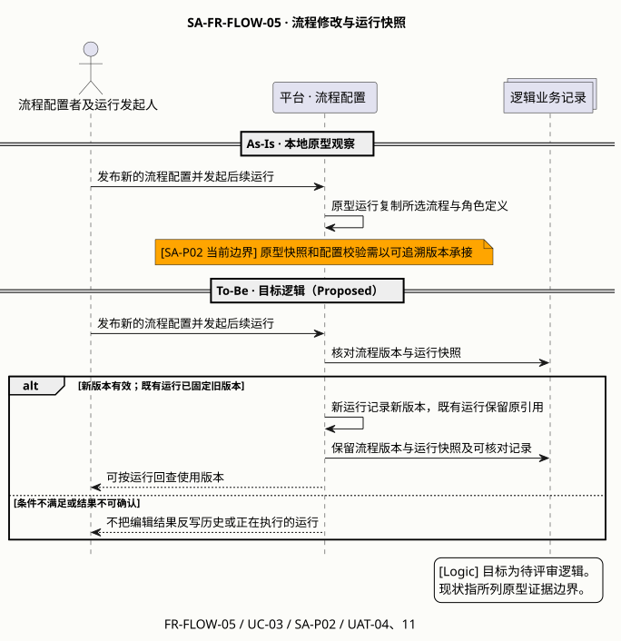

[图源](diagrams/sa-fr-flow-05.puml) · [原型证据 src/engine.mjs:21](../../src/engine.mjs#L21) · SA-P02

| 审阅项 | 口径 |
|---|---|
| 来源与责任 | BR-42。触发角色为流程配置者及运行发起人，平台责任为流程配置。 |
| 前置与完成 | 新版本有效；既有运行已固定旧版本。完成后可按运行回查使用版本。 |
| 当前边界 | 原型运行复制所选流程与角色定义。原型快照和配置校验需以可追溯版本承接。 |
| 例外与禁止效果 | 不把编辑结果反写历史或正在执行的运行。 |
| 状态、数据、集成 | [版本与关系](diagrams/sa-uc03.svg)。创建／读取流程版本与运行快照。N/A（平台内）。所需能力为授权与持久记录。 |
| 验证和 SD 输入 | UAT-04、11。版本封存、快照关系和兼容。[专属 SD 技术图](../SD/diagrams/sd-fr-flow-05.svg) |

### FR-FLOW-06

**检查双分支和实际路线选择** · UC-07 · P0 / Confirmed · Logic · 交付与验收

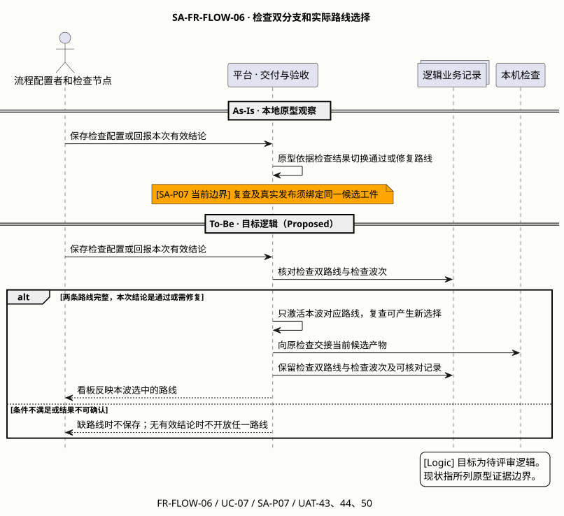

[图源](diagrams/sa-fr-flow-06.puml) · [原型证据 src/engine.mjs:80](../../src/engine.mjs#L80) · SA-P07

| 审阅项 | 口径 |
|---|---|
| 来源与责任 | BR-45、BR-46。触发角色为流程配置者和检查节点，平台责任为交付与验收。 |
| 前置与完成 | 两条路线完整，本次结论是通过或需修复。完成后看板反映本波选中的路线。 |
| 当前边界 | 原型依据检查结果切换通过或修复路线。复查及真实发布须绑定同一候选工件。 |
| 例外与禁止效果 | 缺路线时不保存；无有效结论时不开放任一路线。 |
| 状态、数据、集成 | [检查轮次](diagrams/sa-uc07.svg)。读取／派生／更新检查双路线与检查波次。[SA-I01](diagrams/sa-integration.svg)（本机检查）。所需能力为可恢复任务、消息或证据。 |
| 验证和 SD 输入 | UAT-43、44、50。图校验、波次与路线合流。[专属 SD 技术图](../SD/diagrams/sd-fr-flow-06.svg) |

### FR-FLOW-07

**缺失检查结论与重新检查** · UC-07 · P0 / Confirmed · Logic · 交付与验收

[图源](diagrams/sa-fr-flow-07.puml) · [原型证据 src/engine.mjs:281](../../src/engine.mjs#L281) · SA-P07

| 审阅项 | 口径 |
|---|---|
| 来源与责任 | BR-49。触发角色为当前聊天操作者，平台责任为交付与验收。 |
| 前置与完成 | 仍是当前操作者且原节点处于可重查状态。完成后有效结果开放对应路线。 |
| 当前边界 | 原型以 missing 检查状态阻塞并支持重新检查。复查及真实发布须绑定同一候选工件。 |
| 例外与禁止效果 | 越权或状态变化拒绝；再次无效时继续等待。 |
| 状态、数据、集成 | [检查轮次](diagrams/sa-uc07.svg)。读取／更新无效检查结论和原检查波次。[SA-I01](diagrams/sa-integration.svg)（本机检查）。所需能力为可恢复任务、消息或证据。 |
| 验证和 SD 输入 | UAT-50。无效结论状态与重查幂等。[专属 SD 技术图](../SD/diagrams/sd-fr-flow-07.svg) |

### FR-FLOW-08

**各检查独立修复、同节点复查** · UC-07 · P0 / Confirmed · Logic · 交付与验收

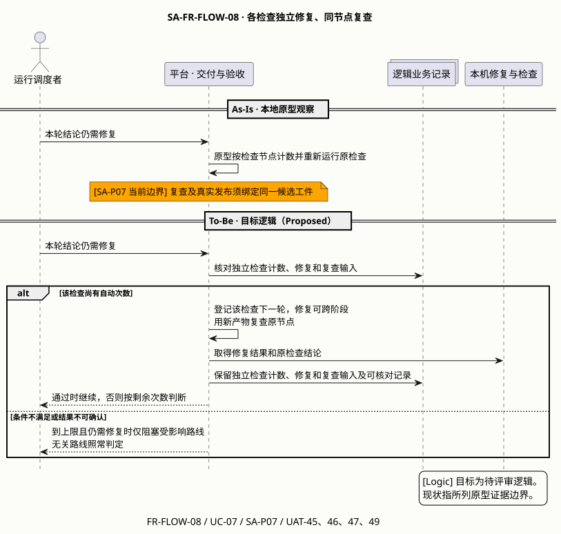

[图源](diagrams/sa-fr-flow-08.puml) · [原型证据 src/engine.mjs:72](../../src/engine.mjs#L72) · SA-P07

| 审阅项 | 口径 |
|---|---|
| 来源与责任 | BR-46、BR-47。触发角色为运行调度者，平台责任为交付与验收。 |
| 前置与完成 | 该检查尚有自动次数。完成后通过时继续，否则按剩余次数判断。 |
| 当前边界 | 原型按检查节点计数并重新运行原检查。复查及真实发布须绑定同一候选工件。 |
| 例外与禁止效果 | 达到上限且仍需修复时，仅受影响路线和依赖等待，无关路线继续，不自动开启额外一轮。 |
| 状态、数据、集成 | [检查轮次](diagrams/sa-uc07.svg)。读取／更新独立检查计数、修复和复查输入。[SA-I01](diagrams/sa-integration.svg)（本机修复与检查）。所需能力为可恢复任务、消息或证据。 |
| 验证和 SD 输入 | UAT-45、46、47、49。轮次锁、原定义绑定和跨阶段规则（SA-D04）。[专属 SD 技术图](../SD/diagrams/sd-fr-flow-08.svg) |

### FR-FLOW-09

**达到上限后的额外一轮或停止** · UC-07 · P0 / Confirmed · Logic · 交付与验收

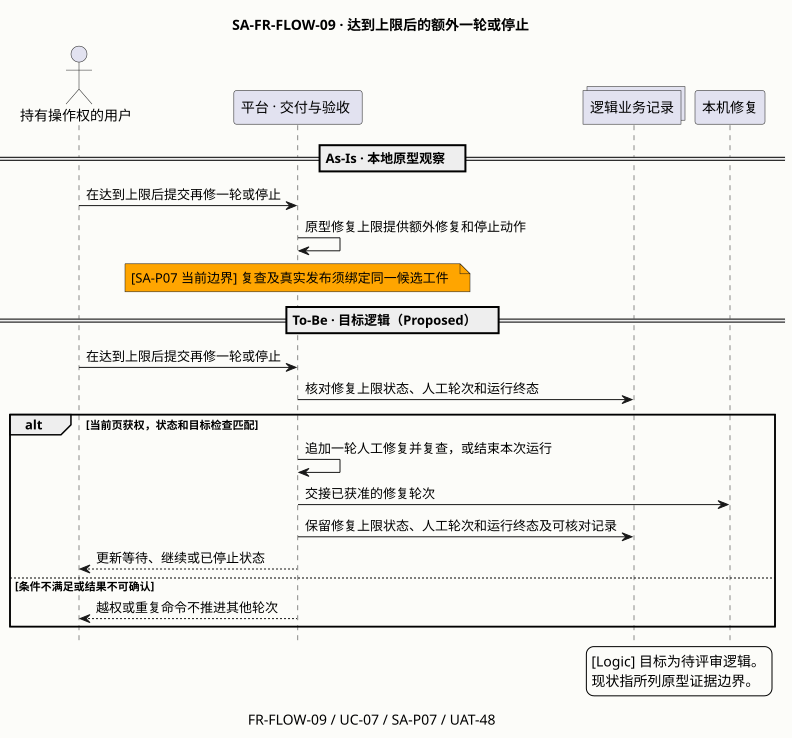

[图源](diagrams/sa-fr-flow-09.puml) · [原型证据 src/engine.mjs:281](../../src/engine.mjs#L281) · SA-P07

| 审阅项 | 口径 |
|---|---|
| 来源与责任 | BR-48。触发角色为持有操作权的用户，平台责任为交付与验收。 |
| 前置与完成 | 当前页获权，状态和目标检查匹配。完成后更新等待、继续或已停止状态。 |
| 当前边界 | 原型修复上限提供额外修复和停止动作。复查及真实发布须绑定同一候选工件。 |
| 例外与禁止效果 | 越权或重复命令不推进其他轮次。 |
| 状态、数据、集成 | [检查轮次](diagrams/sa-uc07.svg)。读取／更新修复上限状态、人工轮次和运行终态。[SA-I01](diagrams/sa-integration.svg)（本机修复）。所需能力为可恢复任务、消息或证据。 |
| 验证和 SD 输入 | UAT-48。操作权、去重和终态边界。[专属 SD 技术图](../SD/diagrams/sd-fr-flow-09.svg) |

### FR-AG-01

**按需选协调者和三名以上子 Agent** · UC-05 · P0 / Confirmed · Logic · 运行编排

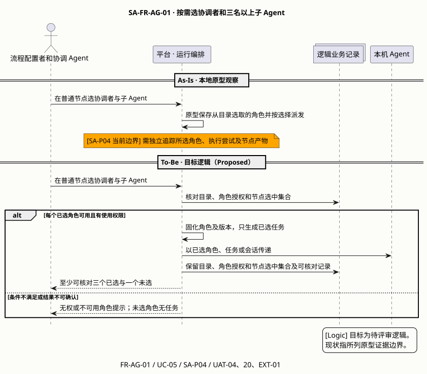

[图源](diagrams/sa-fr-ag-01.puml) · [原型证据 src/model.mjs:130](../../src/model.mjs#L130) · SA-P04

| 审阅项 | 口径 |
|---|---|
| 来源与责任 | BR-09、BR-27，2026-11-09 对话。触发角色为流程配置者和协调 Agent，平台责任为运行编排。 |
| 前置与完成 | 每个已选角色可用且有使用权限。完成后至少可核对三个已选与一个未选。 |
| 当前边界 | 原型保存从目录选取的角色并按选择派发。需独立追踪所选角色、执行尝试及节点产物。 |
| 例外与禁止效果 | 无权或不可用角色提示；未选角色无任务。 |
| 状态、数据、集成 | [角色和任务状态](diagrams/sa-state-run.svg)。创建／读取目录、角色授权和节点选中集合。[SA-I01](diagrams/sa-integration.svg)（本机 Agent）。所需能力为可恢复任务、消息或证据。 |
| 验证和 SD 输入 | UAT-04、20、EXT-01。角色目录权限和快照版本。[专属 SD 技术图](../SD/diagrams/sd-fr-ag-01.svg) |

### FR-AG-02

**子 Agent 有序／默认并行** · UC-05 · P0 / Confirmed · Logic · 运行编排

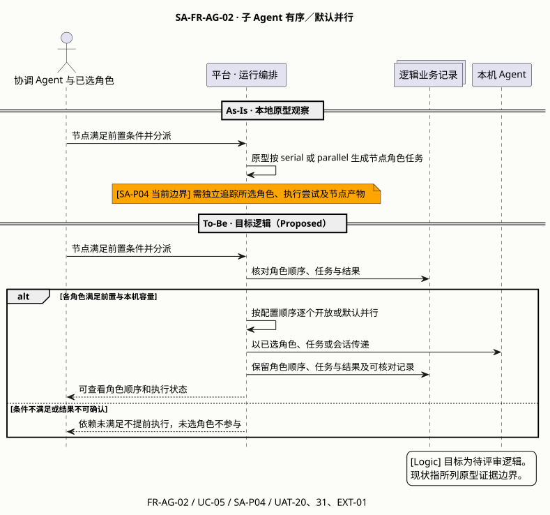

[图源](diagrams/sa-fr-ag-02.puml) · [原型证据 src/engine.mjs:54](../../src/engine.mjs#L54) · SA-P04

| 审阅项 | 口径 |
|---|---|
| 来源与责任 | BR-27、BR-35，2026-11-09 对话。触发角色为协调 Agent 与已选角色，平台责任为运行编排。 |
| 前置与完成 | 各角色满足前置与本机容量。完成后可查看角色顺序和执行状态。 |
| 当前边界 | 原型按 serial 或 parallel 生成节点角色任务。需独立追踪所选角色、执行尝试及节点产物。 |
| 例外与禁止效果 | 依赖未满足不提前执行，未选角色不参与。 |
| 状态、数据、集成 | [角色和任务状态](diagrams/sa-state-run.svg)。创建／读取角色顺序、任务与结果。[SA-I01](diagrams/sa-integration.svg)（本机 Agent）。所需能力为可恢复任务、消息或证据。 |
| 验证和 SD 输入 | UAT-20、31、EXT-01。任务粒度、容量等待及顺序。[专属 SD 技术图](../SD/diagrams/sd-fr-ag-02.svg) |

### FR-AG-03

**角色间交接和人与 Agent 双向通信** · UC-05 · P0 / Confirmed · Contract · 运行编排

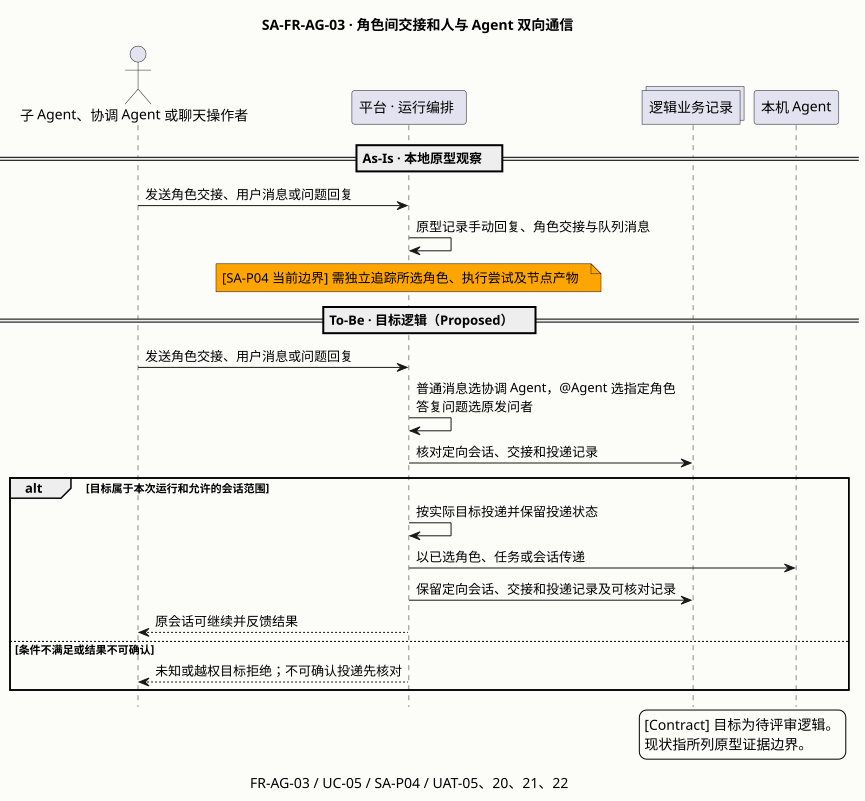

[图源](diagrams/sa-fr-ag-03.puml) · [原型证据 src/engine.mjs:230](../../src/engine.mjs#L230) · SA-P04

| 审阅项 | 口径 |
|---|---|
| 来源与责任 | BR-27、BR-28。触发角色为子 Agent、协调 Agent 或聊天操作者，平台责任为运行编排。 |
| 前置与完成 | 普通消息默认发给当前节点的协调 Agent，用户也可用 `@Agent` 指定该节点的 Agent。待答回复送达提问者。 |
| 当前边界 | 原型记录手动回复、角色交接与队列消息。需独立追踪所选角色、执行尝试及节点产物。 |
| 例外与禁止效果 | 未知或越权目标拒绝；不可确认投递先核对。 |
| 状态、数据、集成 | [角色和任务状态](diagrams/sa-state-run.svg)。读取／更新／投递定向会话、交接和投递记录。[SA-I01](diagrams/sa-integration.svg)（本机 Agent）。所需能力为可恢复任务、消息或证据。 |
| 验证和 SD 输入 | UAT-05、20、21、22。核对默认投递、指定投递、无效目标及问题回复。[专属 SD 技术图](../SD/diagrams/sd-fr-ag-03.svg) |

### FR-AG-04

**收齐成功结果并形成最终产物** · UC-05 · P0 / Confirmed · Logic · 运行编排

[图源](diagrams/sa-fr-ag-04.puml) · [原型证据 src/engine.mjs:99](../../src/engine.mjs#L99) · SA-P04

| 审阅项 | 口径 |
|---|---|
| 来源与责任 | BR-40，2026-11-09 对话。触发角色为协调 Agent 与调度者，平台责任为运行编排。 |
| 前置与完成 | 所选角色均成功或已由当前操作者跳过失败项，最终产物可引用。完成后下游可读取该节点最终产物。 |
| 当前边界 | 原型只在角色和协调产物满足后完成普通节点。需独立追踪所选角色、执行尝试及节点产物。 |
| 例外与禁止效果 | 缺任一成功结果或最终产物时保留等待。 |
| 状态、数据、集成 | [角色和任务状态](diagrams/sa-state-run.svg)。读取／派生／更新已选角色结果、最终产物和前置状态。[SA-I01](diagrams/sa-integration.svg)（本机 Agent）。所需能力为可恢复任务、消息或证据。 |
| 验证和 SD 输入 | UAT-37。结果与产物提交、下游派发一致性。[专属 SD 技术图](../SD/diagrams/sd-fr-ag-04.svg) |

### FR-AG-05

**重试或跳过失败子 Agent** · UC-05 · P0 / Confirmed · Logic · 运行编排

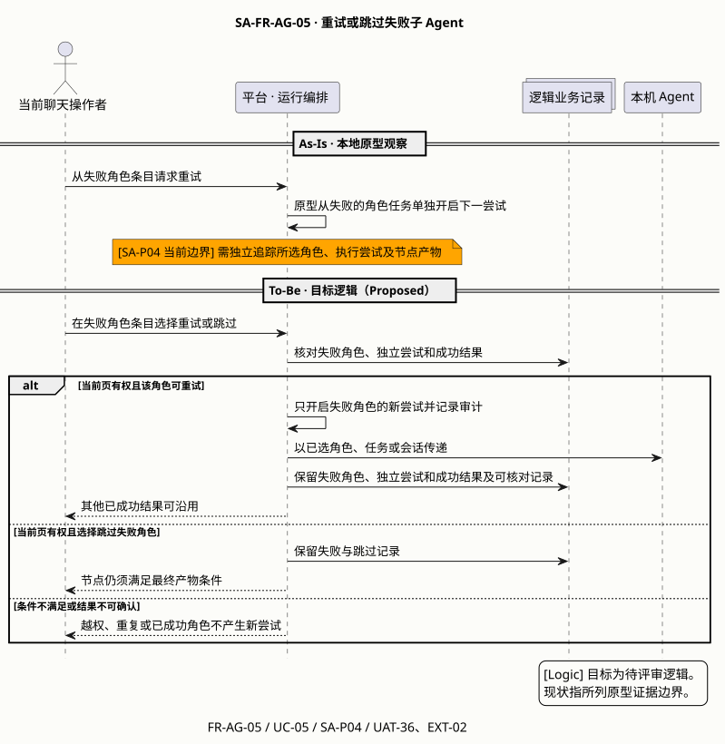

[图源](diagrams/sa-fr-ag-05.puml) · [原型证据 src/engine.mjs:281](../../src/engine.mjs#L281) · SA-P04

| 审阅项 | 口径 |
|---|---|
| 来源与责任 | BR-39。触发角色为当前聊天操作者，平台责任为运行编排。 |
| 前置与完成 | 当前页有权时可重试或跳过失败角色。两种处理均保留成功结果，跳过仍须满足最终产物条件。 |
| 当前边界 | 原型从失败的角色任务单独开启下一尝试。需独立追踪所选角色、执行尝试及节点产物。 |
| 例外与禁止效果 | 越权、重复或已成功角色不产生新尝试。 |
| 状态、数据、集成 | [角色和任务状态](diagrams/sa-state-run.svg)。读取／更新失败角色、独立尝试和成功结果。[SA-I01](diagrams/sa-integration.svg)（本机 Agent）。所需能力为可恢复任务、消息或证据。 |
| 验证和 SD 输入 | UAT-36、EXT-02。局部重试、状态投影、尝试围栏。[专属 SD 技术图](../SD/diagrams/sd-fr-ag-05.svg) |

### FR-AG-06

**并发不足时排队或明确等待** · UC-05 · P0 / Proposed · Logic · 运行编排

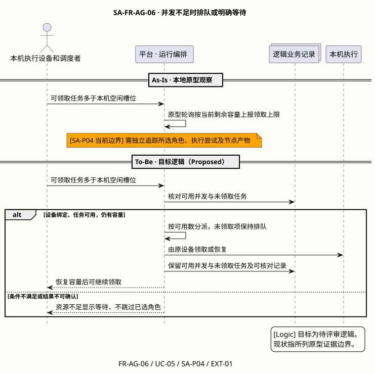

[图源](diagrams/sa-fr-ag-06.puml) · [原型证据 src/worker.mjs:118](../../src/worker.mjs#L118) · SA-P04

| 审阅项 | 口径 |
|---|---|
| 来源与责任 | BR-27、BR-35，Q-05、Q-08。触发角色为本机执行设备和调度者，平台责任为运行编排。 |
| 前置与完成 | 设备绑定、任务可用，仍有容量。完成后恢复容量后可继续领取。 |
| 当前边界 | 原型轮询按当前剩余容量上报领取上限。需独立追踪所选角色、执行尝试及节点产物。 |
| 例外与禁止效果 | 资源不足显示等待，不跳过已选角色。 |
| 状态、数据、集成 | [角色和任务状态](diagrams/sa-state-run.svg)。读取／派生／更新可用并发与未领取任务。[SA-I01](diagrams/sa-integration.svg)（本机执行）。所需能力为可恢复任务、消息或证据。 |
| 验证和 SD 输入 | EXT-01。容量阈值、排队投影与设备心跳（SA-D05）。[专属 SD 技术图](../SD/diagrams/sd-fr-ag-06.svg) |

### FR-RUN-02

**仓库关联、四类分支和缺失 dev** · UC-04 · P0 / Confirmed · Logic · 运行发起

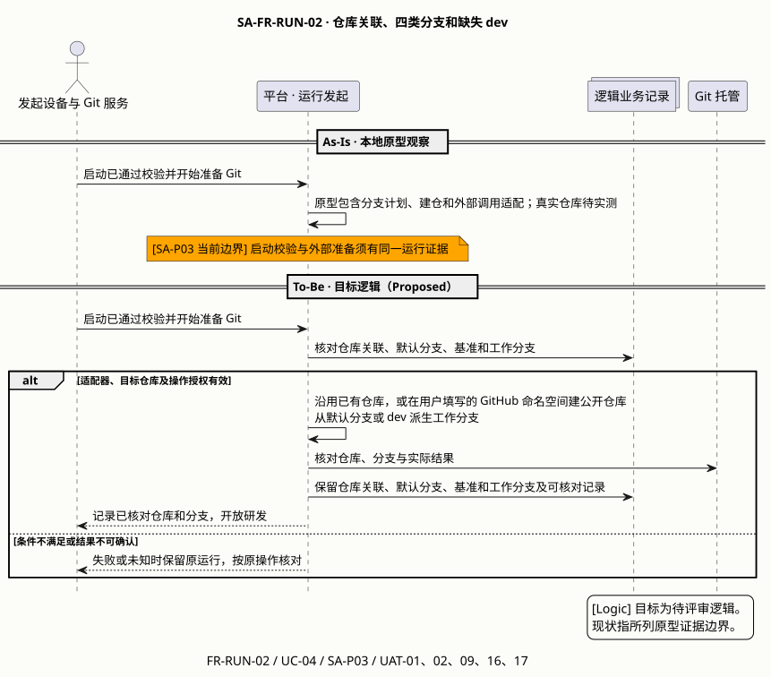

[图源](diagrams/sa-fr-run-02.puml) · [原型证据 src/providers.mjs:26](../../src/providers.mjs#L26) · SA-P03

| 审阅项 | 口径 |
|---|---|
| 来源与责任 | BR-02。触发角色为发起设备与 Git 服务，平台责任为运行发起。 |
| 前置与完成 | 适配器、目标仓库及操作授权有效。完成后记录已核对仓库和分支，开放研发。 |
| 当前边界 | 原型包含分支计划、建仓和外部调用适配；真实仓库待实测。启动校验与外部准备须有同一运行证据。 |
| 例外与禁止效果 | 失败或未知时保留原运行，按原操作核对。 |
| 状态、数据、集成 | [启动与 Git 准备](diagrams/sa-state-run.svg)。读取／派生／更新仓库关联、默认分支、基准和工作分支。[SA-I01](diagrams/sa-integration.svg)（Git 托管）。所需能力为可恢复任务、消息或证据。 |
| 验证和 SD 输入 | UAT-01、02、09、16、17。四种分支规则、外部去重及环境授权。[专属 SD 技术图](../SD/diagrams/sd-fr-run-02.svg) |

### FR-RUN-03

**看板、阻塞原因及产物追溯** · UC-08 · P0 / Confirmed · Contract · 运行证据与恢复

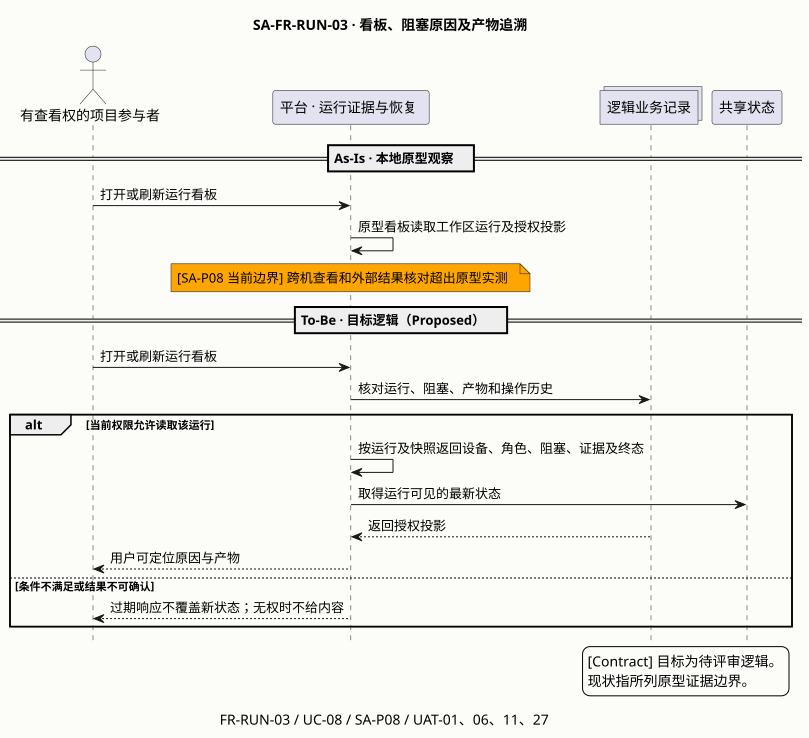

[图源](diagrams/sa-fr-run-03.puml) · [原型证据 src/server.mjs:248](../../src/server.mjs#L248) · SA-P08

| 审阅项 | 口径 |
|---|---|
| 来源与责任 | BR-01、BR-08、BR-27、BR-39、NFR-02。触发角色为有查看权的项目参与者，平台责任为运行证据与恢复。 |
| 前置与完成 | 当前权限允许读取该运行。完成后用户可定位原因与产物。 |
| 当前边界 | 原型看板读取工作区运行及授权投影。跨机查看和外部结果核对超出原型实测。 |
| 例外与禁止效果 | 过期响应不覆盖新状态；无权时不给内容。 |
| 状态、数据、集成 | [运行状态](diagrams/sa-state-run.svg)。读取运行、阻塞、产物和操作历史。[SA-I01](diagrams/sa-integration.svg)（共享状态）。所需能力为可恢复任务、消息或证据。 |
| 验证和 SD 输入 | UAT-01、06、11、27。分页、事件刷新、脱敏及证据索引。[专属 SD 技术图](../SD/diagrams/sd-fr-run-03.svg) |

### FR-RUN-04

**同机执行、另一设备查看和原机续跑** · UC-08 · P0 / Confirmed · Logic · 设备恢复

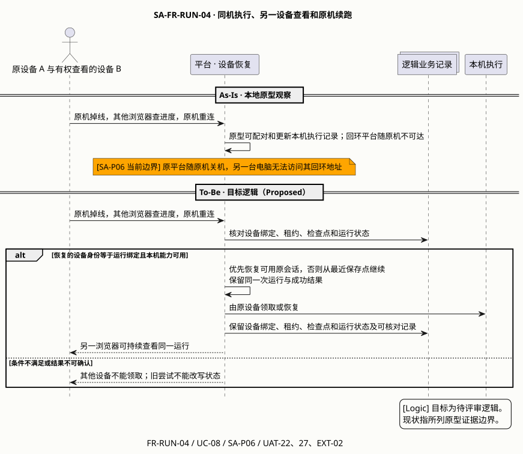

[图源](diagrams/sa-fr-run-04.puml) · [原型证据 src/worker.mjs:48](../../src/worker.mjs#L48) · SA-P06

| 审阅项 | 口径 |
|---|---|
| 来源与责任 | BR-29、BR-32。触发角色为原设备 A 与有权查看的设备 B，平台责任为设备恢复。 |
| 前置与完成 | 原设备认证通过且本机能力可用时优先恢复原会话，否则从最近保存点续跑。另一有权浏览器可查看同一运行。 |
| 当前边界 | 原型可配对和更新本机执行记录；回环平台随原机不可达。原平台随原机关机，另一台电脑无法访问其回环地址。 |
| 例外与禁止效果 | 其他设备不能领取；旧尝试不能改写状态。 |
| 状态、数据、集成 | [运行状态](diagrams/sa-state-run.svg)。读取／派生／更新设备绑定、租约、检查点和运行状态。[SA-I01](diagrams/sa-integration.svg)（本机执行）。所需能力为可恢复任务、消息或证据。 |
| 验证和 SD 输入 | UAT-22、27、EXT-02。共享持久、设备认证、恢复粒度（SA-D08）。[专属 SD 技术图](../SD/diagrams/sd-fr-run-04.svg) |

### FR-RUN-05

**有权恢复、保留历史及外部核对** · UC-08 · P1 / Proposed · Logic · 运行证据与恢复

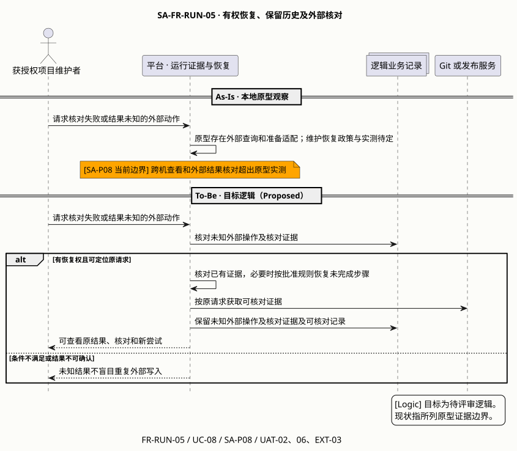

[图源](diagrams/sa-fr-run-05.puml) · [原型证据 src/providers.mjs:38](../../src/providers.mjs#L38) · SA-P08

| 审阅项 | 口径 |
|---|---|
| 来源与责任 | BR-11。触发角色为获授权项目维护者，平台责任为运行证据与恢复。 |
| 前置与完成 | 有恢复权且可定位原请求。完成后可查看原结果、核对和新尝试。 |
| 当前边界 | 原型存在外部查询和准备适配；维护恢复政策与实测待定。跨机查看和外部结果核对超出原型实测。 |
| 例外与禁止效果 | 未知结果不盲目重复外部写入。 |
| 状态、数据、集成 | [运行状态](diagrams/sa-state-run.svg)。读取／派生／更新未知外部操作及核对证据。[SA-I01](diagrams/sa-integration.svg)（Git 或发布服务）。所需能力为可恢复任务、消息或证据。 |
| 验证和 SD 输入 | UAT-02、06、EXT-03。只读核对、写入授权和维护政策（SA-D02、08）。[专属 SD 技术图](../SD/diagrams/sd-fr-run-05.svg) |

### FR-CHAT-01

**获授权运行聊天及定向会话** · UC-06 · P0 / Confirmed · Contract · 运行协作

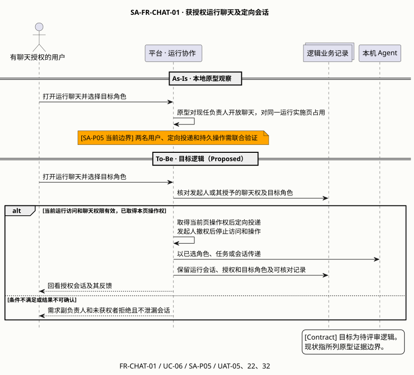

[图源](diagrams/sa-fr-chat-01.puml) · [原型证据 src/server.mjs:221](../../src/server.mjs#L221) · SA-P05

| 审阅项 | 口径 |
|---|---|
| 来源与责任 | BR-10、BR-29、BR-36。触发角色为有聊天授权的用户，平台责任为运行协作。 |
| 前置与完成 | 发起人或其授权的注册用户取得本页操作权后可交流。聊天授权可用于直接打开会话，其他业务对象仍按自身权限。发起人撤权后，目标账号不能读会话或继续操作。 |
| 当前边界 | 原型对现任负责人开放聊天，对同一运行实施页占用。两名用户、定向投递和持久操作需联合验证。 |
| 例外与禁止效果 | 需求副负责人和未获权者拒绝且不泄漏会话。 |
| 状态、数据、集成 | [聊天与待答状态](diagrams/sa-state-chat.svg)。读取／更新／投递运行会话、授权和目标角色。[SA-I01](diagrams/sa-integration.svg)（本机 Agent）。所需能力为可恢复任务、消息或证据。 |
| 验证和 SD 输入 | UAT-05、22、32。运行级授权及双向通信契约（SA-D06）。[专属 SD 技术图](../SD/diagrams/sd-fr-chat-01.svg) |

### FR-CHAT-02

**单角色等待与定向回复** · UC-06 · P0 / Confirmed · Contract · 运行协作

[图源](diagrams/sa-fr-chat-02.puml) · [原型证据 src/engine.mjs:230](../../src/engine.mjs#L230) · SA-P05

| 审阅项 | 口径 |
|---|---|
| 来源与责任 | BR-28。触发角色为发问 Agent 和当前操作者，平台责任为运行协作。 |
| 前置与完成 | 该问题仍待答且页操作权有效。完成后发问者继续，其他独立任务不等待。 |
| 当前边界 | 原型记录提问并恢复对应失败或等待任务。两名用户、定向投递和持久操作需联合验证。 |
| 例外与禁止效果 | 过期或重复回答不投递第二次。 |
| 状态、数据、集成 | [聊天与待答状态](diagrams/sa-state-chat.svg)。读取／更新／投递持久问题、答复和会话。[SA-I01](diagrams/sa-integration.svg)（本机 Agent）。所需能力为可恢复任务、消息或证据。 |
| 验证和 SD 输入 | UAT-21、33、EXT-02。待答持久、定向投递和去重。[专属 SD 技术图](../SD/diagrams/sd-fr-chat-02.svg) |

### FR-CHAT-03

**持久问题、发起人取消及继续** · UC-06 · P0 / Confirmed · Logic · 运行协作

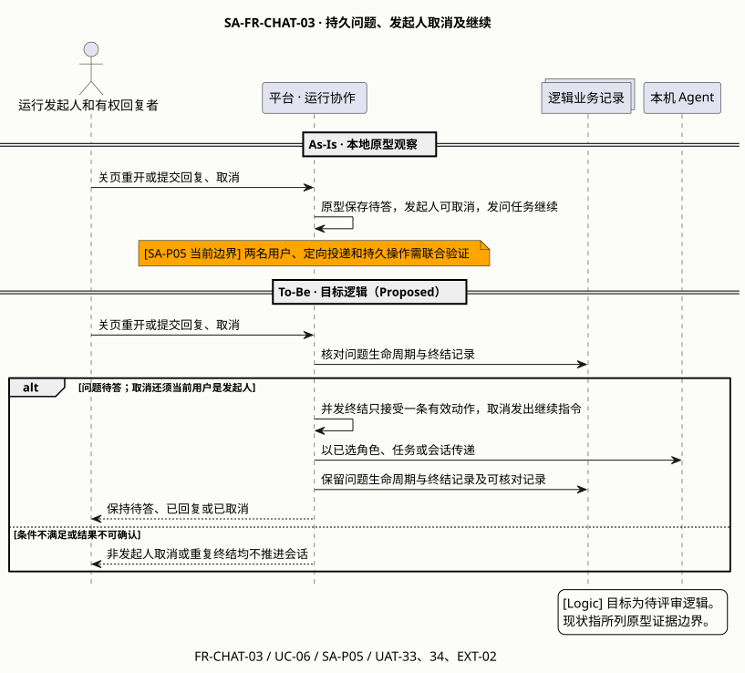

[图源](diagrams/sa-fr-chat-03.puml) · [原型证据 src/engine.mjs:281](../../src/engine.mjs#L281) · SA-P05

| 审阅项 | 口径 |
|---|---|
| 来源与责任 | BR-37。触发角色为运行发起人和有权回复者，平台责任为运行协作。 |
| 前置与完成 | 问题待答；取消还须当前用户是发起人。完成后保持待答、已回复或已取消。 |
| 当前边界 | 原型保存待答，发起人可取消，发问任务继续。两名用户、定向投递和持久操作需联合验证。 |
| 例外与禁止效果 | 非发起人取消或重复终结均不推进会话。 |
| 状态、数据、集成 | [聊天与待答状态](diagrams/sa-state-chat.svg)。读取／更新／投递问题生命周期与终结记录。[SA-I01](diagrams/sa-integration.svg)（本机 Agent）。所需能力为可恢复任务、消息或证据。 |
| 验证和 SD 输入 | UAT-33、34、EXT-02。一次性终结、原会话及离线保留。[专属 SD 技术图](../SD/diagrams/sd-fr-chat-03.svg) |

### FR-CHAT-04

**两人／两标签页竞争与退出** · UC-06 · P0 / Confirmed · Logic · 运行协作

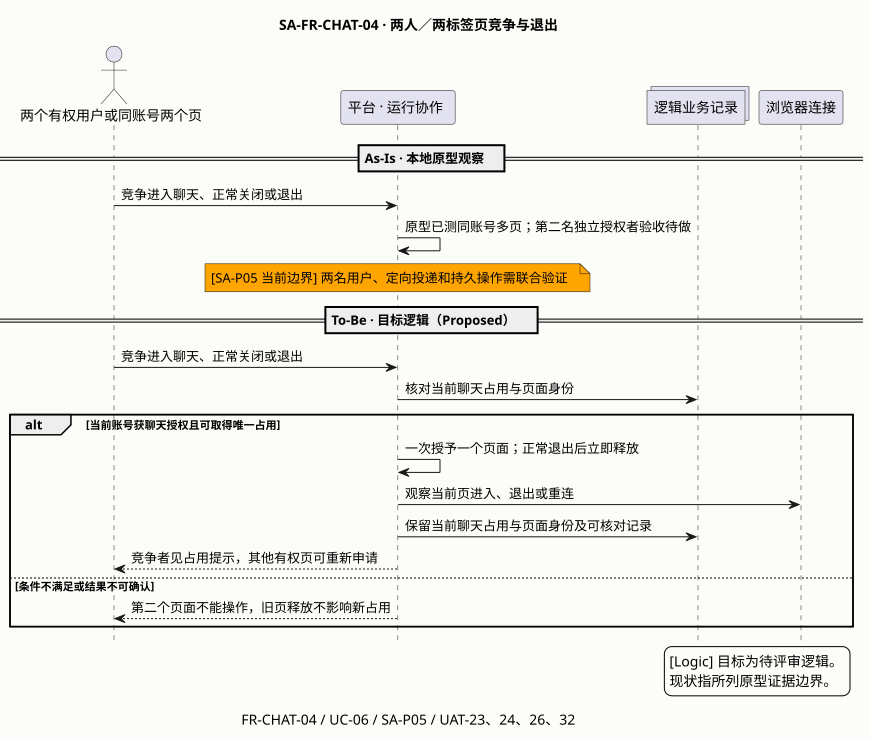

[图源](diagrams/sa-fr-chat-04.puml) · [原型证据 src/server.mjs:228](../../src/server.mjs#L228) · SA-P05

| 审阅项 | 口径 |
|---|---|
| 来源与责任 | BR-30。触发角色为两个有权用户或同账号两个页，平台责任为运行协作。 |
| 前置与完成 | 当前账号获聊天授权且可取得唯一占用。完成后竞争者见占用提示，其他有权页可重新申请。 |
| 当前边界 | 原型已测同账号多页；第二名独立授权者验收待做。两名用户、定向投递和持久操作需联合验证。 |
| 例外与禁止效果 | 第二个页面不能操作，旧页释放不影响新占用。 |
| 状态、数据、集成 | [聊天与待答状态](diagrams/sa-state-chat.svg)。读取／更新当前聊天占用与页面身份。[SA-I01](diagrams/sa-integration.svg)（浏览器连接）。所需能力为可恢复任务、消息或证据。 |
| 验证和 SD 输入 | UAT-23、24、26、32。租约仲裁、退出可达性与授权（SA-D06、10）。[专属 SD 技术图](../SD/diagrams/sd-fr-chat-04.svg) |

### FR-CHAT-05

**检测断网起五分钟宽限** · UC-06 · P0 / Confirmed · Logic · 运行协作

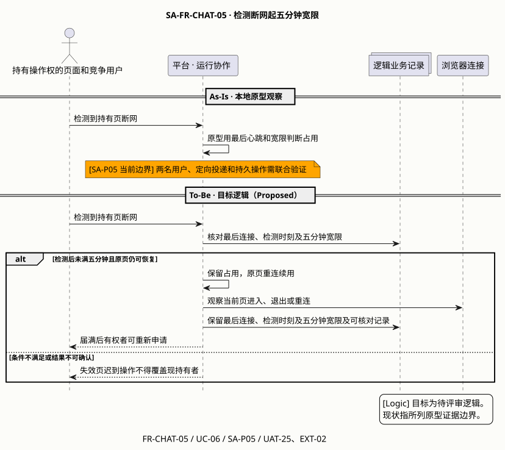

[图源](diagrams/sa-fr-chat-05.puml) · [原型证据 src/server.mjs:221](../../src/server.mjs#L221) · SA-P05

| 审阅项 | 口径 |
|---|---|
| 来源与责任 | BR-31。触发角色为持有操作权的页面和竞争用户，平台责任为运行协作。 |
| 前置与完成 | 检测后未满五分钟且原页仍可恢复。完成后届满后有权者可重新申请。 |
| 当前边界 | 原型用最后心跳和宽限判断占用。两名用户、定向投递和持久操作需联合验证。 |
| 例外与禁止效果 | 失效页迟到操作不得覆盖现持有者。 |
| 状态、数据、集成 | [聊天与待答状态](diagrams/sa-state-chat.svg)。读取／更新最后连接、检测时刻及五分钟宽限。[SA-I01](diagrams/sa-integration.svg)（浏览器连接）。所需能力为可恢复任务、消息或证据。 |
| 验证和 SD 输入 | UAT-25、EXT-02。检测时点、时钟和失效语义。[专属 SD 技术图](../SD/diagrams/sd-fr-chat-05.svg) |

### FR-CHAT-06

**正式变更确认与需求修订** · UC-06 · P0 / Confirmed · Logic · 运行协作

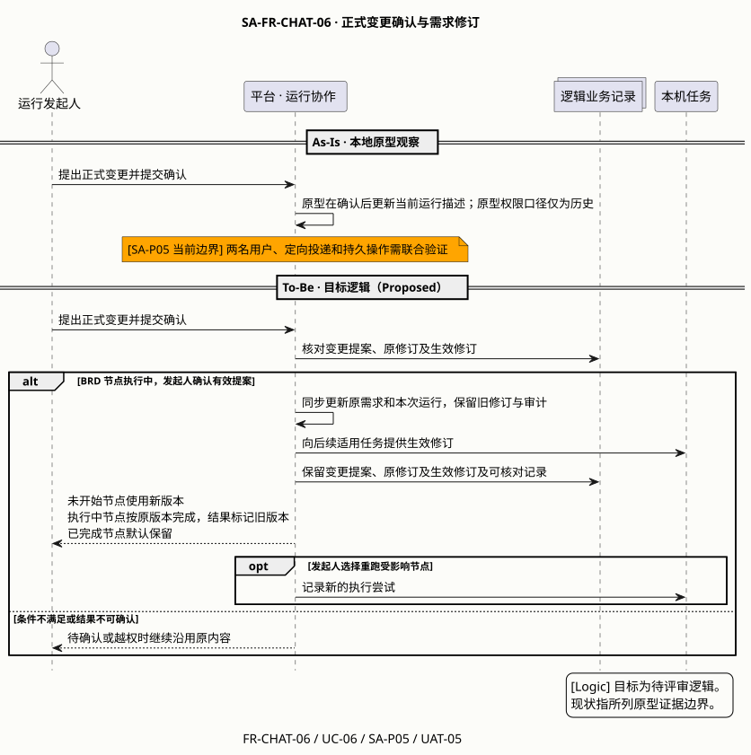

[图源](diagrams/sa-fr-chat-06.puml) · [原型证据 src/engine.mjs:281](../../src/engine.mjs#L281) · SA-P05

| 审阅项 | 口径 |
|---|---|
| 来源与责任 | BR-51。确认角色为运行发起人，平台责任为运行协作。 |
| 前置与完成 | BRD 节点执行中，发起人确认有效提案后原需求与本次运行同步更新。尚未开始的节点采用新版本。已在执行的节点按原版本完成，结果标记为「基于旧版本」。已完成的节点默认保留，由发起人决定是否重跑受影响节点。 |
| 当前边界 | 原型在确认后更新当前运行描述；原型权限口径仅为历史。两名用户、定向投递和持久操作需联合验证。 |
| 例外与禁止效果 | 待确认或越权时继续沿用原内容。 |
| 状态、数据、集成 | [聊天与待答状态](diagrams/sa-state-chat.svg)。读取／更新／投递变更提案、原修订及生效修订。[SA-I01](diagrams/sa-integration.svg)（本机任务）。所需能力为可恢复任务、消息或证据。 |
| 验证和 SD 输入 | UAT-05。验收发起人确认、双处更新、完成节点默认保留和按需重跑。在途结果须标记旧版本。重跑的下游处理见 SA-D03。[专属 SD 技术图](../SD/diagrams/sd-fr-chat-06.svg) |

### FR-DEL-01

**产品定义与后续引用** · UC-05 · P0 / Confirmed · Logic · 运行编排

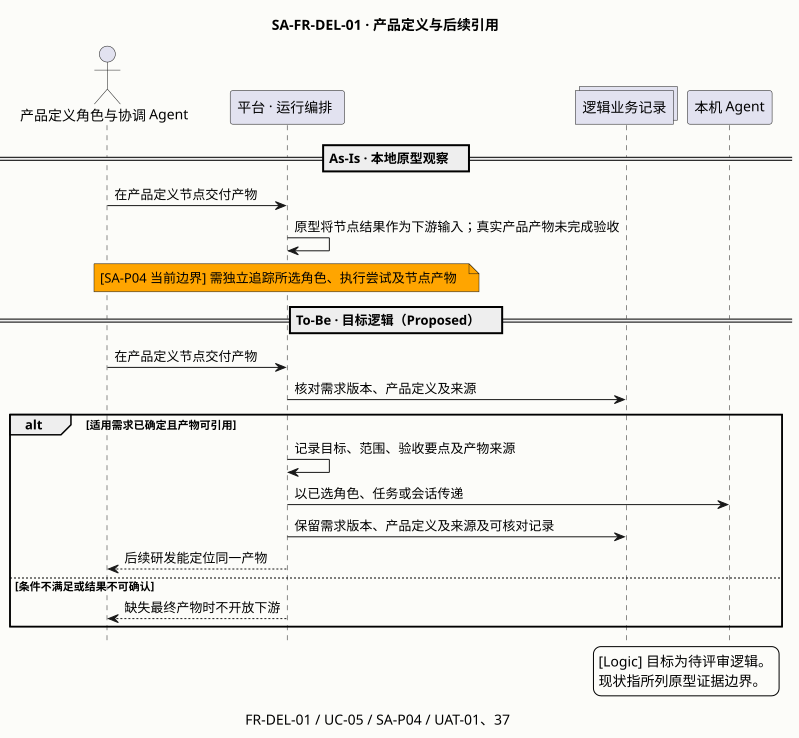

[图源](diagrams/sa-fr-del-01.puml) · [原型证据 src/engine.mjs:208](../../src/engine.mjs#L208) · SA-P04

| 审阅项 | 口径 |
|---|---|
| 来源与责任 | BR-03。触发角色为产品定义角色与协调 Agent，平台责任为运行编排。 |
| 前置与完成 | 适用需求已确定且产物可引用。完成后后续研发能定位同一产物。 |
| 当前边界 | 原型将节点结果作为下游输入；真实产品产物未完成验收。需独立追踪所选角色、执行尝试及节点产物。 |
| 例外与禁止效果 | 缺失最终产物时不开放下游。 |
| 状态、数据、集成 | [角色和任务状态](diagrams/sa-state-run.svg)。创建／读取需求版本、产品定义及来源。[SA-I01](diagrams/sa-integration.svg)（本机 Agent）。所需能力为可恢复任务、消息或证据。 |
| 验证和 SD 输入 | UAT-01、37。产物种类、来源和查看授权。[专属 SD 技术图](../SD/diagrams/sd-fr-del-01.svg) |

### FR-DEL-02

**前后端代码和工作分支证据** · UC-05 · P0 / Confirmed · Logic · 运行编排

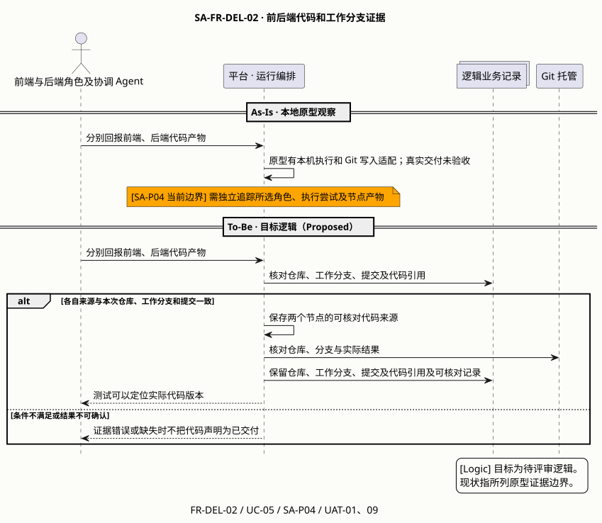

[图源](diagrams/sa-fr-del-02.puml) · [原型证据 src/worker.mjs:48](../../src/worker.mjs#L48) · SA-P04

| 审阅项 | 口径 |
|---|---|
| 来源与责任 | BR-04、BR-05。触发角色为前端与后端角色及协调 Agent，平台责任为运行编排。 |
| 前置与完成 | 各自来源与本次仓库、工作分支和提交一致。完成后测试可以定位实际代码版本。 |
| 当前边界 | 原型有本机执行和 Git 写入适配；真实交付未验收。需独立追踪所选角色、执行尝试及节点产物。 |
| 例外与禁止效果 | 证据错误或缺失时不把代码声明为已交付。 |
| 状态、数据、集成 | [角色和任务状态](diagrams/sa-state-run.svg)。创建／读取仓库、工作分支、提交及代码引用。[SA-I01](diagrams/sa-integration.svg)（Git 托管）。所需能力为可恢复任务、消息或证据。 |
| 验证和 SD 输入 | UAT-01、09。代码证据及受控外部写入。[专属 SD 技术图](../SD/diagrams/sd-fr-del-02.svg) |

### FR-DEL-03

**测试结论、失败详情和被测代码** · UC-07 · P0 / Confirmed · Logic · 交付与验收

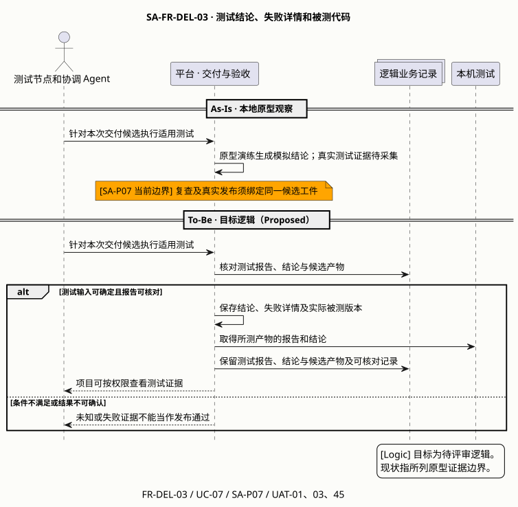

[图源](diagrams/sa-fr-del-03.puml) · [原型证据 src/providers.mjs:142](../../src/providers.mjs#L142) · SA-P07

| 审阅项 | 口径 |
|---|---|
| 来源与责任 | BR-06。触发角色为测试节点和协调 Agent，平台责任为交付与验收。 |
| 前置与完成 | 测试输入可确定且报告可核对。完成后项目可按权限查看测试证据。 |
| 当前边界 | 原型演练生成模拟结论；真实测试证据待采集。复查及真实发布须绑定同一候选工件。 |
| 例外与禁止效果 | 未知或失败证据不能当作发布通过。 |
| 状态、数据、集成 | [检查轮次](diagrams/sa-uc07.svg)。创建／读取测试报告、结论与候选产物。[SA-I01](diagrams/sa-integration.svg)（本机测试）。所需能力为可恢复任务、消息或证据。 |
| 验证和 SD 输入 | UAT-01、03、45。候选身份、报告结论和必测策略（SA-D02）。[专属 SD 技术图](../SD/diagrams/sd-fr-del-03.svg) |

### FR-DEL-04

**复查、发布放行与供应商证据** · UC-07 · 后续 / Confirmed · Logic · 交付与验收

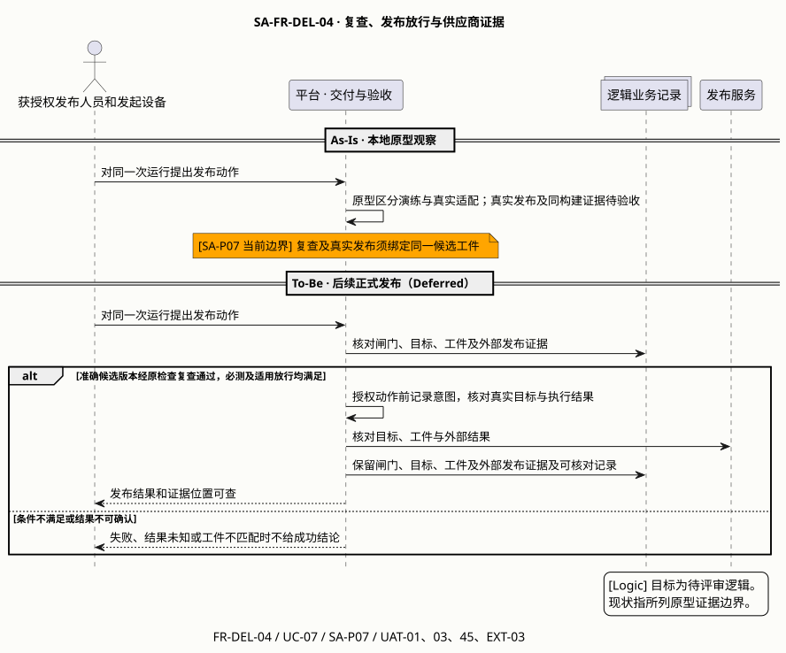

[图源](diagrams/sa-fr-del-04.puml) · [原型证据 src/providers.mjs:96](../../src/providers.mjs#L96) · SA-P07

| 审阅项 | 口径 |
|---|---|
| 来源与责任 | BR-07、BR-46。触发角色为获授权发布人员和发起设备，平台责任为交付与验收。 |
| 前置与完成 | 准确候选版本经原检查复查通过，必测及适用放行均满足。完成后发布结果和证据位置可查。 |
| 当前边界 | 原型区分演练与真实适配；真实发布及同构建证据待验收。复查及真实发布须绑定同一候选工件。 |
| 例外与禁止效果 | 失败、结果未知或工件不匹配时不给成功结论。 |
| 状态、数据、集成 | [检查轮次](diagrams/sa-uc07.svg)。创建／读取闸门、目标、工件及外部发布证据。[SA-I01](diagrams/sa-integration.svg)（发布服务）。所需能力为可恢复任务、消息或证据。 |
| 验证和 SD 输入 | UAT-03、45 的发布分区与 EXT-03 为后续。工件版本绑定、外部核对、放行与目标（SA-D02）。[专属 SD 技术图](../SD/diagrams/sd-fr-del-04.svg) |
