# AgentShip 系统分析 v0.5

范围为 BRD 首期。基线为待签署的 [BRD v0.57](../BRD/AgentShip/BRD-AgentShip.md)、[PRD v0.8](../PRD/PRD-AgentShip.md) 与已有本机原型。状态为 Proposed / Pending Approval。采用新版 `system-analysis-agent` 与 `system-analysis-standard` 重构。独立 FRS、正式变更单、业务签署与环境决策待确认，当前分析以既有需求为准，作为拟议设计的输入。

从[逐功能分册](SA-AgentShip-Features.md)查看 39 条功能的现状证据、目标逻辑、状态、逻辑数据、集成和验证。原 UC-01～08 用于总览。[功能图索引](../SD/AgentShip-Function-Diagrams.md)连接对应的 SD 专属技术图。

## 1. 现状、问题与目标

### SA-00 现有系统逻辑

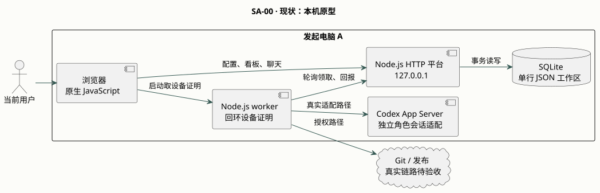

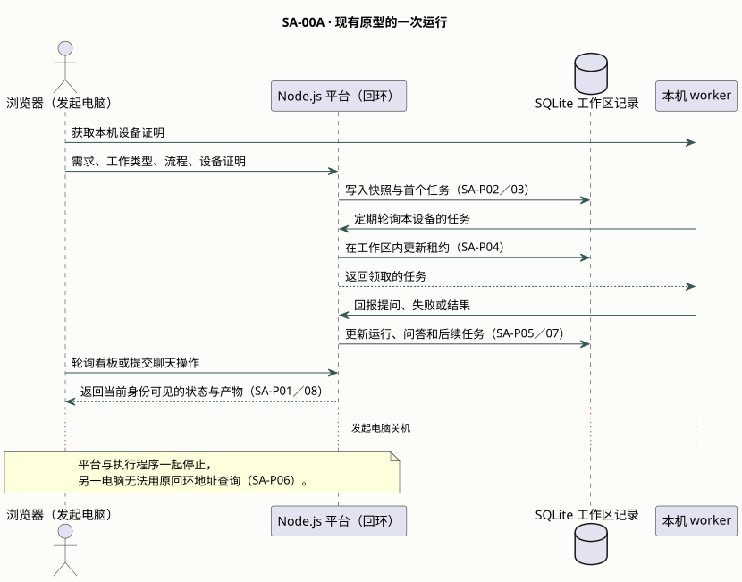

当前范围为已核对的回环原型。历史证据覆盖本机演练和同账号双标签页。真实 Codex、Git、发布与跨设备验收另行验证。[原型验证记录](../../openspec/changes/deliver-agentship-mvp/evidence.md)

### SA-01 当前问题与方案

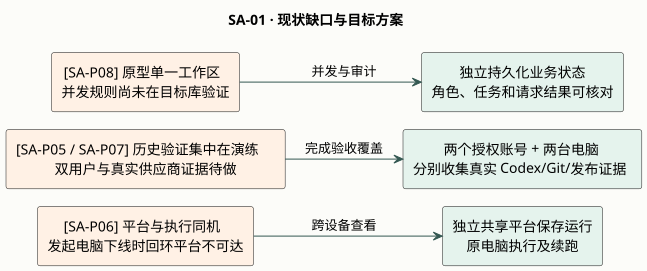

图中左侧是原型观察或验证缺口，右侧是拟议解决方案。来源为 BR-29～32、NFR-02～03 与 UAT-01、UAT-22～27。逐功能图把问题 ID 放在当前路径发生的位置。

| 问题 | 当前证据与影响 |
|---|---|
| SA-P01 身份和权限 | [原型账号、对象访问与撤权](../../src/server.mjs)已可定位。共享环境的并发更新、敏感字段和授权边界待验收。 |
| SA-P02 流程配置与版本 | [原型配置校验](../../src/model.mjs)与[运行快照](../../src/engine.mjs)已有逻辑。目标需保留版本、引用和历史证据。 |
| SA-P03 启动与 Git | [原型启动与供应商适配](../../src/providers.mjs)已有路径。真实仓库、授权、未知结果核对与重放待验收。 |
| SA-P04 调度和产物 | [原型调度](../../src/engine.mjs)以本机运行验证为主。角色尝试、独立任务和真实交付证据需追踪。 |
| SA-P05 聊天及人工操作 | [原型聊天仲裁](../../src/server.mjs)已有同账号多页证据。两个获权用户、定向答复和撤权待验证。 |
| SA-P06 设备离线与恢复 | [原型平台](../../src/server.mjs)和执行程序使用回环地址。原机下线时其他电脑无法借此读取同次运行。 |
| SA-P07 检查与真实发布 | [原型检查与演练](../../src/engine.mjs)提供流程证据。实际测试、复查和发布需绑定同一候选工件。 |
| SA-P08 共享历史与外部核对 | [原型工作区存储](../../src/store.mjs)承担本机读写。跨机查看和外部结果核对待验证。 |

### SA-02 目标系统逻辑

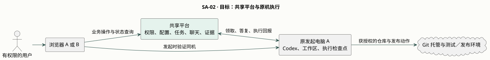

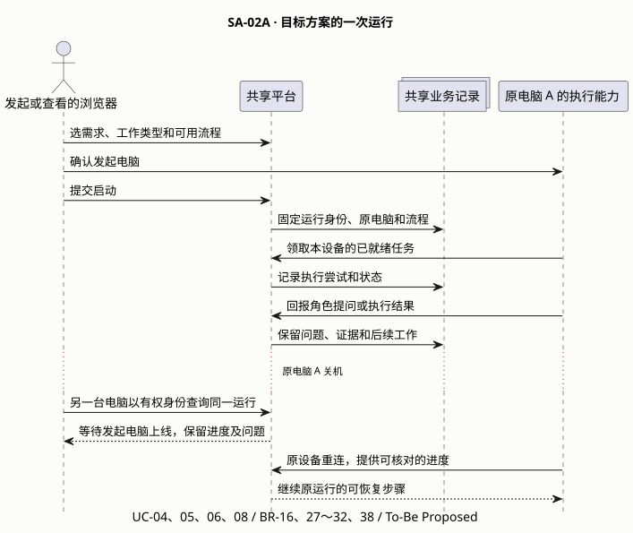

共享平台持有运行状态。运行绑定发起时的设备，聊天操作者可以变化。浏览器 B 可独立读取有权限的状态。部署和信任边界见 [后端系统设计](../SD/SD-AgentShip-backend.md)。

### SA-03 交付主流程

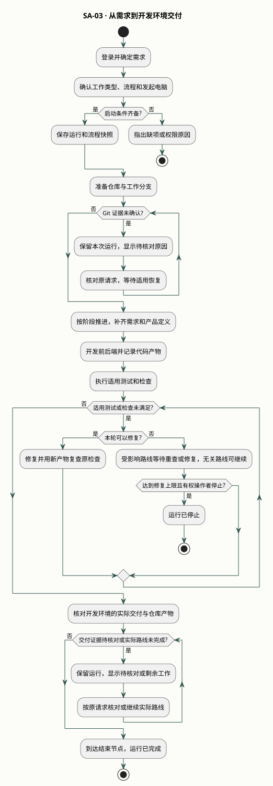

首期从需求发起到开发环境交付并结束。正式发布属于后续路径。实际运行以启动时所选流程为准。修复循环见 [UC-07](#uc-07-检查修复复查与发布)。

## 2. 角色与操作边界

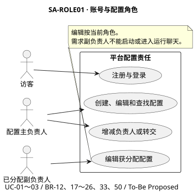

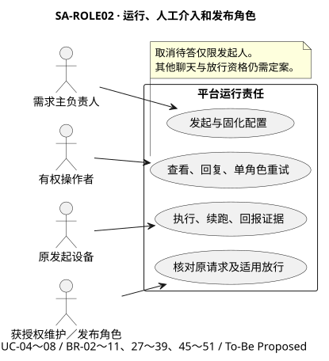

角色图分别覆盖配置和运行。配置权限、启动身份、聊天占用和外部放行独立核验。[配置图源](diagrams/sa-role-config.puml) · [运行图源](diagrams/sa-role-run.puml)

| 身份 | 操作边界 |
|---|---|
| 当前主负责人／副负责人 | 主负责人管理成员与转交。副负责人编辑已分配配置。流程副负责人可在有权启动的运行中选用该流程，Agent 副负责人可在有权编辑的流程中选用该 Agent。需求副负责人可见并可编辑需求，启动与聊天按各自权限裁决。 |
| 运行发起人／发起设备 | 记录启动时的账号和电脑。发起人可添加或撤销聊天用户。只有发起人可取消待答、确认 BRD 节点内的正式变更，并选择重跑受影响的节点。 |
| 当前聊天操作者 | 已通过聊天授权且持有唯一标签页。回复、失败角色重试或跳过、重新检查和修复上限动作按状态开放。 |
| 维护者／后续发布人员 | 经独立授权执行适用操作。正式角色、范围和放行条件见第 5 节。 |
| 协调 Agent／子 Agent | 按已选角色分派、定向交接和汇总。每个角色的执行、待答和失败状态单独追踪。 |

## 3. 用例和逻辑

以下图用于阅读主用例。每条可独立验收功能见[逐功能分册](SA-AgentShip-Features.md)。

### UC-01 注册与登录

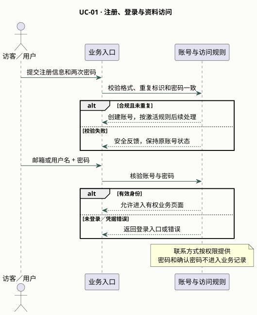

开放注册。用户名最多 100 字符，大小写不区分，允许字母、数字、下划线和短横线。并发同名只允许一个账号。密码为 15～128 个字符，允许空格和符号，两次输入须完全一致。注册后账号待验证，邮箱和手机号都验证成功才激活并允许登录。同一个邮箱、同一个手机号各只能绑定一个账号。邮箱不区分大小写，手机号统一带国家区号判重。注册受理后待验证状态保留 24 小时。未完成双渠道验证而到期时，原验证码失效，释放用户名、邮箱和手机号，允许重新注册。首批开发和验收使用本地模拟邮件和短信，真实发送待供应商确定后接入。验收 UAT-12、13、15。

### UC-02 配置所有权与需求共享

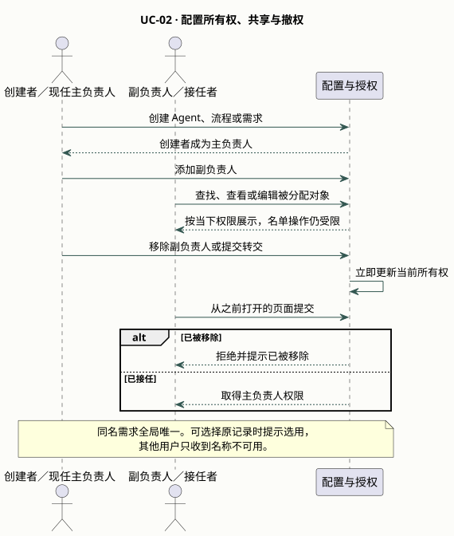

转交可直接给其他已注册用户，接任和原负责人退出同时生效。列表、搜索、下拉、详情和提交均按当前权限判定。副负责人可在启动候选里看到已授权需求，提交启动仍按 UC-04 检查。验收 UAT-07、14、18、19、28、29、54。

### UC-03 配置与保存流程

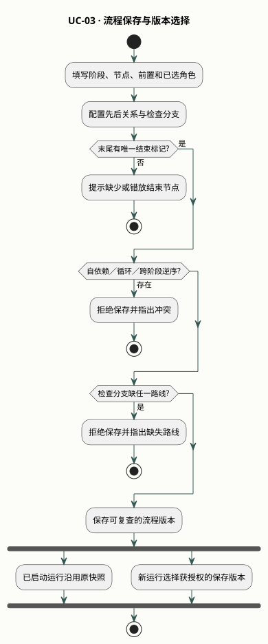

前置节点限于同阶段或更早阶段。结束节点仅标记完成。循环依赖显示「有循环依赖」。验收 UAT-04、08、11、35、42、44。

### UC-04 发起运行与 Git 准备

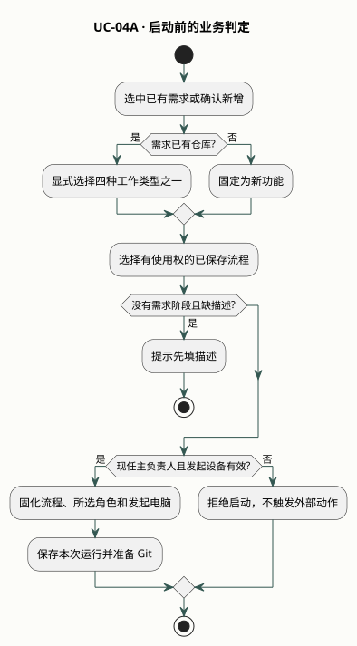

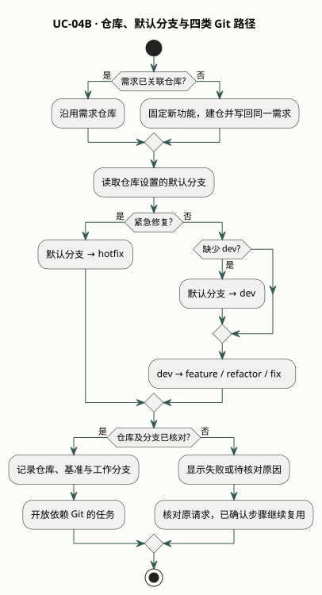

仅输入搜索文字不构成选择。含需求阶段时可到该阶段补充并保存描述。已保存但未关联仓库的需求也固定按新功能启动。默认分支取仓库实际设置，包括 `main` 和 `master`。重复提交返回原启动结果。验收 UAT-01、02、09、10、16、17、30、51～54。

### UC-05 节点调度、角色与产物

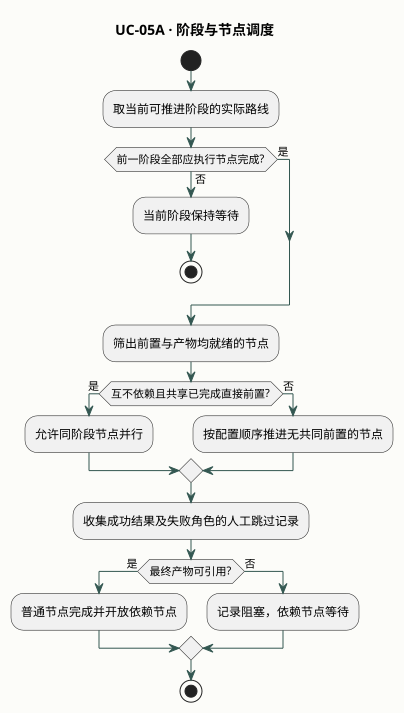

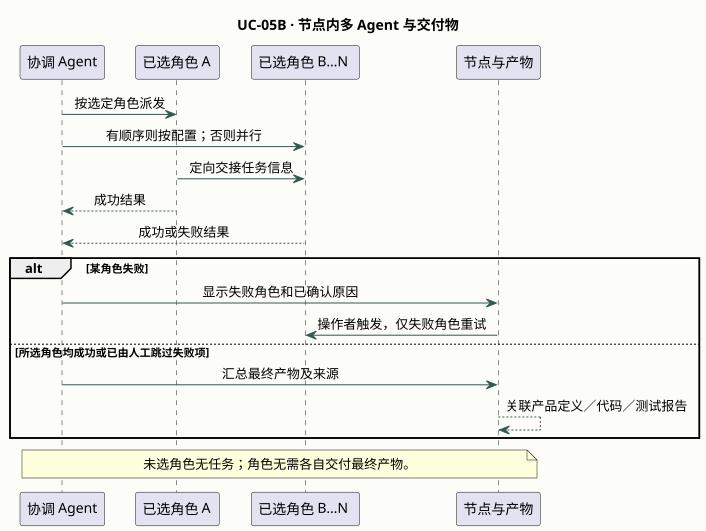

同一节点支持三个以上所选角色。已选角色须成功或由当前聊天操作者处置为跳过，节点最终产物可引用后才开放下游。协调 Agent 先尝试解决产物冲突，未解决时等待人工。前后端代码分别关联仓库和分支，测试报告关联被测代码。失败原因无法确认时显示「暂时无法确认失败原因」。验收 UAT-01、04、06、20、31、36～41。

### UC-06 聊天、问答与正式变更

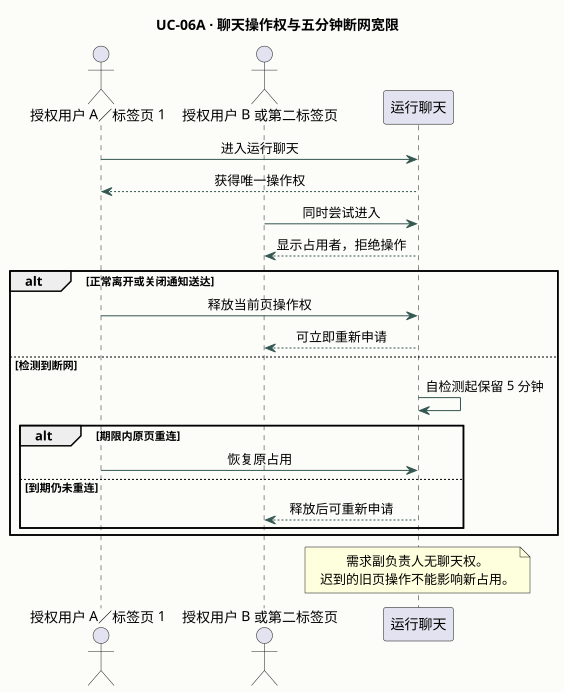

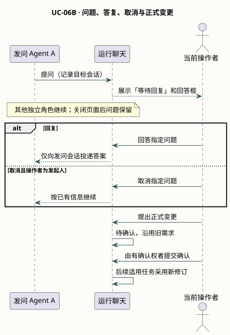

普通消息默认发给当前节点的协调 Agent，用户也可用 `@Agent` 指定该节点的 Agent。发问角色等待，其他独立任务可继续。并发回复与取消只接受先成功提交的有效动作。待确认的变更沿用旧版本。第二名聊天用户与正式确认人的授权规则分别见 SA-D06、SA-D03。验收 UAT-05、20～26、32～34、36。

### UC-07 检查、修复、复查与发布

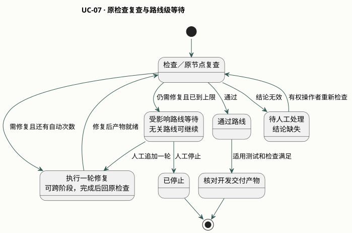

每次检查只激活对应路线，每个检查节点独立计算自动次数，首轮记为 1。复查使用修复后的产物。达到上限当轮通过也可继续。修复可跨阶段并返回原检查。达到上限且仍需修复时，只阻塞受影响路线及其依赖，其他路线照常满足既有条件。人工追加一轮后仍未通过则该路线再次等待。首期核对开发交付与检查结果，正式发布条件保留到后续。验收 UAT-03、43～50。

### UC-08 离线恢复、看板和结束

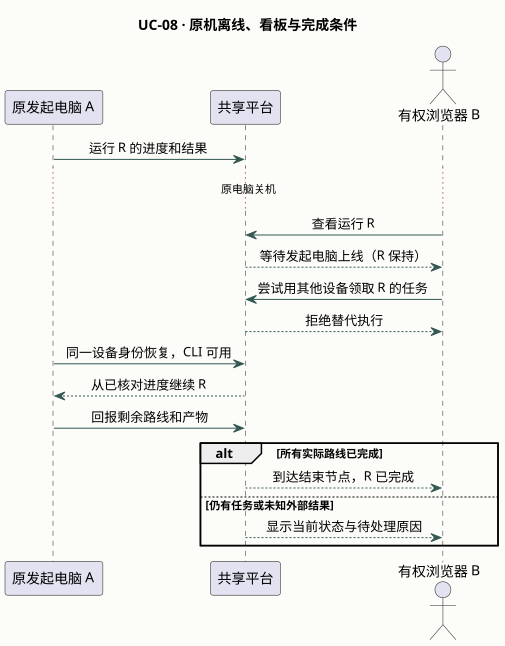

其他设备可查看有权运行。迟到事件不能改写当前尝试。原机优先恢复可用 Codex 会话，会话不可用时从最近保存的进度续跑。已确认的成功步骤沿用。未激活的条件路线不阻塞结束，停止与完成独立记录。验收 UAT-01、02、06、22、27、35、39。

## 4. 数据、质量与交接

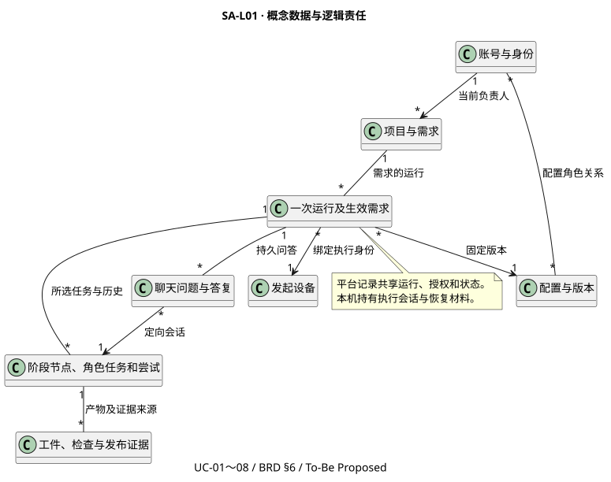

平台保存授权和业务状态。发起设备持有本机会话及恢复材料，Git 和发布方负责外部结果。字段、物理存储与生命周期技术选择见 [SD 数据设计](../SD/SD-AgentShip-data.md)。[图源](diagrams/sa-logical-data.puml)

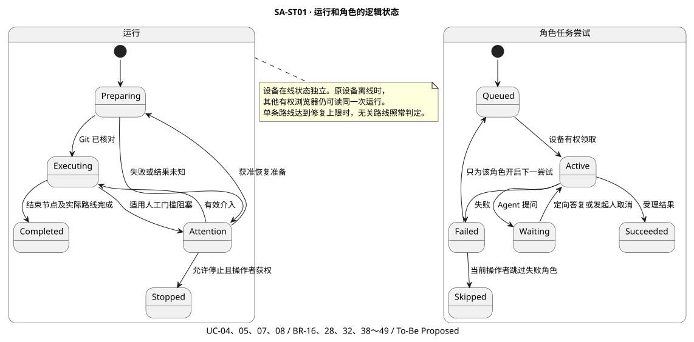

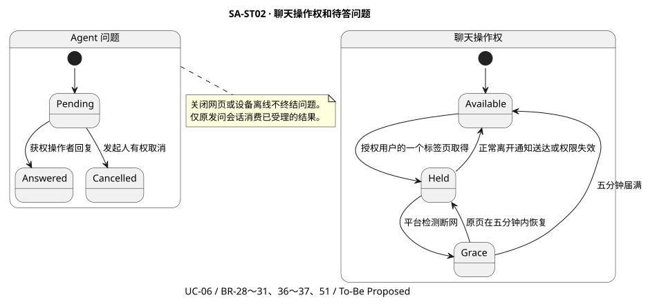

整体运行、角色尝试、聊天占用及待答问题分别演进。设备离线是独立观察，保留已有运行状态。各功能的逻辑读写和禁止效果见[逐功能分册](SA-AgentShip-Features.md)。[运行图源](diagrams/sa-state-run.puml) · [聊天图源](diagrams/sa-state-chat.puml)

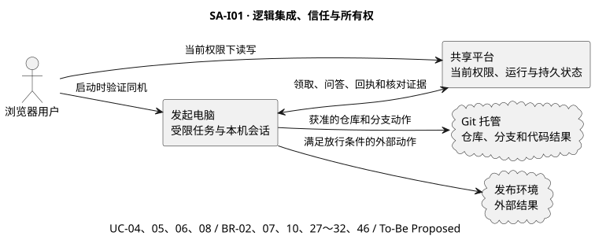

所需能力包括共享持久记录、可恢复任务、定向投递和可核对外部结果。密码、确认密码和设备凭据不进入业务记录。平台使用当前角色限制资料、运行及敏感操作。接入方案、存储和中间件选型见 [SD 集成](../SD/SD-AgentShip-integration.md)与[中间件设计](../SD/SD-AgentShip-middleware.md)。[图源](diagrams/sa-integration.puml)

## 5. 待决事项

本节记录会影响开工和验收的剩余决定。已确认的行为进入对应功能图、设计契约与 OpenSpec。

| ID | 决策和影响 | 状态 |
|---|---|---|
| SA-D01 | 按需选角色，正常路径全部所选角色参加。以三个以上角色和一个未选角色验收。 | Confirmed |
| SA-D02 | GitHub、用户填写账号或组织、公开新仓库及开发环境范围已确认。待细化固定分支命名与异常恢复。 | Partial |
| SA-D03 | 仅在当前 BRD 阶段节点内改需求。发起人确认后同步原需求与本次运行，已完成节点默认保留，可由发起人选择重跑受影响节点。在途节点按原版本完成并标记旧版本，尚未开始节点使用新版本。重跑的下游影响待细化。 | Partial |
| SA-D04 | 允许跨阶段修复并返回原检查。修复上限只阻塞受影响路线。常规节点沿用阶段门槛，修复子路径归属原检查波次并在完成后返回。分支归属和合流由 SD 落地。 | Partial |
| SA-D05 | 协调 Agent 先汇总冲突，仍冲突则等人工，失败 Agent 可重试或跳过。普通消息路由已确认。角色目录、容量及续跑实测待定。流程和 Agent 的使用权来自当前主、副负责人身份，并须满足对应启动或编辑权限。单独向非负责人授予使用权留待后续。 | Partial |
| SA-D06 | 运行发起人可添加或撤销聊天用户。需求副负责人仍禁止聊天。撤权及占用的联动待技术验收。 | Confirmed |
| SA-D07 | 注册、激活、密码、联系方式判重、24 小时期限和开发模拟渠道已确认。邮箱和手机号仅本人登录后可查看。首期不提供管理员查看他人联系方式或停用账号的后台。已激活账号的留存待定。 | Partial |
| SA-D08 | 同机原会话可用则沿用，否则回最近保存的进度。首期 macOS 与 Chrome。外部结果未知的处置仍待定。 | Partial |
| SA-D09 | 可公开交付物归档到需求关联仓库。账号资料、聊天原文和原始执行日志留平台。平台可见角色、留存和运营责任待定。 | Partial |
| SA-D10 | 正常关闭收到通知即释放。通知未送达按 5 分钟断连宽限。目标浏览器的通知送达和续租行为待实测。 | Confirmed |

### 影响开工的产品决定

| 决策 | 待确认的可观察行为 | 影响范围 |
|---|---|---|
| SA-D07 / Q-01 | 本人资料读取及后台范围已确认。留存期限待定。 | 账号资料与生命周期 |
| SA-D03 / Q-04 | 重跑产出新版本后，已消费旧产物的下游及检查结果怎么处理。拟保留历史，标出直接或间接使用旧产物的结果，仅由发起人选择是否重跑。 | 按需重跑及后续验收 |
| SA-D05 / Q-05、Q-09 | 仅协调 Agent 的节点是否可保存、首期角色与容量，以及跳过角色后其下游角色所需输入如何补齐。 | Agent 配置与节点完成 |
| SA-D02、D08 / Q-03、Q-08 | Git 分支重名的固定命名方式、仓库不可达时的反馈，以及外部结果不明的人工恢复资格。 | Git 接入、真实开发环境验收 |

## 6. 自检与 SD 交接

| 检查 | 结果 |
|---|---|
| 来源、现状证据与功能对账 | 通过文档核对。39 项均有来源、现状路径、问题标记、目标和验证。 |
| 概念数据、生命周期及集成 | 通过文档核对。物理数据、协议和产品选型由 SD 承接。 |
| 质量、业务和运维目标 | Needs decision。资料留存、容量、可用性、环境和恢复策略待定。 |
| SA-Ready | Blocked。须落实第 5 节关键业务决定、正式来源签署和验收责任。 |

SD 按[逐功能分册](SA-AgentShip-Features.md)中的输入落地授权、状态、数据、集成与失败处置。OpenSpec 追溯见 [BRD 到交付矩阵](../SD/AgentShip-Traceability.md)。

| 版本 | 内容 |
|---|---|
| v0.3 | 现状、目标、主流程和八组用例图。 |
| v0.4 | 对齐新版 SA Agent 与 Skill，补 39 张专属图、现状热点、分角色、概念模型、状态与集成。 |
| v0.5 | 对齐 BRD v0.54 与 PRD v0.5，更新开发环境范围、角色权限、分支暂停、失败跳过及同机续跑。 |
