# AgentShip 逐功能技术设计 v0.5

[返回 SD 索引](SD-AgentShip-index.md) · [快速导航](AgentShip-Function-Diagrams.md) · [数据与事务](SD-AgentShip-data.md)。以下设计为 Proposed。独立图的 As-Is 分区只描述原型证据，To-Be 分区遵循当前草案权限。

### FR-ACC-01

**注册校验、判重和资料保护** · UC-01 · Logic · 平台／身份和配置

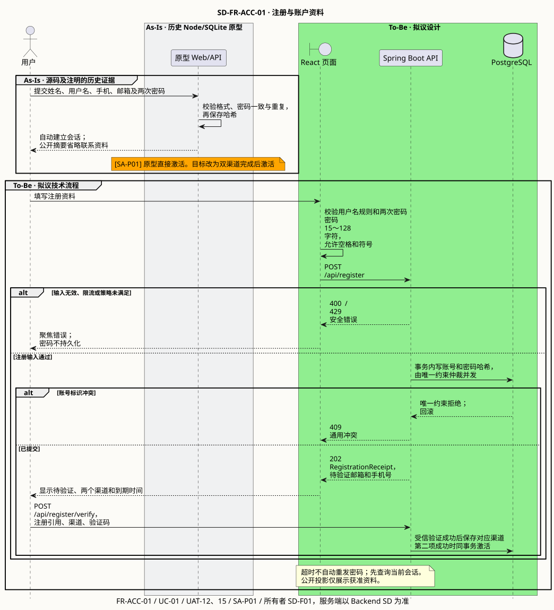

[图源](diagrams/sd-fr-acc-01.puml) · [SA 专属图](../SA/diagrams/sa-fr-acc-01.svg) · SA-P01 · UAT-12、15

| 设计口径 | 约束 |
|---|---|
| 入参与可观察输出 | 用户名、规范化邮件和手机号各自唯一。密码 15～128 字符且两次一致。注册返回待验证状态，邮箱和手机号均通过后才激活。受理后 24 小时未完成则原凭证失效，可重新注册。首期用本地模拟渠道。 |
| 事务、并发和恢复 | TX-AUTH。访客输入校验和唯一账号键判重，不依赖既有对象权限。 |
| 接口、数据和依赖 | account。见 [DML-ACC-01](data/dml-catalog.md)、[API v1 草案](contracts/agentship-v1.json)及[中间件](SD-AgentShip-middleware.md) MW-01 MW-02。 |
| 错误、禁止效果及验证 | 重复标识或输入非法，无新增。重试、重复请求及不确定结果按专属图和契约裁决。UAT-12、15。 |

### FR-ACC-02

**邮箱或用户名登录与受限页面** · UC-01 · Contract · 平台／身份和配置

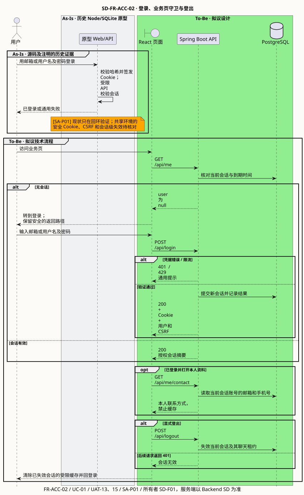

[图源](diagrams/sd-fr-acc-02.puml) · [SA 专属图](../SA/diagrams/sa-fr-acc-02.svg) · SA-P01 · UAT-13、15

| 设计口径 | 约束 |
|---|---|
| 入参与可观察输出 | 凭据有效且当前会话有权访问。进入有权页面。 |
| 事务、并发和恢复 | TX-AUTH。凭据核验在应用边界，拒绝返回安全结果。 |
| 接口、数据和依赖 | account、account_session。见 [DML-ACC-02](data/dml-catalog.md)、[API v1 草案](contracts/agentship-v1.json)及[中间件](SD-AgentShip-middleware.md) MW-01 MW-02。 |
| 错误、禁止效果及验证 | 不匹配或已撤销返回安全错误。重试、重复请求及不确定结果按专属图和契约裁决。UAT-13、15。 |

### FR-OWN-01

**三类配置主副负责人、添加和移除** · UC-02 · Logic · 平台／身份和配置

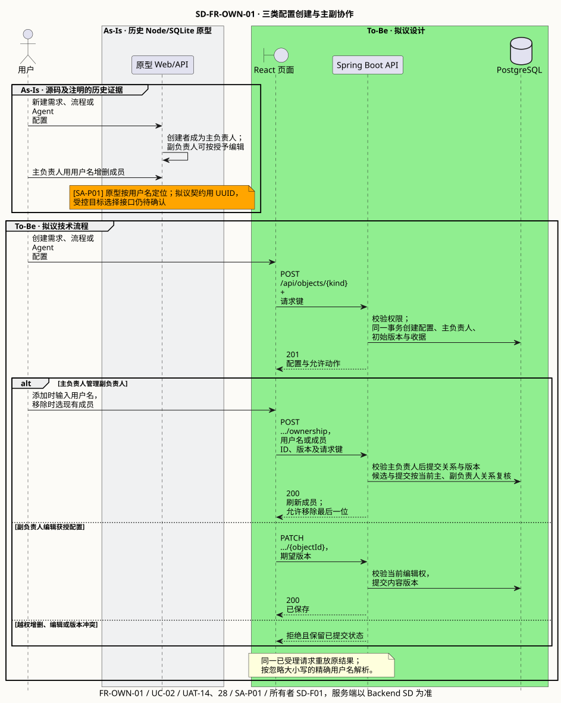

[图源](diagrams/sd-fr-own-01.puml) · [SA 专属图](../SA/diagrams/sa-fr-own-01.svg) · SA-P01 · UAT-14、28

| 设计口径 | 约束 |
|---|---|
| 入参与可观察输出 | 创建者或现任主负责人资格有效。当前成员关系可查。 |
| 事务、并发和恢复 | TX-CFG。核验与写入同事务，版本冲突整条回滚。 |
| 接口、数据和依赖 | configuration、configuration_deputy。见 [DML-OWN-01](data/dml-catalog.md)、[API v1 草案](contracts/agentship-v1.json)及[中间件](SD-AgentShip-middleware.md) MW-01 MW-02。 |
| 错误、禁止效果及验证 | 无当前主权限或版本过期不写。重试、重复请求及不确定结果按专属图和契约裁决。UAT-14、28。 |

### FR-OWN-02

**撤权与旧页面保存** · UC-02 · Logic · 平台／身份和配置

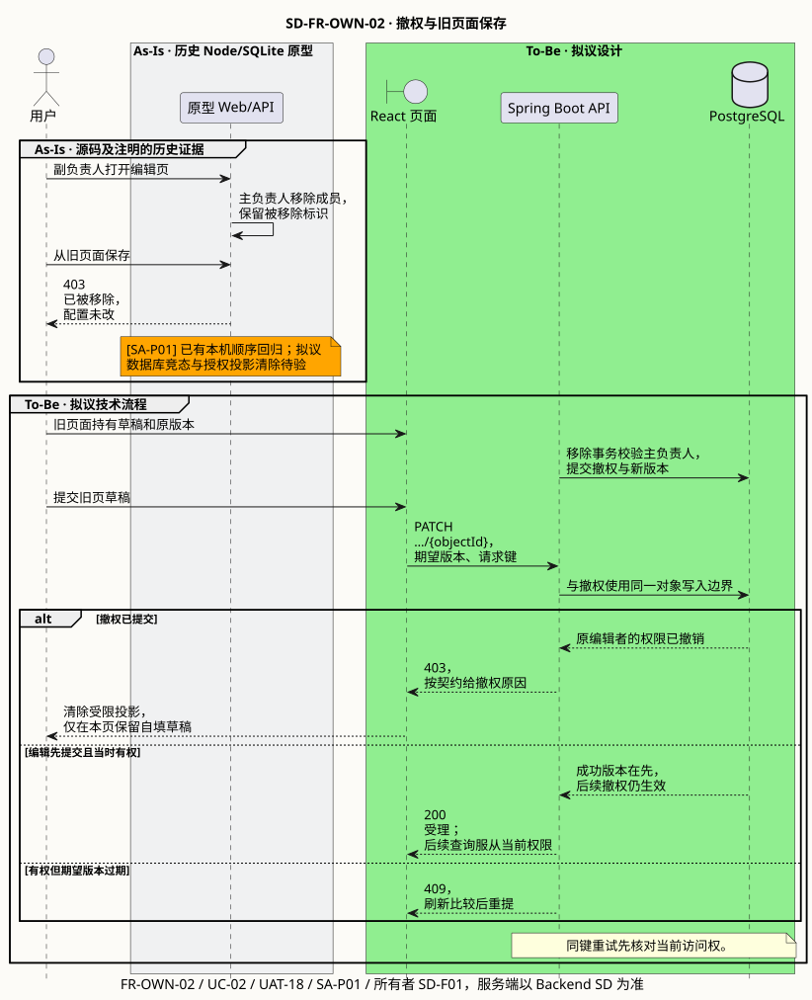

[图源](diagrams/sd-fr-own-02.puml) · [SA 专属图](../SA/diagrams/sa-fr-own-02.svg) · SA-P01 · UAT-18

| 设计口径 | 约束 |
|---|---|
| 入参与可观察输出 | 当前编辑权和预期版本仍有效。保存成功或准确的撤权提示。 |
| 事务、并发和恢复 | TX-CFG。核验与写入同事务，版本冲突整条回滚。 |
| 接口、数据和依赖 | configuration、configuration_deputy、requirement。见 [DML-OWN-02](data/dml-catalog.md)、[API v1 草案](contracts/agentship-v1.json)及[中间件](SD-AgentShip-middleware.md) MW-01 MW-02。 |
| 错误、禁止效果及验证 | 撤权或版本冲突，旧页不得覆盖。重试、重复请求及不确定结果按专属图和契约裁决。UAT-18。 |

### FR-OWN-03

**向注册用户转交并即时生效** · UC-02 · Logic · 平台／身份和配置

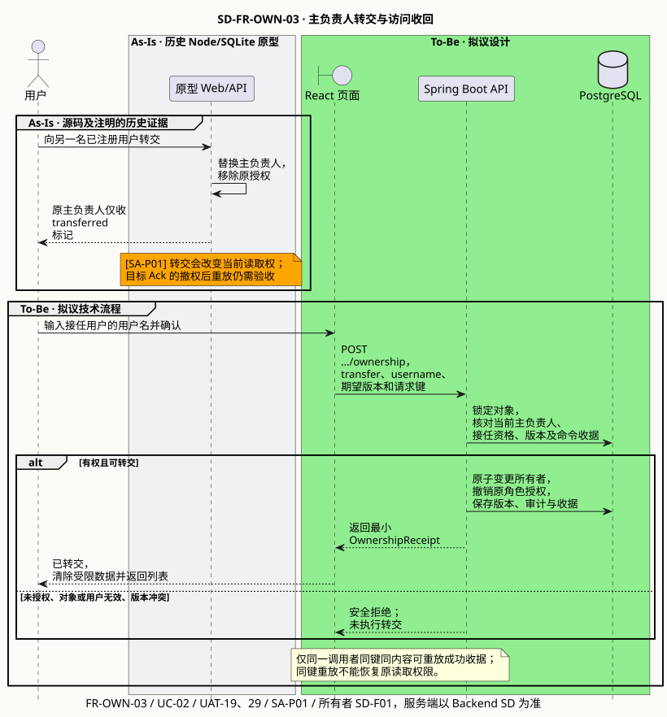

[图源](diagrams/sd-fr-own-03.puml) · [SA 专属图](../SA/diagrams/sa-fr-own-03.svg) · SA-P01 · UAT-19、29

| 设计口径 | 约束 |
|---|---|
| 入参与可观察输出 | 发起者仍为现任主负责人且接任者合法。接任者立即取得角色权限。 |
| 事务、并发和恢复 | TX-CFG。核验与写入同事务，版本冲突整条回滚。 |
| 接口、数据和依赖 | configuration、configuration_deputy、command_receipt。见 [DML-OWN-03](data/dml-catalog.md)、[API v1 草案](contracts/agentship-v1.json)及[中间件](SD-AgentShip-middleware.md) MW-01 MW-02。 |
| 错误、禁止效果及验证 | 冲突返回安全结果；转交收据契约待定。重试、重复请求及不确定结果按专属图和契约裁决。UAT-19、29。 |

### FR-REQ-01

**需求私有、分享和可见范围** · UC-02 · Logic · 平台／身份和配置

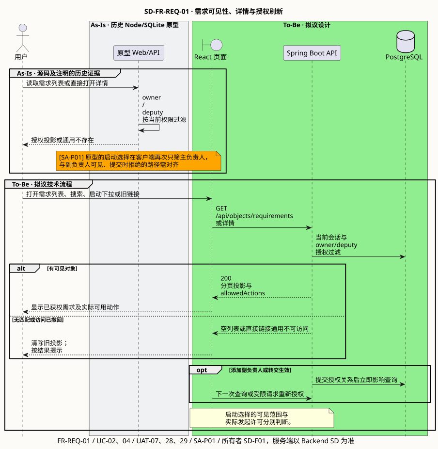

[图源](diagrams/sd-fr-req-01.puml) · [SA 专属图](../SA/diagrams/sa-fr-req-01.svg) · SA-P01 · UAT-07、28、29

| 设计口径 | 约束 |
|---|---|
| 入参与可观察输出 | 当前身份有读取范围。展示有权需求，副负责人可编辑其分配项。 |
| 事务、并发和恢复 | TX-READ。读取失败或游标冲突不泄漏资源。 |
| 接口、数据和依赖 | requirement、configuration、configuration_deputy。见 [DML-REQ-01](data/dml-catalog.md)、[API v1 草案](contracts/agentship-v1.json)及[中间件](SD-AgentShip-middleware.md) MW-01 MW-02。 |
| 错误、禁止效果及验证 | 无权统一拒绝；项目权限不替代需求授权。重试、重复请求及不确定结果按专属图和契约裁决。UAT-07、28、29。 |

### FR-REQ-02

**需求全局唯一、同名选择或安全提示** · UC-02 · Logic · 平台／身份和配置

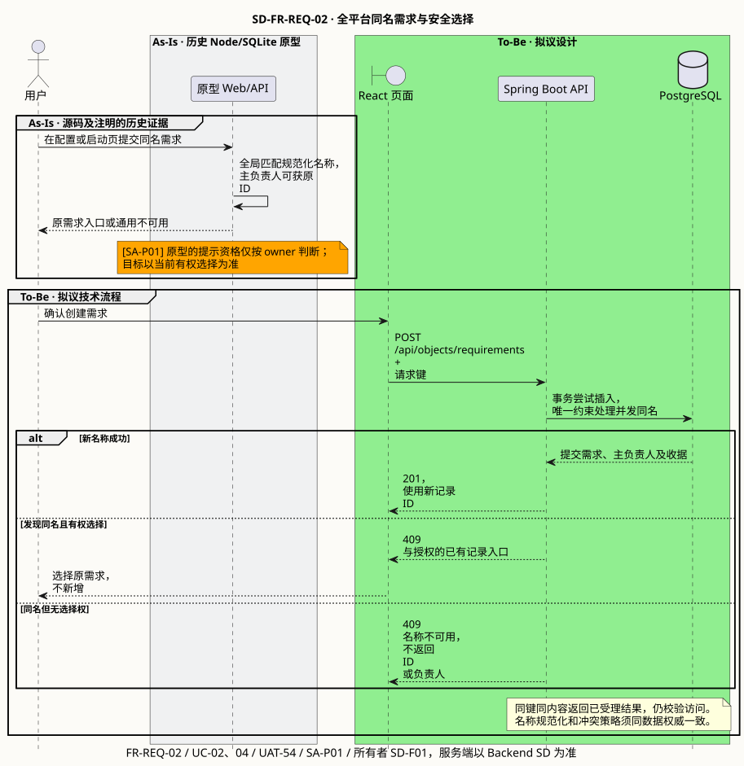

[图源](diagrams/sd-fr-req-02.puml) · [SA 专属图](../SA/diagrams/sa-fr-req-02.svg) · SA-P01 · UAT-54

| 设计口径 | 约束 |
|---|---|
| 入参与可观察输出 | 名称规范化后未占用。取得新需求标识。 |
| 事务、并发和恢复 | TX-CFG。核验与写入同事务，版本冲突整条回滚。 |
| 接口、数据和依赖 | requirement、configuration。见 [DML-REQ-02](data/dml-catalog.md)、[API v1 草案](contracts/agentship-v1.json)及[中间件](SD-AgentShip-middleware.md) MW-01 MW-02。 |
| 错误、禁止效果及验证 | 无权限时不给对象或负责人线索。重试、重复请求及不确定结果按专属图和契约裁决。UAT-54。 |

### FR-REQ-03

**新建或选择需求、描述校验和补录** · UC-04 · Logic · 平台／身份和配置

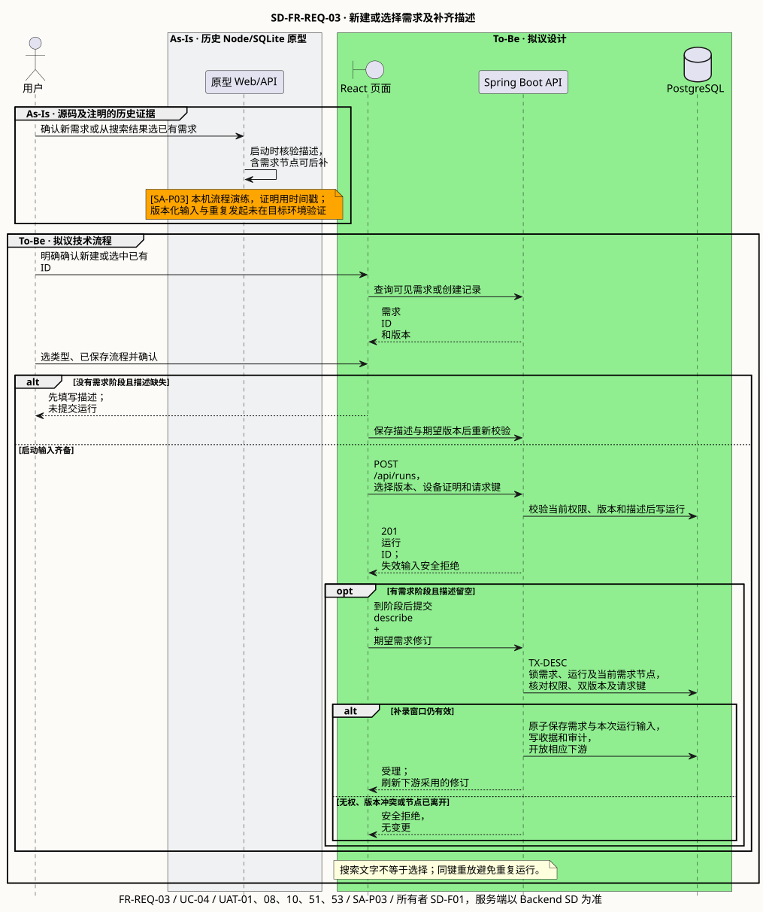

[图源](diagrams/sd-fr-req-03.puml) · [SA 专属图](../SA/diagrams/sa-fr-req-03.svg) · SA-P03 · UAT-10、51、53

| 设计口径 | 约束 |
|---|---|
| 入参与可观察输出 | 已确认具体需求；描述已齐或流程含需求阶段。后续适用节点可读取有效描述。 |
| 事务、并发和恢复 | TX-RUN 处理启动，TX-DESC 处理已到需求节点的补录。目标需求和本次运行输入同事务更新，其他运行保留原快照。 |
| 接口、数据和依赖 | requirement、workflow_version、run_requirement_revision。见 [DML-REQ-03](data/dml-catalog.md)、[API v1 草案](contracts/agentship-v1.json)及[中间件](SD-AgentShip-middleware.md) MW-01 MW-02。 |
| 错误、禁止效果及验证 | 缺描述或选择失效时按流程条件拒绝。重试、重复请求及不确定结果按专属图和契约裁决。UAT-10、51、53。 |

### FR-REQ-04

**主负责人启动权限** · UC-04 · Logic · 平台／身份和配置，执行或证据边界见专属图

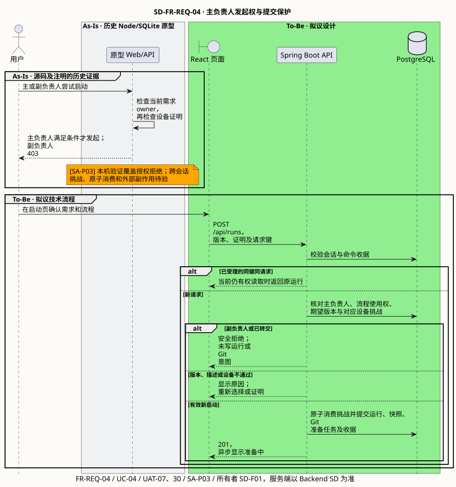

[图源](diagrams/sd-fr-req-04.puml) · [SA 专属图](../SA/diagrams/sa-fr-req-04.svg) · SA-P03 · UAT-30、52

| 设计口径 | 约束 |
|---|---|
| 入参与可观察输出 | 提交时用户是当前需求主负责人且设备证明有效。发起获准。 |
| 事务、并发和恢复 | TX-RUN。校验与运行、快照、首次任务同事务。 |
| 接口、数据和依赖 | configuration、device_challenge、run。见 [DML-REQ-04](data/dml-catalog.md)、[API v1 草案](contracts/agentship-v1.json)及[中间件](SD-AgentShip-middleware.md) MW-01 MW-02 MW-05。 |
| 错误、禁止效果及验证 | 旧角色或旧挑战不建运行／Git 任务。重试、重复请求及不确定结果按专属图和契约裁决。UAT-30、52。 |

### FR-RUN-01

**工作类型和已有流程选择** · UC-04 · Contract · 平台／调度和证据，执行或证据边界见专属图

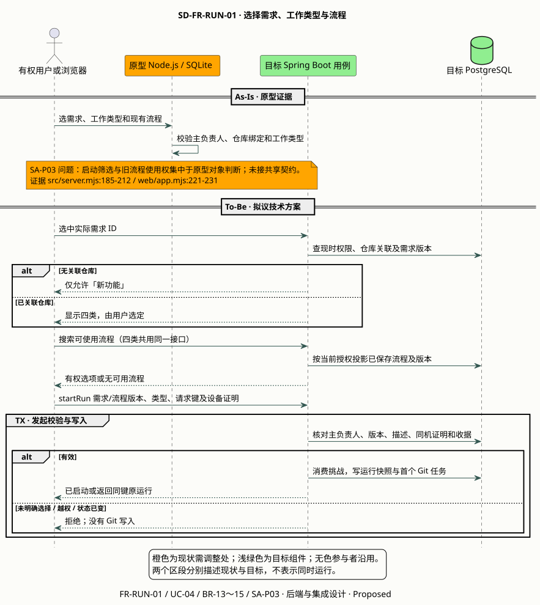

[图源](diagrams/sd-fr-run-01.puml) · [SA 专属图](../SA/diagrams/sa-fr-run-01.svg) · SA-P03 · UAT-01、09、10、16、52

| 设计口径 | 约束 |
|---|---|
| 入参与可观察输出 | 未关联仓库固定新功能；已有仓库显式选四类之一，流程可使用。请求进入设备与 Git 准备。 |
| 事务、并发和恢复 | TX-RUN。校验与运行、快照、首次任务同事务。 |
| 接口、数据和依赖 | requirement、workflow_version、command_receipt、run。见 [DML-RUN-01](data/dml-catalog.md)、[API v1 草案](contracts/agentship-v1.json)及[中间件](SD-AgentShip-middleware.md) MW-01 MW-02 MW-05。 |
| 错误、禁止效果及验证 | 拒绝不合法工作类型、无权选择或键复用冲突。重试、重复请求及不确定结果按专属图和契约裁决。UAT-01、09、10、16、52。 |

### FR-FLOW-01

**阶段、节点及唯一结束标记** · UC-03 · Logic · 平台／调度和证据

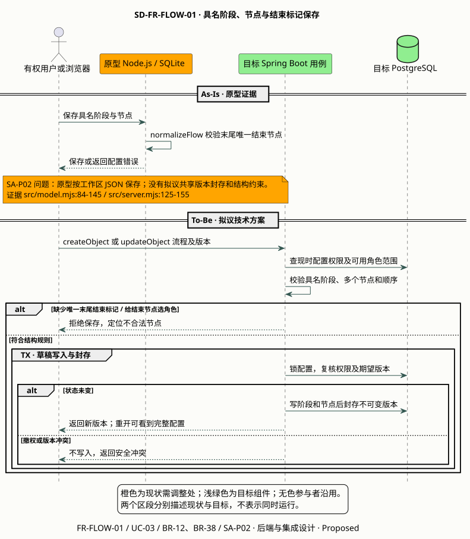

[图源](diagrams/sd-fr-flow-01.puml) · [SA 专属图](../SA/diagrams/sa-fr-flow-01.svg) · SA-P02 · UAT-08、35

| 设计口径 | 约束 |
|---|---|
| 入参与可观察输出 | 定义完整，只有一个末尾结束节点。可重新打开或供后续运行选择。 |
| 事务、并发和恢复 | TX-CFG。核验与写入同事务，版本冲突整条回滚。 |
| 接口、数据和依赖 | workflow_version、workflow_stage、workflow_node。见 [DML-FLOW-01](data/dml-catalog.md)、[API v1 草案](contracts/agentship-v1.json)及[中间件](SD-AgentShip-middleware.md) MW-01。 |
| 错误、禁止效果及验证 | 无唯一末尾结束标记时不得封存。重试、重复请求及不确定结果按专属图和契约裁决。UAT-08、35。 |

### FR-FLOW-02

**跨阶段依赖和循环校验** · UC-03 · No Change · 平台／调度和证据

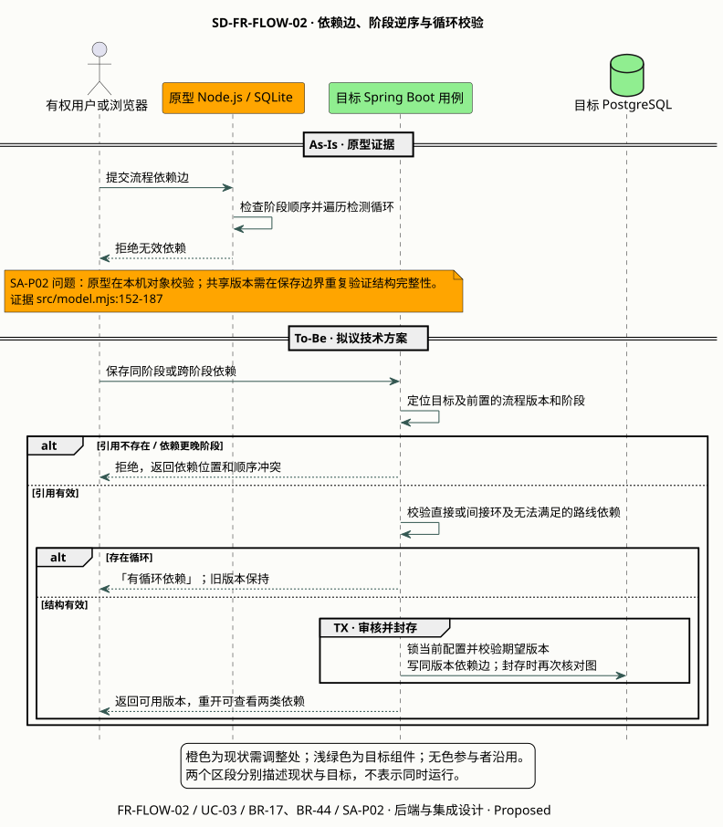

[图源](diagrams/sd-fr-flow-02.puml) · [SA 专属图](../SA/diagrams/sa-fr-flow-02.svg) · SA-P02 · UAT-08、42

| 设计口径 | 约束 |
|---|---|
| 入参与可观察输出 | 同一流程的同阶段或更早阶段，且引用无环。配置可用于就绪判断。 |
| 事务、并发和恢复 | TX-CFG。核验与写入同事务，版本冲突整条回滚。 |
| 接口、数据和依赖 | workflow_dependency、workflow_stage、workflow_version。见 [DML-FLOW-02](data/dml-catalog.md)、[API v1 草案](contracts/agentship-v1.json)及[中间件](SD-AgentShip-middleware.md) MW-01。 |
| 错误、禁止效果及验证 | 循环、失效或逆向引用不封存。重试、重复请求及不确定结果按专属图和契约裁决。UAT-08、42。 |

### FR-FLOW-03

**阶段屏障、共同前置与顺序** · UC-05 · Logic · 平台／调度和证据，执行或证据边界见专属图

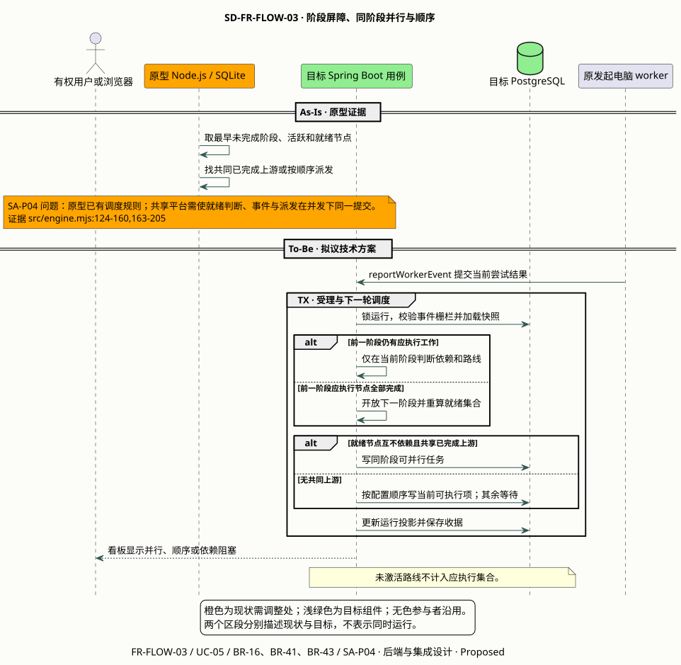

[图源](diagrams/sd-fr-flow-03.puml) · [SA 专属图](../SA/diagrams/sa-fr-flow-03.svg) · SA-P04 · UAT-38、40、41

| 设计口径 | 约束 |
|---|---|
| 入参与可观察输出 | 上阶段应执行节点结束且各自前置与产物满足。仅开放本轮具备条件的节点。 |
| 事务、并发和恢复 | TX-TASK。领取按运行和任务锁序核对当前路线，回报按尝试栅栏复核并原子推进。 |
| 接口、数据和依赖 | node_execution、role_task、task_attempt。见 [DML-FLOW-03](data/dml-catalog.md)、[API v1 草案](contracts/agentship-v1.json)及[中间件](SD-AgentShip-middleware.md) MW-01 MW-03 MW-05。 |
| 错误、禁止效果及验证 | 阶段或依赖不满足不得创建可领取工作。重试、重复请求及不确定结果按专属图和契约裁决。UAT-38、40、41。 |

### FR-FLOW-04

**并行路线汇合和完成判定** · UC-08 · Logic · 平台／调度和证据

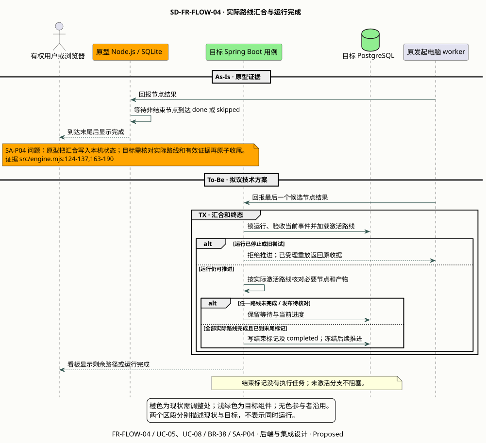

[图源](diagrams/sd-fr-flow-04.puml) · [SA 专属图](../SA/diagrams/sa-fr-flow-04.svg) · SA-P04 · UAT-35、39

| 设计口径 | 约束 |
|---|---|
| 入参与可观察输出 | 实际选中路线和应执行节点均已完成。看板显示已完成。 |
| 事务、并发和恢复 | TX-TASK。领取按运行和任务锁序核对当前路线，回报按尝试栅栏复核并原子推进。 |
| 接口、数据和依赖 | run、node_execution。见 [DML-FLOW-04](data/dml-catalog.md)、[API v1 草案](contracts/agentship-v1.json)及[中间件](SD-AgentShip-middleware.md) MW-01 MW-03。 |
| 错误、禁止效果及验证 | 实际路线或开发交付证据未满足时不得提前完成。重试、重复请求及不确定结果按专属图和契约裁决。UAT-35、39。 |

### FR-FLOW-05

**流程修改与运行快照** · UC-03 · Logic · 平台／调度和证据

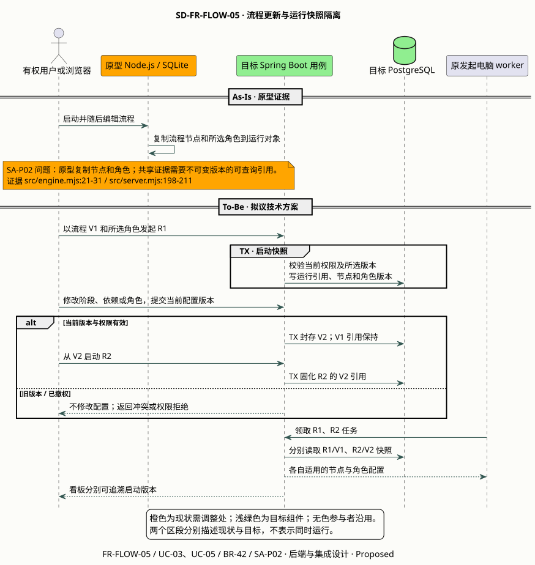

[图源](diagrams/sd-fr-flow-05.puml) · [SA 专属图](../SA/diagrams/sa-fr-flow-05.svg) · SA-P02 · UAT-04、11

| 设计口径 | 约束 |
|---|---|
| 入参与可观察输出 | 新版本有效；既有运行已固定旧版本。可按运行回查使用版本。 |
| 事务、并发和恢复 | TX-CFG。核验与写入同事务，版本冲突整条回滚。 |
| 接口、数据和依赖 | workflow_version、workflow_role、run。见 [DML-FLOW-05](data/dml-catalog.md)、[API v1 草案](contracts/agentship-v1.json)及[中间件](SD-AgentShip-middleware.md) MW-01。 |
| 错误、禁止效果及验证 | 旧运行始终使用既有引用。重试、重复请求及不确定结果按专属图和契约裁决。UAT-04、11。 |

### FR-FLOW-06

**检查双分支和实际路线选择** · UC-07 · Logic · 平台／调度和证据，执行或证据边界见专属图

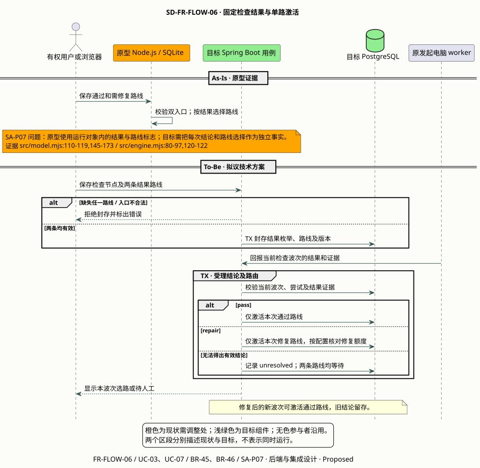

[图源](diagrams/sd-fr-flow-06.puml) · [SA 专属图](../SA/diagrams/sa-fr-flow-06.svg) · SA-P07 · UAT-43、44、50

| 设计口径 | 约束 |
|---|---|
| 入参与可观察输出 | 两条路线完整，本次结论是通过或需修复。看板反映本波选中的路线。 |
| 事务、并发和恢复 | TX-CHECK。保留原波次，复查或暂停按当前状态处理。 |
| 接口、数据和依赖 | workflow_check、workflow_route_node、check_wave。见 [DML-FLOW-06](data/dml-catalog.md)、[API v1 草案](contracts/agentship-v1.json)及[中间件](SD-AgentShip-middleware.md) MW-01 MW-03。 |
| 错误、禁止效果及验证 | 不完整分支不能封存；无结论阻塞。重试、重复请求及不确定结果按专属图和契约裁决。UAT-43、44、50。 |

### FR-FLOW-07

**缺失检查结论与重新检查** · UC-07 · Logic · 平台／调度和证据，执行或证据边界见专属图

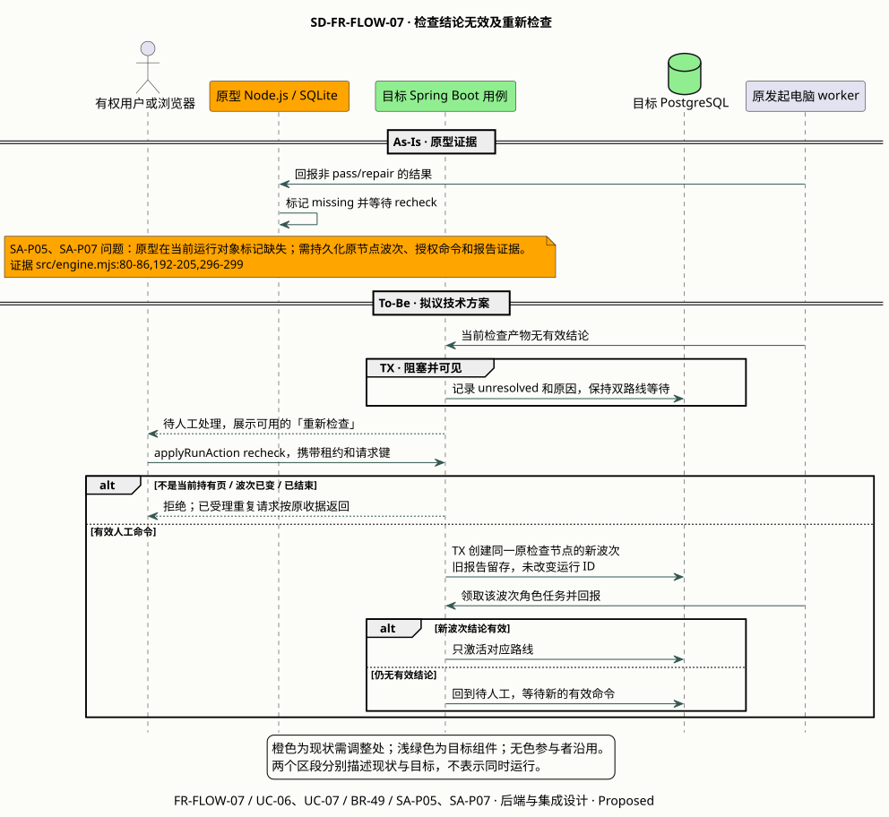

[图源](diagrams/sd-fr-flow-07.puml) · [SA 专属图](../SA/diagrams/sa-fr-flow-07.svg) · SA-P07 · UAT-50

| 设计口径 | 约束 |
|---|---|
| 入参与可观察输出 | 仍是当前操作者且原节点处于可重查状态。有效结果开放对应路线。 |
| 事务、并发和恢复 | TX-CHECK。保留原波次，复查或暂停按当前状态处理。 |
| 接口、数据和依赖 | check_cycle、check_wave、chat_lease。见 [DML-FLOW-07](data/dml-catalog.md)、[API v1 草案](contracts/agentship-v1.json)及[中间件](SD-AgentShip-middleware.md) MW-01 MW-03。 |
| 错误、禁止效果及验证 | 状态失效或越权时不产生重查。重试、重复请求及不确定结果按专属图和契约裁决。UAT-50。 |

### FR-FLOW-08

**各检查独立修复、同节点复查** · UC-07 · Logic · 平台／调度和证据，执行或证据边界见专属图

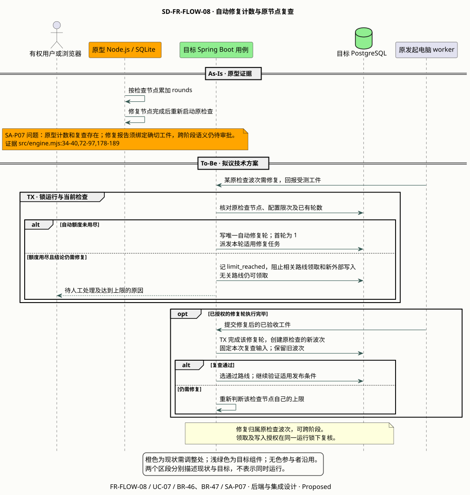

[图源](diagrams/sd-fr-flow-08.puml) · [SA 专属图](../SA/diagrams/sa-fr-flow-08.svg) · SA-P07 · UAT-45、46、47、49

| 设计口径 | 约束 |
|---|---|
| 入参与可观察输出 | 该检查尚有自动次数。通过时继续，否则按剩余次数判断。 |
| 事务、并发和恢复 | TX-CHECK。保留原波次，复查或暂停按当前状态处理。 |
| 接口、数据和依赖 | check_cycle、repair_round、check_wave。见 [DML-FLOW-08](data/dml-catalog.md)、[API v1 草案](contracts/agentship-v1.json)及[中间件](SD-AgentShip-middleware.md) MW-01 MW-03。 |
| 错误、禁止效果及验证 | 到上限时阻止该路线及依赖的领取和新增外部写入授权，无关路线继续。旧波次无权推进。重试、重复请求及不确定结果按专属图和契约裁决。UAT-45、46、47、49。 |

### FR-FLOW-09

**达到上限后的额外一轮或停止** · UC-07 · Logic · 平台／调度和证据，执行或证据边界见专属图

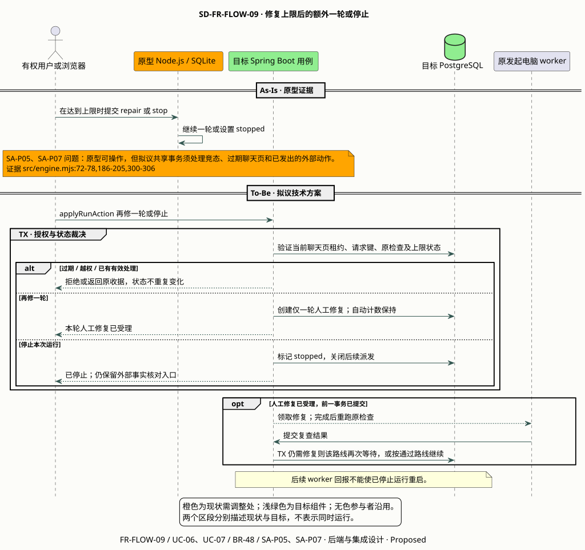

[图源](diagrams/sd-fr-flow-09.puml) · [SA 专属图](../SA/diagrams/sa-fr-flow-09.svg) · SA-P07 · UAT-48

| 设计口径 | 约束 |
|---|---|
| 入参与可观察输出 | 当前页获权，状态和目标检查匹配。更新等待、继续或已停止状态。 |
| 事务、并发和恢复 | TX-CHECK。保留原波次，复查或暂停按当前状态处理。 |
| 接口、数据和依赖 | repair_round、chat_lease、run。见 [DML-FLOW-09](data/dml-catalog.md)、[API v1 草案](contracts/agentship-v1.json)及[中间件](SD-AgentShip-middleware.md) MW-01 MW-03。 |
| 错误、禁止效果及验证 | 无权或重复命令不增加轮次。重试、重复请求及不确定结果按专属图和契约裁决。UAT-48。 |

### FR-AG-01

**按需选协调者和三名以上子 Agent** · UC-05 · Logic · 平台／调度和证据，执行或证据边界见专属图

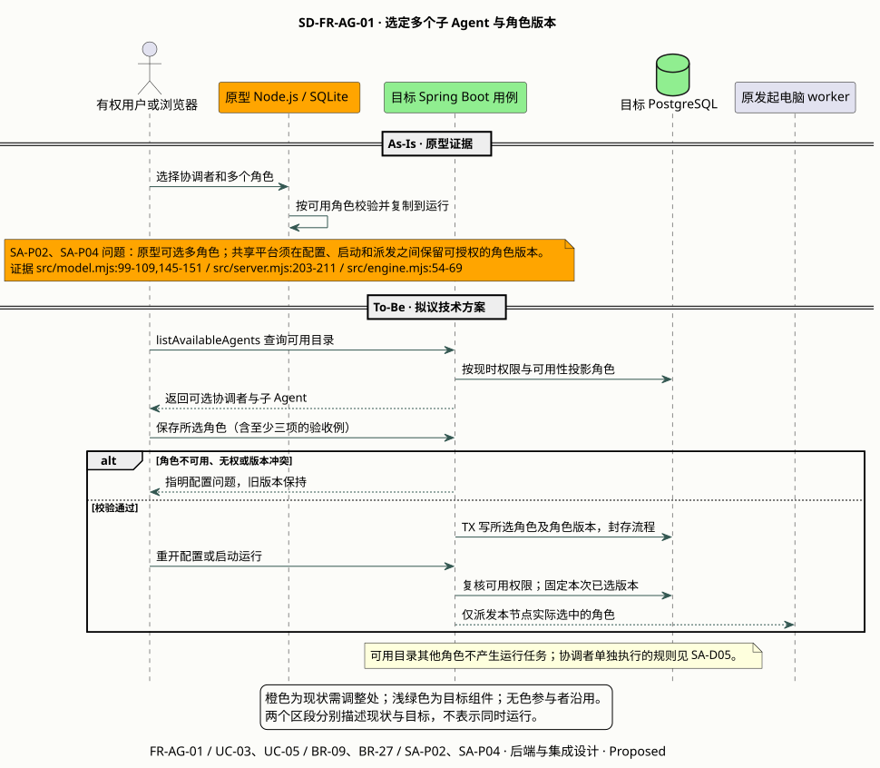

[图源](diagrams/sd-fr-ag-01.puml) · [SA 专属图](../SA/diagrams/sa-fr-ag-01.svg) · SA-P04 · UAT-04、20、EXT-01

| 设计口径 | 约束 |
|---|---|
| 入参与可观察输出 | 每个已选角色可用且有使用权限。至少可核对三个已选与一个未选。 |
| 事务、并发和恢复 | TX-CFG。核验与写入同事务，版本冲突整条回滚。 |
| 接口、数据和依赖 | agent_version、workflow_role、role_task。见 [DML-AG-01](data/dml-catalog.md)、[API v1 草案](contracts/agentship-v1.json)及[中间件](SD-AgentShip-middleware.md) MW-01 MW-03 MW-05。 |
| 错误、禁止效果及验证 | 不可用或无权角色不给任务。重试、重复请求及不确定结果按专属图和契约裁决。UAT-04、20、EXT-01。 |

### FR-AG-02

**子 Agent 有序／默认并行** · UC-05 · Logic · 平台／调度和证据，执行或证据边界见专属图

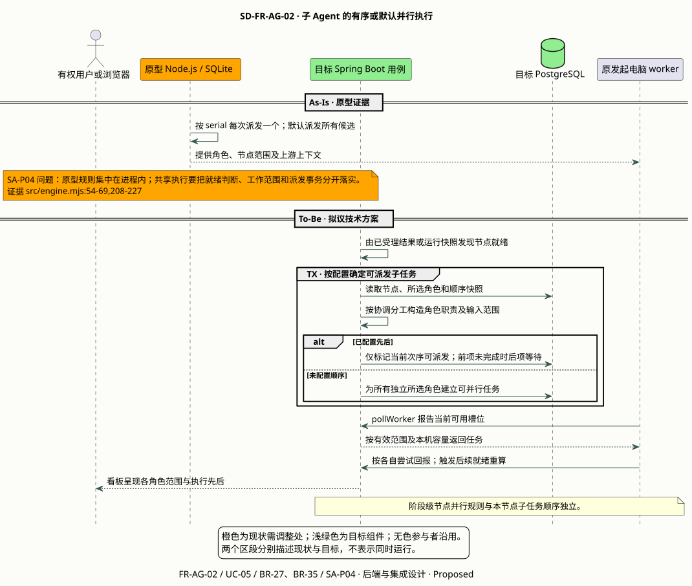

[图源](diagrams/sd-fr-ag-02.puml) · [SA 专属图](../SA/diagrams/sa-fr-ag-02.svg) · SA-P04 · UAT-20、31、EXT-01

| 设计口径 | 约束 |
|---|---|
| 入参与可观察输出 | 各角色满足前置与本机容量。可查看角色顺序和执行状态。 |
| 事务、并发和恢复 | TX-TASK。领取按运行和任务锁序核对当前路线，回报按尝试栅栏复核并原子推进。 |
| 接口、数据和依赖 | workflow_role、role_task、task_attempt。见 [DML-AG-02](data/dml-catalog.md)、[API v1 草案](contracts/agentship-v1.json)及[中间件](SD-AgentShip-middleware.md) MW-01 MW-03 MW-05。 |
| 错误、禁止效果及验证 | 先后条件不满足不提前领取。重试、重复请求及不确定结果按专属图和契约裁决。UAT-20、31、EXT-01。 |

### FR-AG-03

**角色间交接和人与 Agent 双向通信** · UC-05 · Contract · 平台／调度和证据，执行或证据边界见专属图

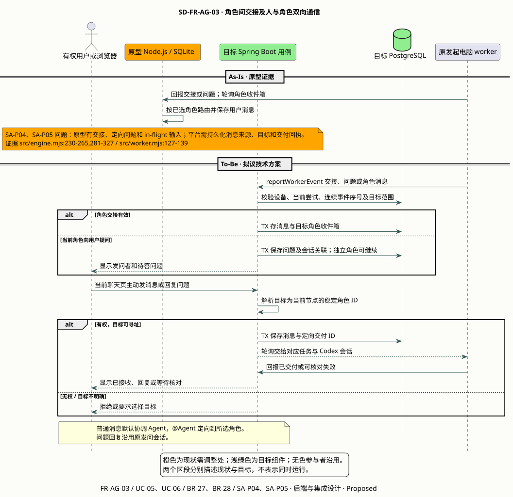

[图源](diagrams/sd-fr-ag-03.puml) · [SA 专属图](../SA/diagrams/sa-fr-ag-03.svg) · SA-P04 · UAT-05、20、21、22

| 设计口径 | 约束 |
|---|---|
| 入参与可观察输出 | 普通消息默认发给当前节点的协调 Agent，用户也可用 `@Agent` 指定该节点的 Agent。定向解析后保存目标角色及投递记录。 |
| 事务、并发和恢复 | TX-CHAT。相关状态、答复／请求、审计同事务。 |
| 接口、数据和依赖 | chat_message、agent_inbox、task_event。见 [DML-AG-03](data/dml-catalog.md)、[API v1 草案](contracts/agentship-v1.json)及[中间件](SD-AgentShip-middleware.md) MW-01 MW-03 MW-05。 |
| 错误、禁止效果及验证 | 无权或目标不匹配拒绝；主动消息接口缺口见 SD-C03。重试、重复请求及不确定结果按专属图和契约裁决。UAT-05、20、21、22。 |

### FR-AG-04

**收齐成功结果并形成最终产物** · UC-05 · Logic · 平台／调度和证据，执行或证据边界见专属图

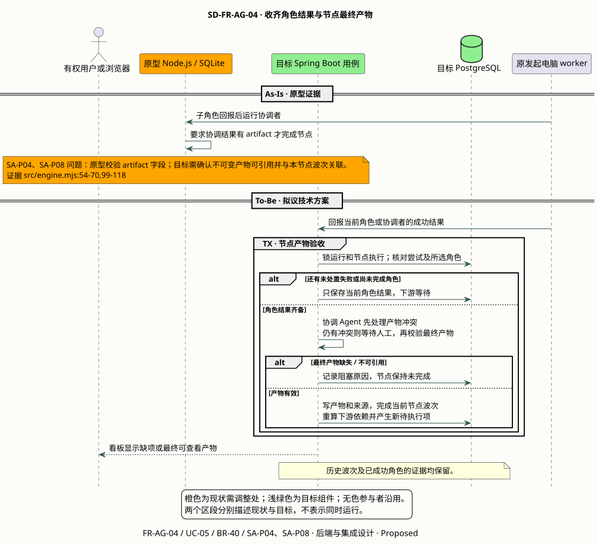

[图源](diagrams/sd-fr-ag-04.puml) · [SA 专属图](../SA/diagrams/sa-fr-ag-04.svg) · SA-P04 · UAT-37

| 设计口径 | 约束 |
|---|---|
| 入参与可观察输出 | 所选角色均成功或已由当前操作者跳过失败项，最终产物可引用。下游可读取该节点最终产物。 |
| 事务、并发和恢复 | TX-TASK。领取按运行和任务锁序核对当前路线，回报按尝试栅栏复核并原子推进。 |
| 接口、数据和依赖 | role_task、task_attempt、artifact、node_execution。见 [DML-AG-04](data/dml-catalog.md)、[API v1 草案](contracts/agentship-v1.json)及[中间件](SD-AgentShip-middleware.md) MW-01 MW-03。 |
| 错误、禁止效果及验证 | 缺成功结果或产物时不释放下游。重试、重复请求及不确定结果按专属图和契约裁决。UAT-37。 |

### FR-AG-05

**重试或跳过失败子 Agent** · UC-05 · Logic · 平台／调度和证据，执行或证据边界见专属图

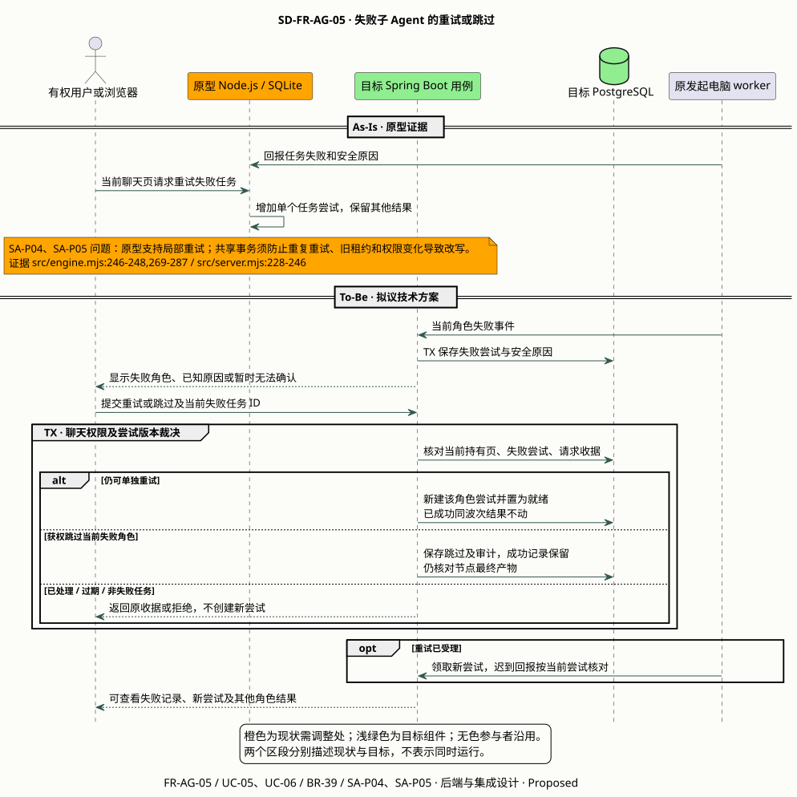

[图源](diagrams/sd-fr-ag-05.puml) · [SA 专属图](../SA/diagrams/sa-fr-ag-05.svg) · SA-P04 · UAT-36、EXT-02

| 设计口径 | 约束 |
|---|---|
| 入参与可观察输出 | 当前页有权时可重试或跳过失败角色。保留已有成功结果，跳过仍校验最终产物。 |
| 事务、并发和恢复 | TX-CHAT。相关状态、答复／请求、审计同事务。 |
| 接口、数据和依赖 | role_task、task_attempt、chat_lease。见 [DML-AG-05](data/dml-catalog.md)、[API v1 草案](contracts/agentship-v1.json)及[中间件](SD-AgentShip-middleware.md) MW-01 MW-03 MW-05。 |
| 错误、禁止效果及验证 | 旧租约、重复或非失败角色拒绝。重试、重复请求及不确定结果按专属图和契约裁决。UAT-36、EXT-02。 |

### FR-AG-06

**并发不足时排队或明确等待** · UC-05 · Logic · 平台／调度和证据，执行或证据边界见专属图

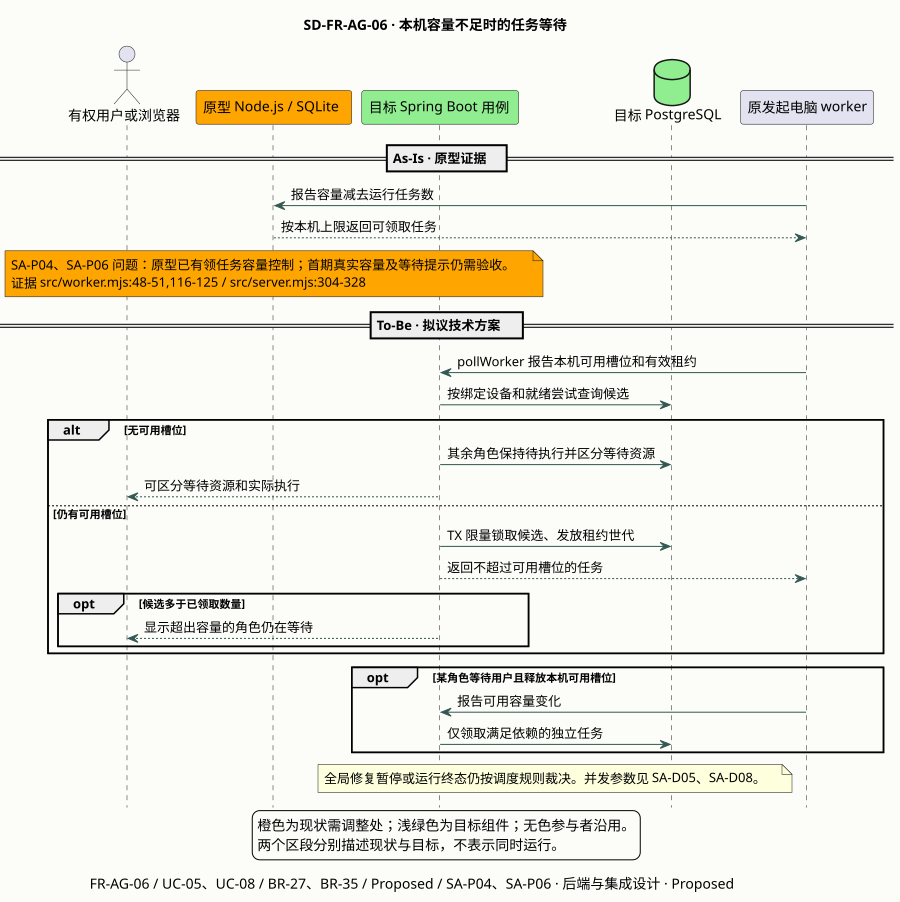

[图源](diagrams/sd-fr-ag-06.puml) · [SA 专属图](../SA/diagrams/sa-fr-ag-06.svg) · SA-P04 · EXT-01

| 设计口径 | 约束 |
|---|---|
| 入参与可观察输出 | 设备绑定、任务可用，仍有容量。恢复容量后可继续领取。 |
| 事务、并发和恢复 | TX-TASK。领取按运行和任务锁序核对当前路线，回报按尝试栅栏复核并原子推进。 |
| 接口、数据和依赖 | device、task_attempt。见 [DML-AG-06](data/dml-catalog.md)、[API v1 草案](contracts/agentship-v1.json)及[中间件](SD-AgentShip-middleware.md) MW-01 MW-03 MW-05。 |
| 错误、禁止效果及验证 | 容量不足时保留未领取项。重试、重复请求及不确定结果按专属图和契约裁决。EXT-01。 |

### FR-RUN-02

**仓库关联、四类分支和缺失 dev** · UC-04 · Logic · 平台／调度和证据，执行或证据边界见专属图

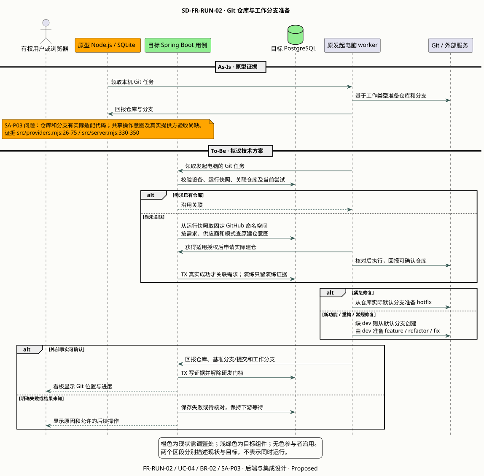

[图源](diagrams/sd-fr-run-02.puml) · [SA 专属图](../SA/diagrams/sa-fr-run-02.svg) · SA-P03 · UAT-01、02、09、16、17

| 设计口径 | 约束 |
|---|---|
| 入参与可观察输出 | 适配器、目标仓库及操作授权有效。记录已核对仓库和分支，开放研发。 |
| 事务、并发和恢复 | TX-EXT。短事务记意图；外部调用在事务外；核对后另事务保存。 |
| 接口、数据和依赖 | run、requirement、repository、external_operation。见 [DML-RUN-02](data/dml-catalog.md)、[API v1 草案](contracts/agentship-v1.json)及[中间件](SD-AgentShip-middleware.md) MW-01 MW-03 MW-06。 |
| 错误、禁止效果及验证 | 失败或未知不释放研发，不盲目重发。重试、重复请求及不确定结果按专属图和契约裁决。UAT-01、02、09、16、17。 |

### FR-RUN-03

**看板、阻塞原因及产物追溯** · UC-08 · Contract · 平台／调度和证据，执行或证据边界见专属图

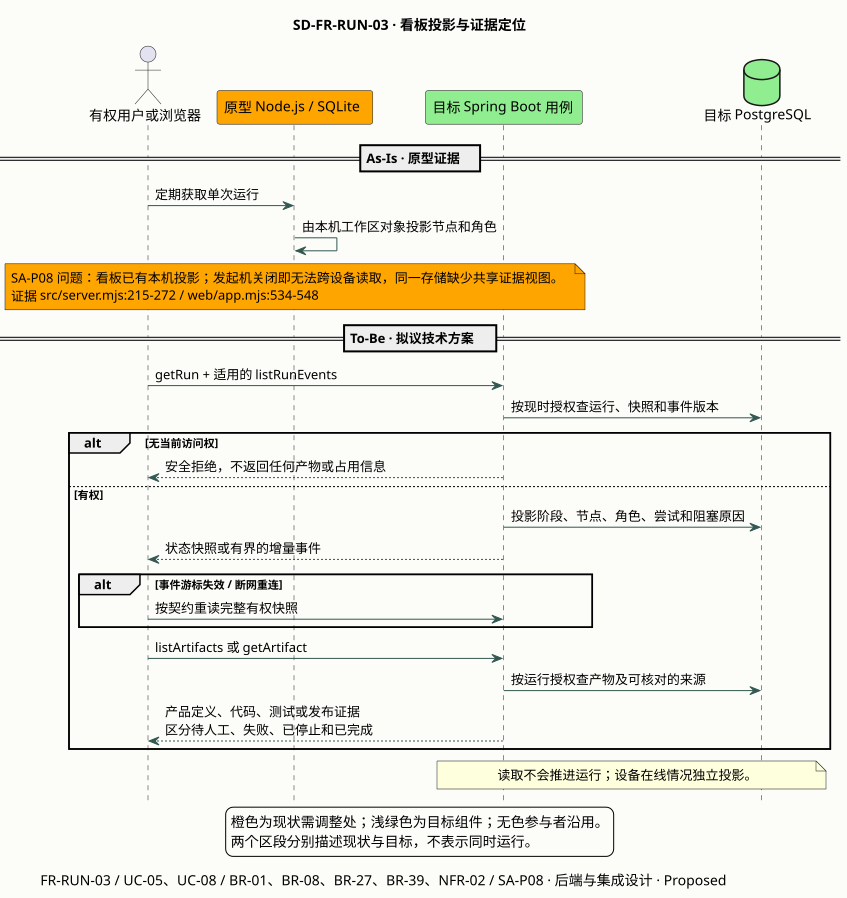

[图源](diagrams/sd-fr-run-03.puml) · [SA 专属图](../SA/diagrams/sa-fr-run-03.svg) · SA-P08 · UAT-01、06、11、27

| 设计口径 | 约束 |
|---|---|
| 入参与可观察输出 | 当前权限允许读取该运行。用户可定位原因与产物。 |
| 事务、并发和恢复 | TX-READ。读取失败或游标冲突不泄漏资源。 |
| 接口、数据和依赖 | run、node_execution、task_attempt、artifact。见 [DML-RUN-03](data/dml-catalog.md)、[API v1 草案](contracts/agentship-v1.json)及[中间件](SD-AgentShip-middleware.md) MW-01 MW-02。 |
| 错误、禁止效果及验证 | 过期或无权视图不覆盖新状态；历史投影缺口见 SD-C04。重试、重复请求及不确定结果按专属图和契约裁决。UAT-01、06、11、27。 |

### FR-RUN-04

**同机执行、另一设备查看和原机续跑** · UC-08 · Logic · 平台／调度和证据，执行或证据边界见专属图

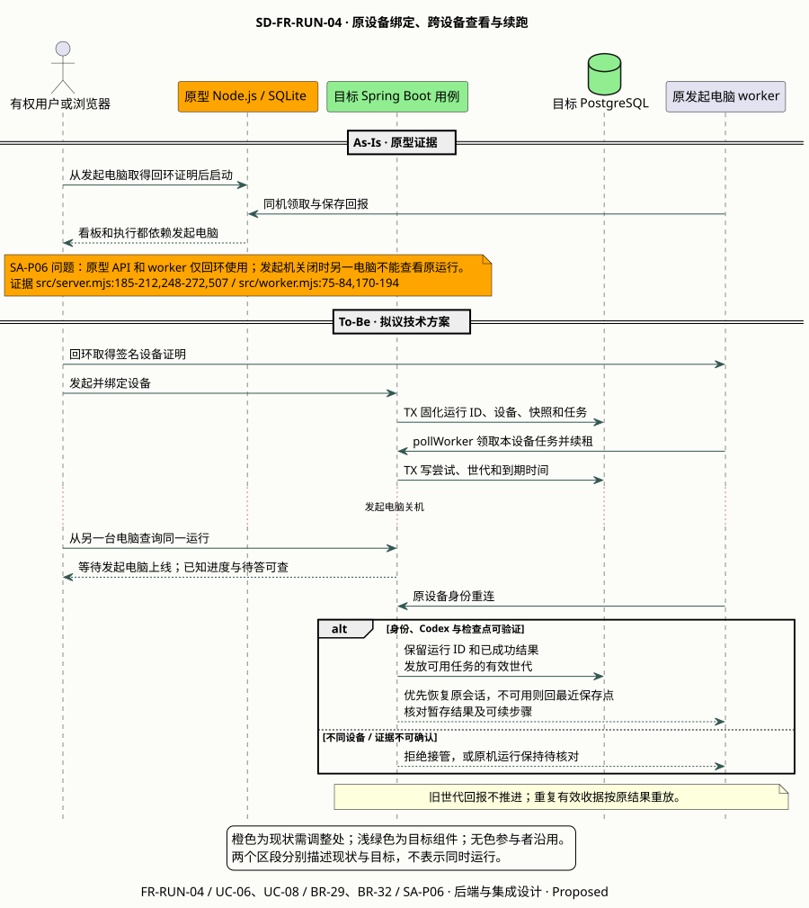

[图源](diagrams/sd-fr-run-04.puml) · [SA 专属图](../SA/diagrams/sa-fr-run-04.svg) · SA-P06 · UAT-22、27、EXT-02

| 设计口径 | 约束 |
|---|---|
| 入参与可观察输出 | 恢复的设备身份等于运行绑定且本机能力可用。另一浏览器可持续查看同一运行。 |
| 事务、并发和恢复 | TX-TASK。领取按运行和任务锁序核对当前路线，回报按尝试栅栏复核并原子推进。 |
| 接口、数据和依赖 | device、role_task、task_attempt、run。见 [DML-RUN-04](data/dml-catalog.md)、[API v1 草案](contracts/agentship-v1.json)及[中间件](SD-AgentShip-middleware.md) MW-01 MW-03 MW-05。 |
| 错误、禁止效果及验证 | 错误设备、迟到或缺号不得改写原运行。重试、重复请求及不确定结果按专属图和契约裁决。UAT-22、27、EXT-02。 |

### FR-RUN-05

**有权恢复、保留历史及外部核对** · UC-08 · Logic · 平台／调度和证据，执行或证据边界见专属图

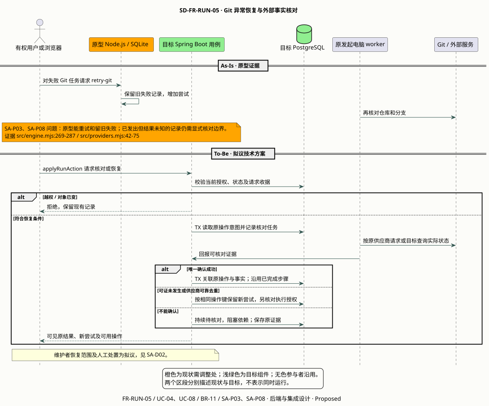

[图源](diagrams/sd-fr-run-05.puml) · [SA 专属图](../SA/diagrams/sa-fr-run-05.svg) · SA-P08 · UAT-02、06、EXT-03

| 设计口径 | 约束 |
|---|---|
| 入参与可观察输出 | 有恢复权且可定位原请求。可查看原结果、核对和新尝试。 |
| 事务、并发和恢复 | TX-EXT。短事务记意图；外部调用在事务外；核对后另事务保存。 |
| 接口、数据和依赖 | external_operation、operation_evidence、audit_event。见 [DML-RUN-05](data/dml-catalog.md)、[API v1 草案](contracts/agentship-v1.json)及[中间件](SD-AgentShip-middleware.md) MW-01 MW-06。 |
| 错误、禁止效果及验证 | 未知不得重复写；终止后授权范围待定。重试、重复请求及不确定结果按专属图和契约裁决。UAT-02、06、EXT-03。 |

### FR-CHAT-01

**获授权运行聊天及定向会话** · UC-06 · Contract · 平台／运行协作，执行或证据边界见专属图

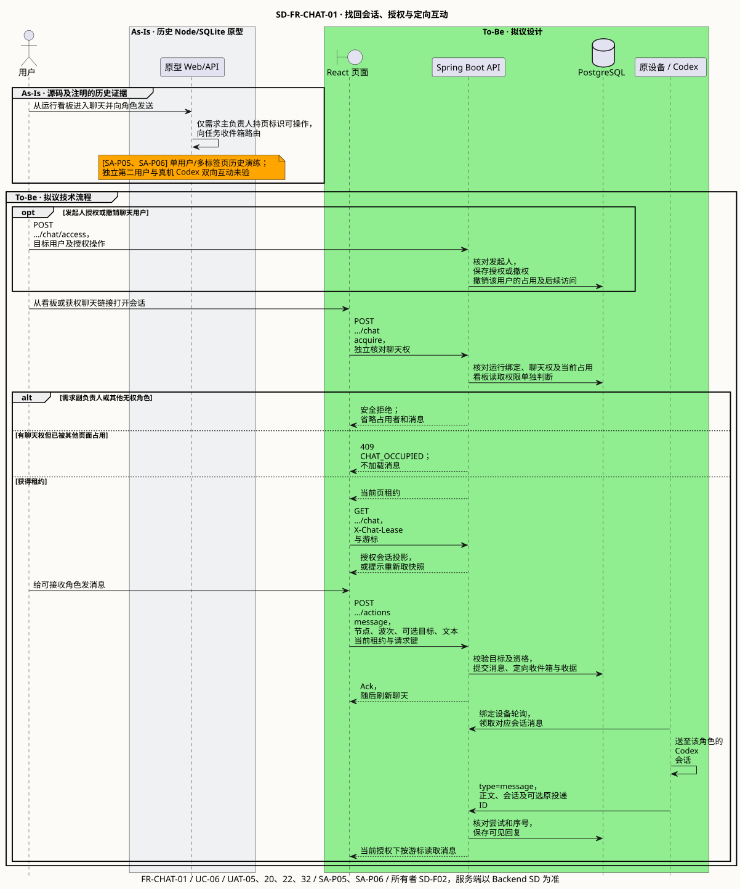

[图源](diagrams/sd-fr-chat-01.puml) · [SA 专属图](../SA/diagrams/sa-fr-chat-01.svg) · SA-P05 · UAT-05、22、32

| 设计口径 | 约束 |
|---|---|
| 入参与可观察输出 | 当前运行访问和聊天权限有效，已取得本页操作权。回看授权会话及其反馈。 |
| 事务、并发和恢复 | TX-CHAT。相关状态、答复／请求、审计同事务。 |
| 接口、数据和依赖 | run_permission、chat_lease、chat_message、agent_inbox。见 [DML-CHAT-01](data/dml-catalog.md)、[API v1 草案](contracts/agentship-v1.json)及[中间件](SD-AgentShip-middleware.md) MW-01 MW-02 MW-03 MW-05。 |
| 错误、禁止效果及验证 | 副负责人或无授权拒绝；普通消息回报缺口见 SD-C03。重试、重复请求及不确定结果按专属图和契约裁决。UAT-05、22、32。 |

### FR-CHAT-02

**单角色等待与定向回复** · UC-06 · Contract · 平台／运行协作，执行或证据边界见专属图

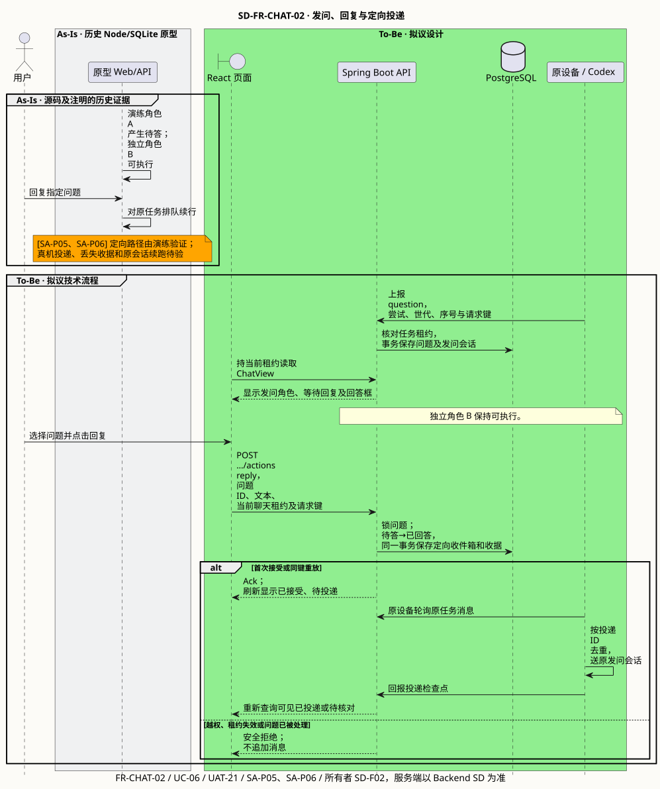

[图源](diagrams/sd-fr-chat-02.puml) · [SA 专属图](../SA/diagrams/sa-fr-chat-02.svg) · SA-P05 · UAT-21、33、EXT-02

| 设计口径 | 约束 |
|---|---|
| 入参与可观察输出 | 该问题仍待答且页操作权有效。发问者继续，其他独立任务不等待。 |
| 事务、并发和恢复 | TX-CHAT。相关状态、答复／请求、审计同事务。 |
| 接口、数据和依赖 | agent_question、question_resolution、agent_inbox。见 [DML-CHAT-02](data/dml-catalog.md)、[API v1 草案](contracts/agentship-v1.json)及[中间件](SD-AgentShip-middleware.md) MW-01 MW-03 MW-05。 |
| 错误、禁止效果及验证 | 越权或已回复不能追加第二次。重试、重复请求及不确定结果按专属图和契约裁决。UAT-21、33、EXT-02。 |

### FR-CHAT-03

**持久问题、发起人取消及继续** · UC-06 · Logic · 平台／运行协作，执行或证据边界见专属图

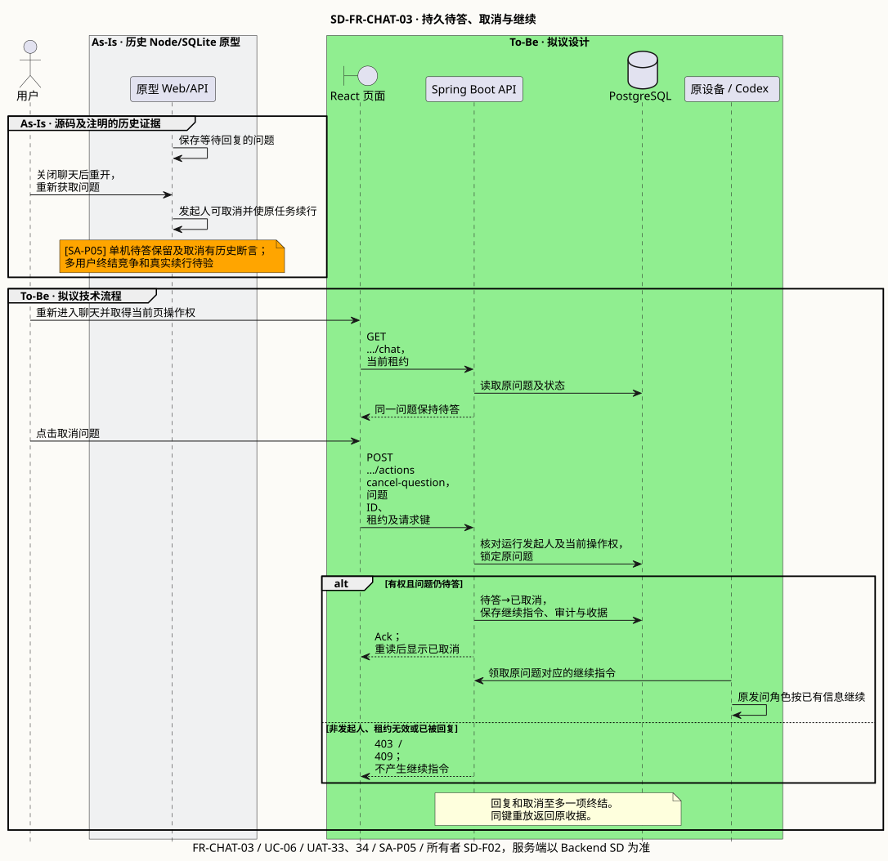

[图源](diagrams/sd-fr-chat-03.puml) · [SA 专属图](../SA/diagrams/sa-fr-chat-03.svg) · SA-P05 · UAT-33、34、EXT-02

| 设计口径 | 约束 |
|---|---|
| 入参与可观察输出 | 问题待答；取消还须当前用户是发起人。保持待答、已回复或已取消。 |
| 事务、并发和恢复 | TX-CHAT。相关状态、答复／请求、审计同事务。 |
| 接口、数据和依赖 | agent_question、question_resolution、agent_inbox。见 [DML-CHAT-03](data/dml-catalog.md)、[API v1 草案](contracts/agentship-v1.json)及[中间件](SD-AgentShip-middleware.md) MW-01 MW-03。 |
| 错误、禁止效果及验证 | 关闭页面不删除问题，其他人不得取消。重试、重复请求及不确定结果按专属图和契约裁决。UAT-33、34、EXT-02。 |

### FR-CHAT-04

**两人／两标签页竞争与退出** · UC-06 · Logic · 平台／运行协作，执行或证据边界见专属图

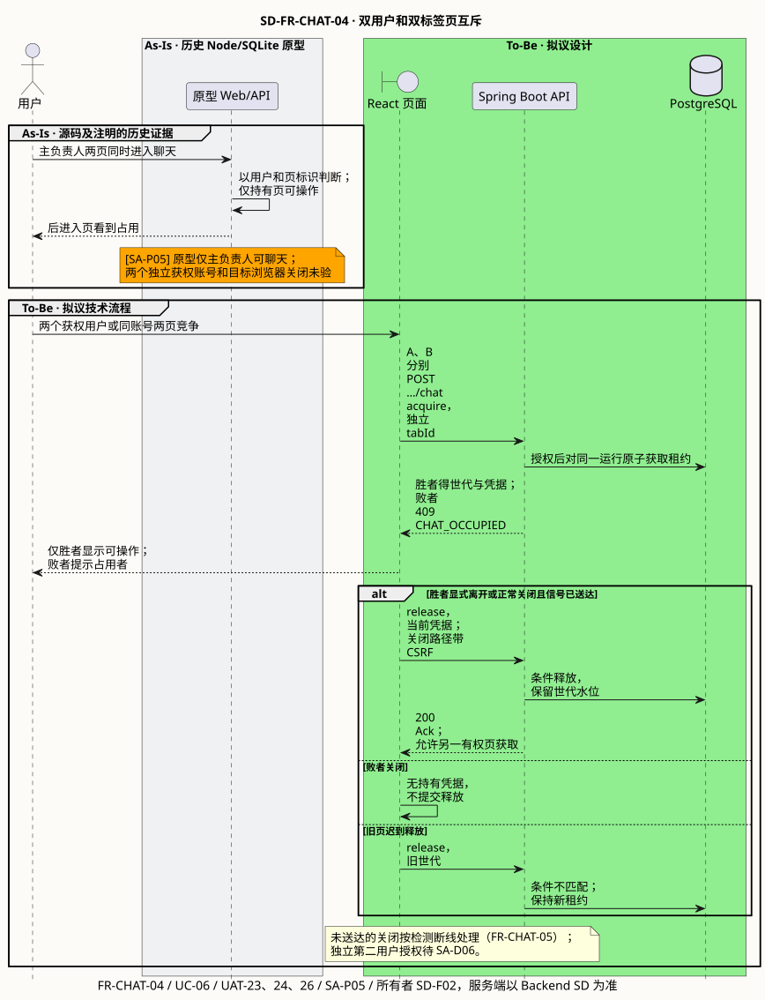

[图源](diagrams/sd-fr-chat-04.puml) · [SA 专属图](../SA/diagrams/sa-fr-chat-04.svg) · SA-P05 · UAT-23、24、26、32

| 设计口径 | 约束 |
|---|---|
| 入参与可观察输出 | 当前账号获聊天授权且可取得唯一占用。竞争者见占用提示，其他有权页可重新申请。 |
| 事务、并发和恢复 | TX-CHAT。相关状态、答复／请求、审计同事务。 |
| 接口、数据和依赖 | run_permission、chat_lease。见 [DML-CHAT-04](data/dml-catalog.md)、[API v1 草案](contracts/agentship-v1.json)及[中间件](SD-AgentShip-middleware.md) MW-01 MW-02。 |
| 错误、禁止效果及验证 | 竞争页拒绝，旧页不能释放新租约。重试、重复请求及不确定结果按专属图和契约裁决。UAT-23、24、26、32。 |

### FR-CHAT-05

**检测断网起五分钟宽限** · UC-06 · Logic · 平台／运行协作，执行或证据边界见专属图

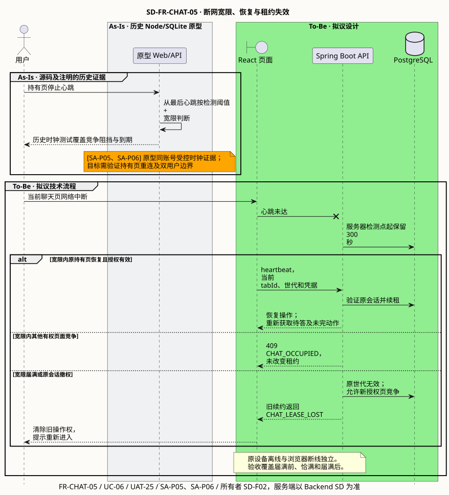

[图源](diagrams/sd-fr-chat-05.puml) · [SA 专属图](../SA/diagrams/sa-fr-chat-05.svg) · SA-P05 · UAT-25、EXT-02

| 设计口径 | 约束 |
|---|---|
| 入参与可观察输出 | 检测后未满五分钟且原页仍可恢复。届满后有权者可重新申请。 |
| 事务、并发和恢复 | TX-CHAT。相关状态、答复／请求、审计同事务。 |
| 接口、数据和依赖 | chat_lease。见 [DML-CHAT-05](data/dml-catalog.md)、[API v1 草案](contracts/agentship-v1.json)及[中间件](SD-AgentShip-middleware.md) MW-01 MW-02。 |
| 错误、禁止效果及验证 | 过期页不获旧权，正常关闭规则另验收。重试、重复请求及不确定结果按专属图和契约裁决。UAT-25、EXT-02。 |

### FR-CHAT-06

**正式变更确认与需求修订** · UC-06 · Logic · 平台／运行协作，执行或证据边界见专属图

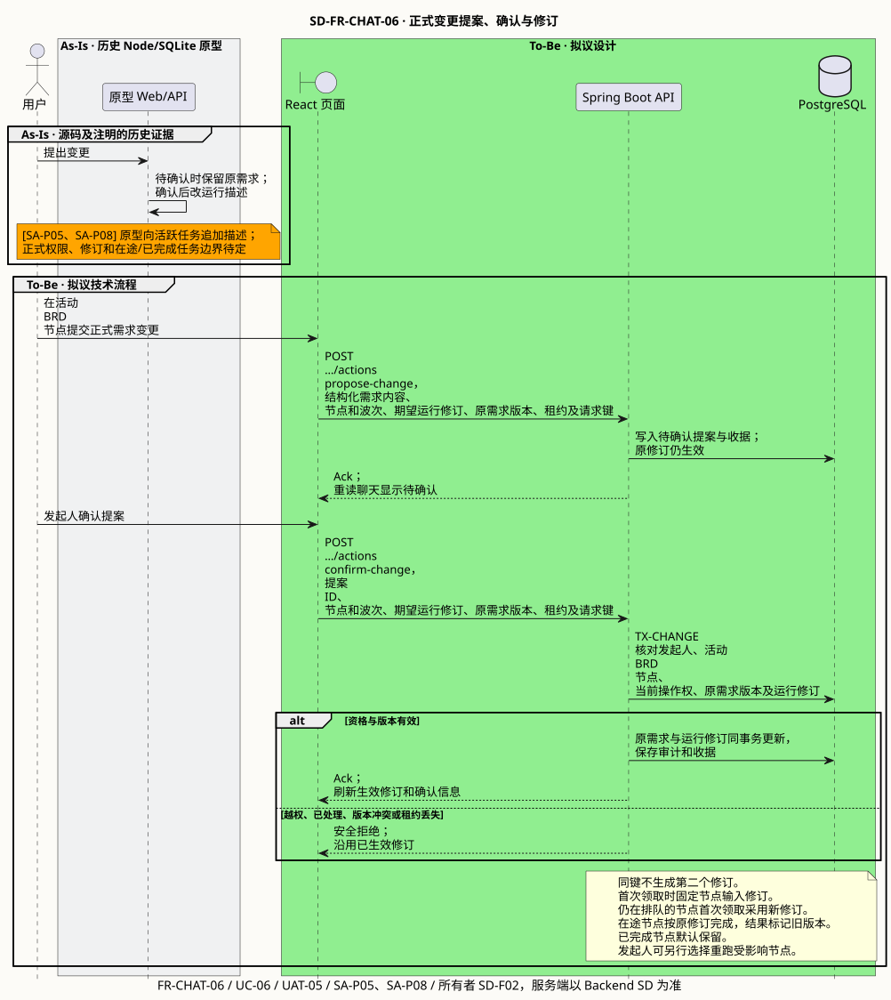

[图源](diagrams/sd-fr-chat-06.puml) · [SA 专属图](../SA/diagrams/sa-fr-chat-06.svg) · SA-P05 · UAT-05

| 设计口径 | 约束 |
|---|---|
| 入参与可观察输出 | 仅在执行中的 BRD 节点内受理。发起人确认有效提案后，尚未开始节点采用新修订。正在执行的节点按启动时的修订完成，结果显示「基于旧版本」。默认保留已完成节点，由发起人按需重跑受影响节点。 |
| 事务、并发和恢复 | TX-CHANGE。提案单独落库。确认时锁定需求、运行、操作权和活动节点，校验原需求版本与运行修订，同事务更新原需求、本次运行修订和审计。 |
| 接口、数据和依赖 | requirement_change、run_requirement_revision、run。见 [DML-CHAT-06](data/dml-catalog.md)、[API v1 草案](contracts/agentship-v1.json)及[中间件](SD-AgentShip-middleware.md) MW-01 MW-03。 |
| 错误、禁止效果及验证 | 未确认或越权时沿用旧修订。重试、重复请求及不确定结果按专属图和契约裁决。UAT-05。 |

### FR-DEL-01

**产品定义与后续引用** · UC-05 · Logic · 平台／调度和证据，执行或证据边界见专属图

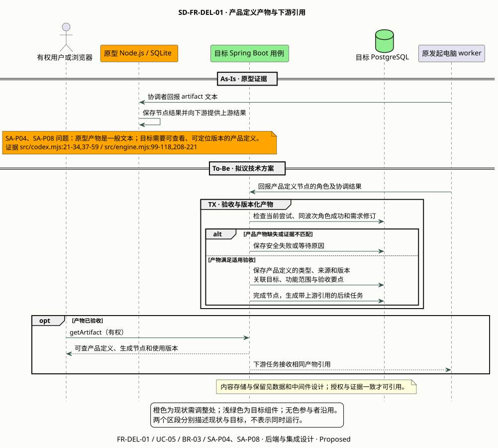

[图源](diagrams/sd-fr-del-01.puml) · [SA 专属图](../SA/diagrams/sa-fr-del-01.svg) · SA-P04 · UAT-01、37

| 设计口径 | 约束 |
|---|---|
| 入参与可观察输出 | 适用需求已确定且产物可引用。后续研发能定位同一产物。 |
| 事务、并发和恢复 | TX-TASK。领取按运行和任务锁序核对当前路线，回报按尝试栅栏复核并原子推进。 |
| 接口、数据和依赖 | artifact、node_execution、run_requirement_revision。见 [DML-DEL-01](data/dml-catalog.md)、[API v1 草案](contracts/agentship-v1.json)及[中间件](SD-AgentShip-middleware.md) MW-01 MW-03 MW-05。 |
| 错误、禁止效果及验证 | 缺最终产物不开放研发。重试、重复请求及不确定结果按专属图和契约裁决。UAT-01、37。 |

### FR-DEL-02

**前后端代码和工作分支证据** · UC-05 · Logic · 平台／调度和证据，执行或证据边界见专属图

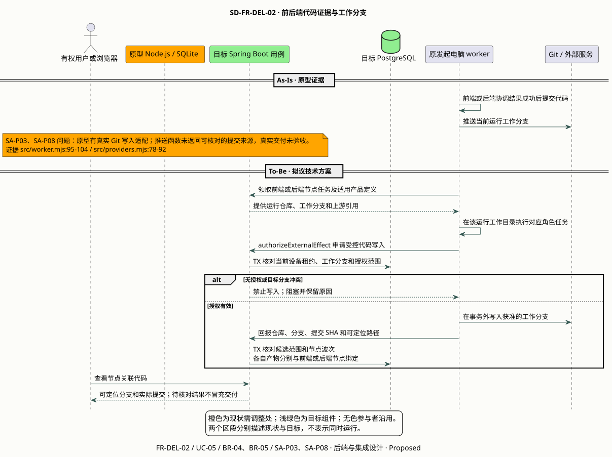

[图源](diagrams/sd-fr-del-02.puml) · [SA 专属图](../SA/diagrams/sa-fr-del-02.svg) · SA-P04 · UAT-01、09

| 设计口径 | 约束 |
|---|---|
| 入参与可观察输出 | 各自来源与本次仓库、工作分支和提交一致。测试可以定位实际代码版本。 |
| 事务、并发和恢复 | TX-EXT。短事务记意图；外部调用在事务外；核对后另事务保存。 |
| 接口、数据和依赖 | artifact、repository、external_operation。见 [DML-DEL-02](data/dml-catalog.md)、[API v1 草案](contracts/agentship-v1.json)及[中间件](SD-AgentShip-middleware.md) MW-01 MW-06。 |
| 错误、禁止效果及验证 | 工件来源不一致时不交付。重试、重复请求及不确定结果按专属图和契约裁决。UAT-01、09。 |

### FR-DEL-03

**测试结论、失败详情和被测代码** · UC-07 · Logic · 平台／调度和证据，执行或证据边界见专属图

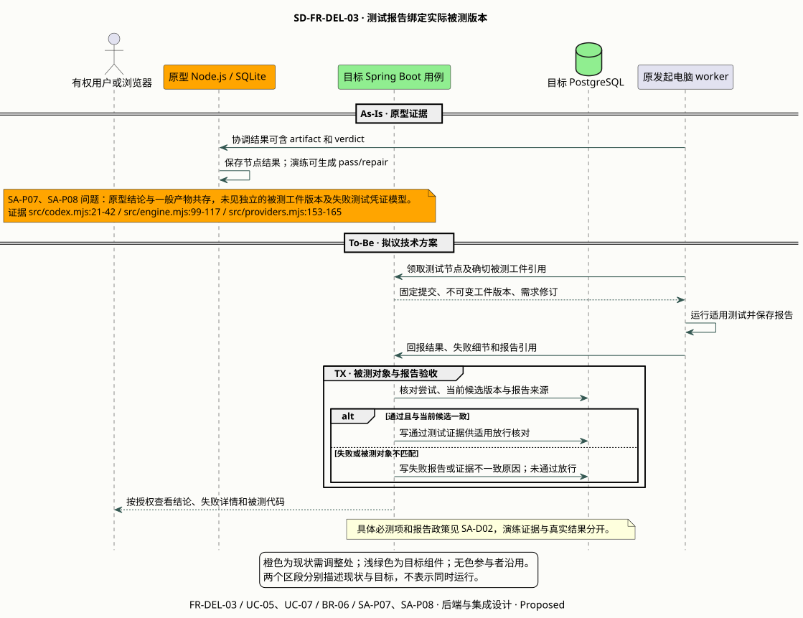

[图源](diagrams/sd-fr-del-03.puml) · [SA 专属图](../SA/diagrams/sa-fr-del-03.svg) · SA-P07 · UAT-01、03、45

| 设计口径 | 约束 |
|---|---|
| 入参与可观察输出 | 测试输入可确定且报告可核对。项目可按权限查看测试证据。 |
| 事务、并发和恢复 | TX-CHECK。保留原波次，复查或暂停按当前状态处理。 |
| 接口、数据和依赖 | artifact、check_wave、node_execution。见 [DML-DEL-03](data/dml-catalog.md)、[API v1 草案](contracts/agentship-v1.json)及[中间件](SD-AgentShip-middleware.md) MW-01 MW-03 MW-05。 |
| 错误、禁止效果及验证 | 失败和未确认测试不满足必测门槛。重试、重复请求及不确定结果按专属图和契约裁决。UAT-01、03、45。 |

### FR-DEL-04

**复查、发布放行与供应商证据** · UC-07 · Deferred · 平台／调度和证据，执行或证据边界见专属图

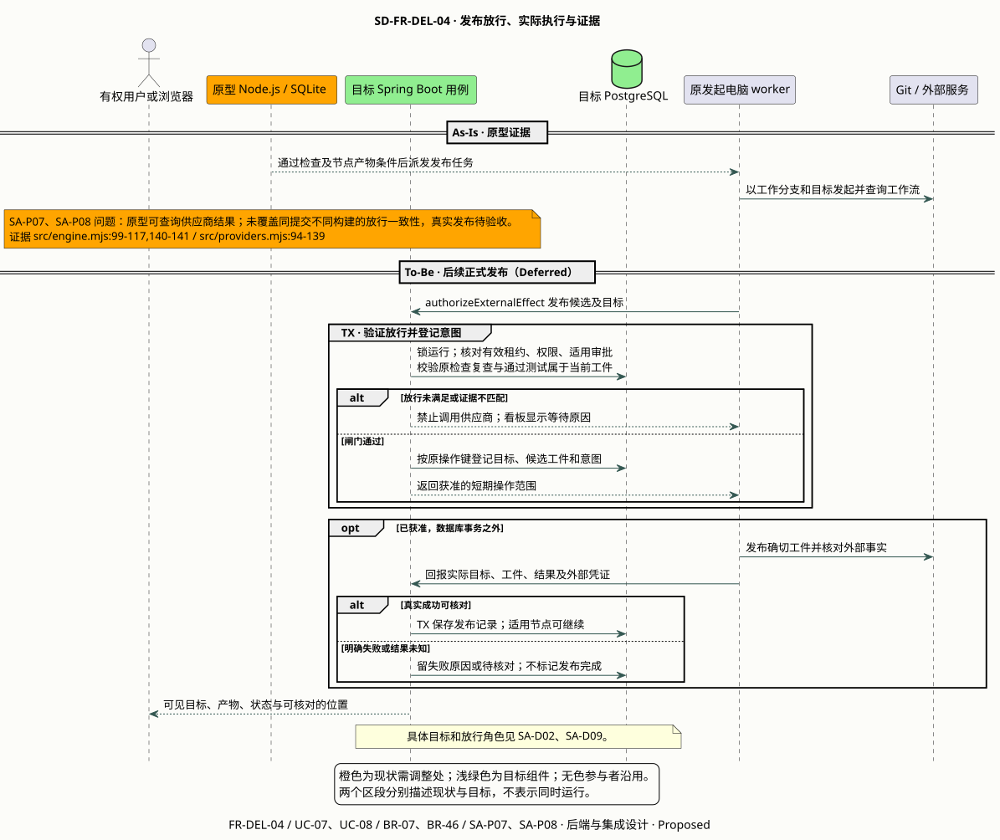

[图源](diagrams/sd-fr-del-04.puml) · [SA 专属图](../SA/diagrams/sa-fr-del-04.svg) · SA-P07 · UAT-01、03、45、EXT-03

| 设计口径 | 约束 |
|---|---|
| 入参与可观察输出 | 准确候选版本经原检查复查通过，必测及适用放行均满足。发布结果和证据位置可查。 |
| 事务、并发和恢复 | TX-EXT。短事务记意图；外部调用在事务外；核对后另事务保存。 |
| 接口、数据和依赖 | publication_gate、publication_check_evidence、external_operation。见 [DML-DEL-04](data/dml-catalog.md)、[API v1 草案](contracts/agentship-v1.json)及[中间件](SD-AgentShip-middleware.md) MW-01 MW-03 MW-06。 |
| 错误、禁止效果及验证 | 同提交其他工件、失败报告、未知结果不准发布或报成功。重试、重复请求及不确定结果按专属图和契约裁决。UAT-03、45 的发布分区及 EXT-03 留待后续。 |

