# AgentShip 后端系统设计 v0.5

基线为 [BRD v0.54](../BRD/AgentShip/BRD-AgentShip.md)、[PRD v0.5](../PRD/PRD-AgentShip.md) 和 [SA v0.5](../SA/SA-AgentShip.md)。Java Spring Boot、PostgreSQL 和 Java 本机执行程序为已确认选型。专图中的 As-Is 以可核对的 Node.js/SQLite 原型为限，To-Be 为 Proposed。共享环境、接入规则与验收状态见 [设计索引](SD-AgentShip-index.md)。

## SD-B01 组件、边界和生命周期

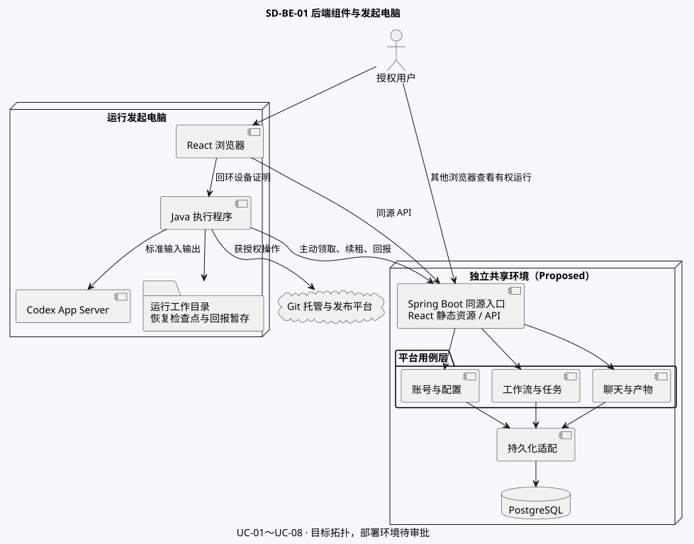

图中连线表示依赖或调用方向。覆盖 UC-01～08，重点说明 BR-29、BR-32 的原机执行及跨设备查看。

| 组件 | 技术职责 |
|---|---|
| 平台 HTTP | 同源静态文件与 JSON API，校验身份、来源、字段，统一响应与请求标识。 |
| 用例层与领域规则 | 用例层组织授权、事务及审计。领域规则计算版本、权限、调度、完成和恢复，与 HTTP、JDBC 及供应商 SDK 解耦。 |
| PostgreSQL 适配 | 共享业务状态、版本、任务、租约、会话投影和证据的持久化。以 [数据设计、DDL 与 DML](SD-AgentShip-data.md) 为准。 |
| 本机执行程序 | 在发起电脑隔离工作目录，维护 Codex 会话、检查点及回报暂存，按有效租约和授权执行。 |

浏览器、平台和设备分别有独立生命周期。其他浏览器可按当前权限查看同一运行。当前允许回环开发与测试。共享入口、证书和网络边界待批准，见 [中间件](SD-AgentShip-middleware.md)。

## SD-B02 身份、权限与隐私

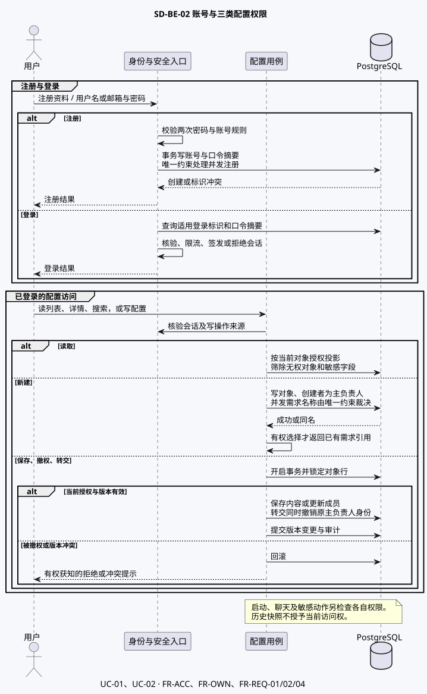

图中三类对象为需求、Agent 和流程，覆盖 UC-01、UC-02、FR-ACC-01～02、FR-OWN-01～03、FR-REQ-01～02。

- 写入使用当前身份、对象关系及预期版本。同一对象的保存、撤权和转交锁定同一对象行。转交在一次事务内改主负责人，移除原角色并记录审计。
- 无权账号在列表、搜索或详情中得不到对象或其联系方式。需求同名时，仅有权选择的主体可获原引用。撤销前确实可编辑的人仅能得到面向自己的撤权提示。
- 运行启动仅限需求主负责人。需求副负责人可在授权列表看到需求，并可编辑。该身份不授予启动或聊天权。发起人可授予或撤销其他注册用户的运行聊天权限。撤权后关闭该账号占用及读写权限，需求副负责人仍禁止聊天。
- 平台以安全会话和来源校验保护浏览器写请求，本机设备使用独立凭据。口令摘要、会话和设备凭据保护见 [中间件](SD-AgentShip-middleware.md) 及 [集成设计](SD-AgentShip-integration.md)。联系方式只由本人资料接口按当前会话返回。账号资料管理员后台留待后续。已激活资料的留存见 SA-D07。

## SD-B03 流程编译与状态

### 校验和版本

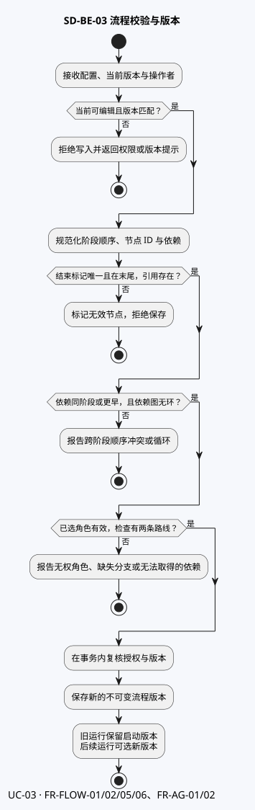

覆盖 UC-03、FR-FLOW-01～02、FR-FLOW-05～06、FR-AG-01～02。保存阶段和节点的稳定标识、顺序、依赖、结束标记及检查双路线。互斥分支后的硬依赖若可能无法取得产物，则指出冲突。运行持有启动时版本，编辑生效于后续运行。协调者单独执行是否允许见 SA-D05。

本批流程配置实现采用两个版本号：`version` 是配置编辑及负责人修改的乐观锁；`workflowVersion` 是已封存流程图的版本，供后续启动固定引用。角色引用在保存时校验当前使用权，并固定 Agent 版本。存量未补齐的流程不出现在使用候选中。仅协调者执行按可选子 Agent 契约作为实施默认值，SA-D05 的业务复核仍保留。

### 检查、修复和发布

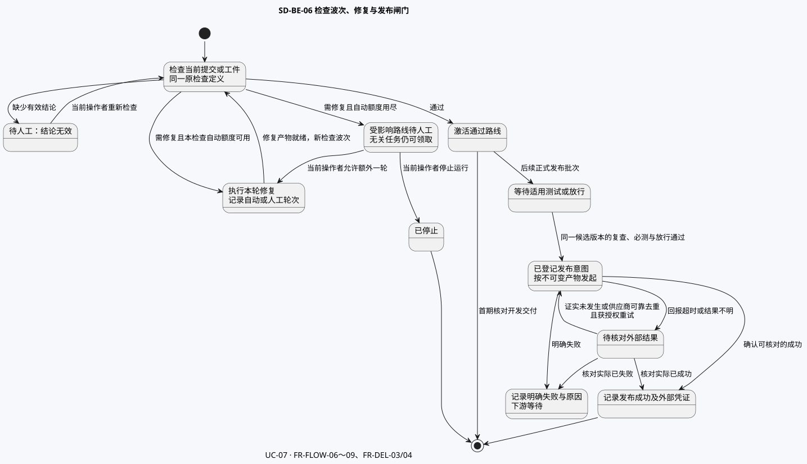

覆盖 UC-07、FR-FLOW-06～09、FR-DEL-03～04。检查、修复与复查均属于同一运行。正式发布图为后续范围。发布图的终点代表记录外部结果，运行的完成另按结束标记判断。

| 分支 | 技术约束 |
|---|---|
| 检查 | 每个检查只接受 **通过** 或 **需修复**。缺少有效结论时停在原节点等待当前操作者重新检查。有效结论只激活当前波次对应路线。 |
| 修复 | 第一次自动修复记作 1，各检查独立计算。修复交付后，用对应产物启动原检查的新波次。额外一轮需授权，独立记录且不重置自动计数。跨阶段修复作为原检查波次的受控子路径。普通节点仍遵守阶段屏障。修复完成只返回原检查，按新波次选路并满足合流条件。 |
| 发布（后续） | 复查和已通过的必测报告须匹配待发布的不可变工件版本、提交与需求修订。同一提交的不同构建分别核对。适用放行未满足时继续等待，未知外部结果转入核对。 |
| 停止 | 不再创建后续任务，旧回报无权恢复调度。已发生或可能已发出的外部动作继续保留证据并核对。 |

## SD-B04 角色任务、问答、修订与产物

### 启动和 Git 准备

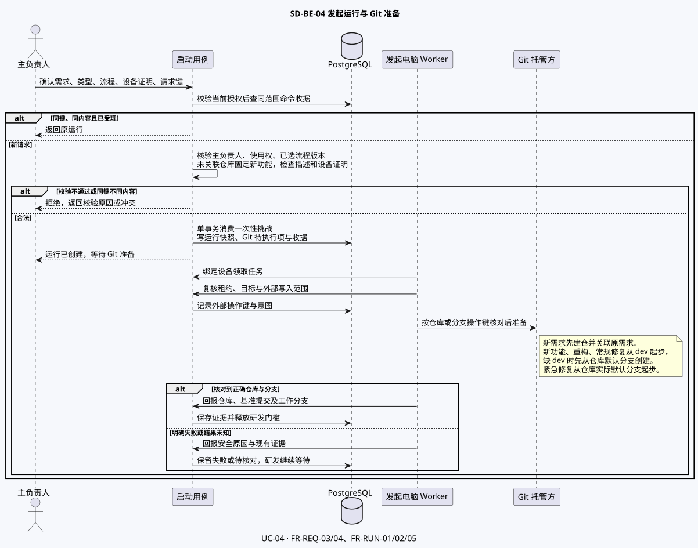

覆盖 UC-04、FR-REQ-03～04、FR-RUN-01～02、FR-RUN-05。流程要求先有描述时，缺描述不进入 Git 准备。流程含需求阶段时，按该阶段规则补充本次运行描述。未关联仓库时，启动收据与运行快照记录用户选择的 GitHub 命名空间。Git worker 按固定目标建仓，重试沿用已记录的目标。已有仓库沿用原关联。Git 写入前复核任务租约和操作范围。可确认的建仓结果关联原需求，工作分支确认完成后才释放研发门槛。四类工作类型的业务映射见 [SA](../SA/SA-AgentShip.md)，外部调用边界见 SD-I04。

### 调度、角色和完成

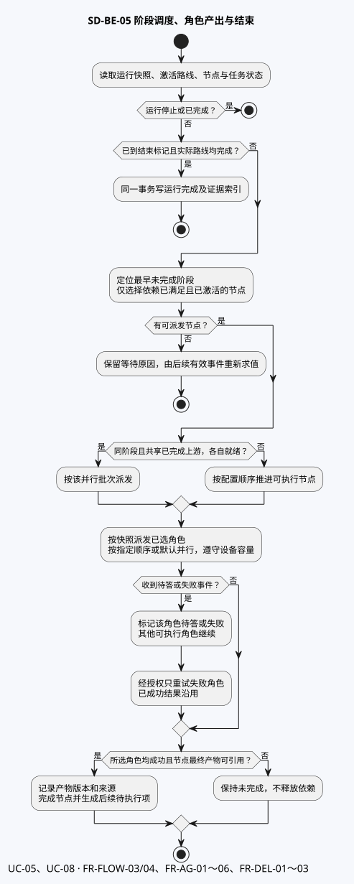

覆盖 UC-05、UC-08、FR-FLOW-03～04、FR-AG-01～06、FR-DEL-01～03。

- 调度从运行快照计算。上一阶段的应执行节点完成后才打开下一阶段。同阶段共享已完成上游且各自就绪的节点可并行，其余按配置顺序。未激活路线不计入完成。到达结束标记且实际路线均完成后才标记完成。
- 任务关联运行、节点波次、角色、尝试和设备。只分派所选角色，按已配顺序或默认并行。当前操作者可重试或跳过失败角色，沿用同波次已成功结果。角色成功或人工跳过失败项，且最终产物可引用后才完成普通节点。协调 Agent 先汇总并尝试解决冲突，未解决转人工。
- 待答关联原角色和可寻址会话，离开页面或设备离线不消除问题。回复或发起人取消只生效一次。其他可执行角色继续。普通聊天与正式提案使用不同命令。执行中的 BRD 节点内由发起人确认后，同事务更新原需求、本次运行修订与审计。节点首次成功取得执行租约时，在同一运行锁内固定需求修订。仍在排队的节点采用领取时的当前修订。确认时已在执行的节点继续使用固定修订，结果展示旧版本标记。尚未开始节点读取新修订。已完成节点保留，由发起人按需重跑。重跑的下游处理见 SA-D03。
- 代码关联工作分支与提交 SHA，测试关联被测提交或工件及检查波次，发布关联目标、交付版本和供应商结果。可公开交付物归档到需求 Git 仓库，账号资料、聊天原文与原始日志留平台。下载与留存细节待定，字段与关系见 [数据设计](SD-AgentShip-data.md)。

## SD-B05 运行恢复、部署和运维

### 聊天与执行租约

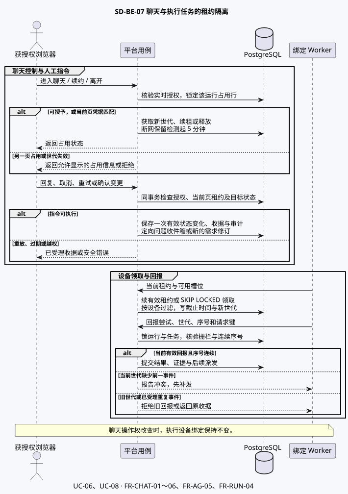

覆盖 UC-06、UC-08、FR-CHAT-01～06、FR-AG-05、FR-RUN-04。数据库时间决定租约有效性。聊天操作检查权限、标签页、世代及目标状态。设备领取按绑定设备和任务就绪条件判定。单个问题或角色失败时，独立任务仍可领取。修复到上限时只阻止该检查所控制路线及其依赖的工作和新外部写入授权。无关工作照常判定，显式停止及运行终态才停止全局新派发。回报核验尝试、世代、连续序号及请求键。

跨实体事务按对象、运行、聊天租约、任务或问题的统一顺序加锁。领取、修复到上限与外部写入授权共用运行锁，再按固定顺序锁候选任务。锁到之后按当前已提交状态复核。已获得授权的外部动作可以回报和只读核对，恢复不能借用旧授权发起新的写入。短事务冲突可限次重试。数据库事务不包含 Codex、Git 或供应商调用。具体查询及受影响行规则见 [DML](data/agentship-postgresql-dml.sql)。

### 原设备恢复与外部核对

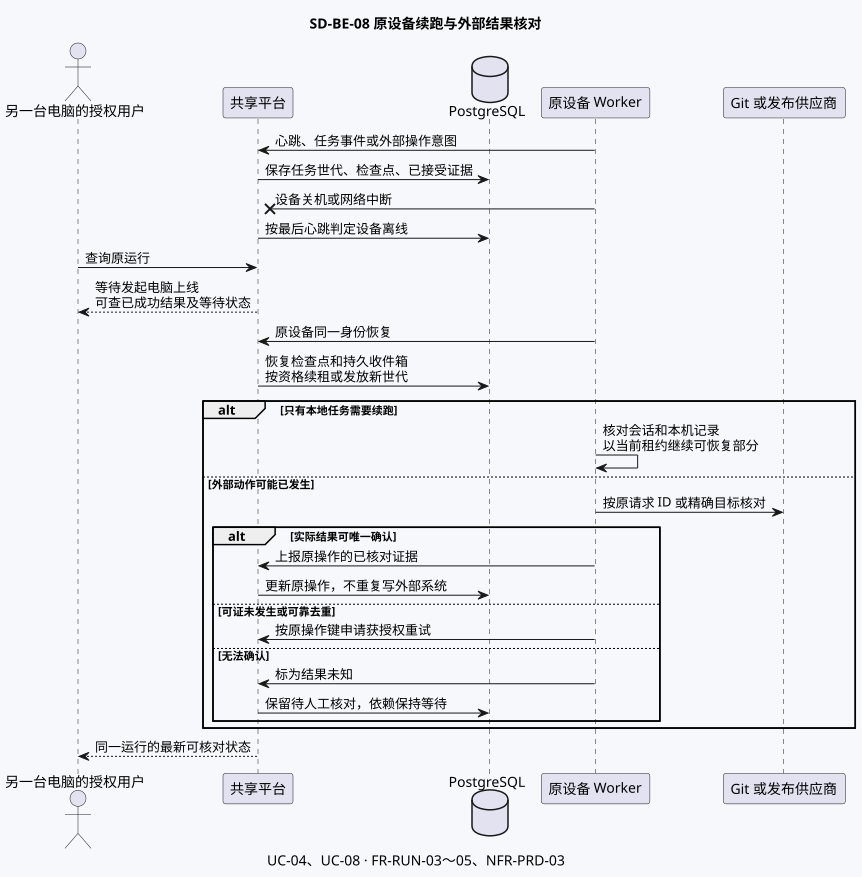

覆盖 UC-04、UC-08、FR-RUN-03～05、NFR-PRD-03。看板区分设备离线、设备在线但 Codex 不可用和外部结果未知。原设备以同一身份优先沿用可用的 Codex 会话，否则回到最近可验证的保存点。已成功结果仍可查看。外部动作结果不明时按操作键核对，证实未发生或供应商可靠去重后才可获准重试。

| 状态 | 运行与运维动作 |
|---|---|
| 本机验证 | 平台、PostgreSQL 与设备桥使用回环地址及隔离数据。用替身验证队列、故障和重连。 |
| 共享目标拓扑 | 平台与数据库独立于发起电脑。浏览器和执行程序通过获准 HTTPS 接入，数据库仅供平台连接。目标环境、支持浏览器与运维责任待批准。 |
| 升级与恢复 | 独立版本的 Java 平台、静态前端与 Java 执行程序按兼容窗口发布。先验证数据库迁移与恢复，确认 API 混合版本后再升级。回退需核对已执行外部操作，无法安全回退的数据变化走前滚修复。 |
| 仍待决定 | 原设备身份或目录丢失后的接续权限、备份与恢复目标、生产容量及告警阈值。监测与接入见 [中间件](SD-AgentShip-middleware.md)。 |

主要验收包含并发同名和撤权后保存、无效流程与历史快照、共享上游与阶段屏障、单角色重试、检查波次和错误发布证据、双账号与同账号标签页、原机重启、旧租约及外部结果核对。验收编号见 [需求追溯](AgentShip-Traceability.md)。Backend-Ready 待审批与实测。

## SD-B06 代码模块与分层

状态为 Proposed。范围为 Java 平台和本机 Worker 的代码组织。业务依据为 [SA v0.5](../SA/SA-AgentShip.md) UC-01～08，接口以 [OpenAPI draft.13](contracts/agentship-v1.json) 为准。现状图以当前 Java 源码为依据，历史 Node.js 原型见 SD-SYS01。新架构决策的责任方为后端维护者，实施及验证由后续 SDD 承接。

首批实施覆盖原 `platform.git`。任务、Git 准备和协作分别归入 `runtime.application` 的子包，调度选路归 `runtime.domain`，相关 SQL 由 JDBC 适配实现。归档独立为 `archive`，看板在 `workbench` 中聚合已授权的运行和归档视图。下方现状图记录迁移前基线。旧启动和运行读模型的 SQL 分层，以及其余身份与配置迁移，留在后续批次。

### 迁移前现状与拆分点

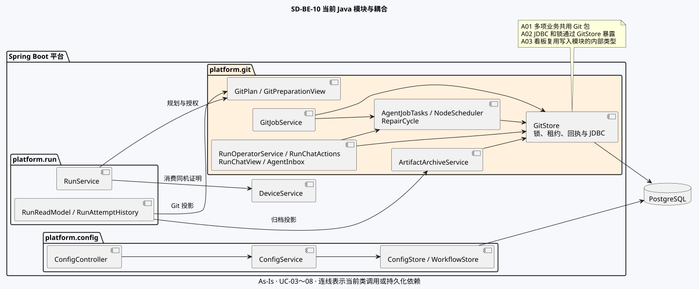

[PlantUML 源文件](diagrams/sd-be-10-code-current.puml)

| 现状 | 源码证据与影响 |
|---|---|
| A01 Git 包承接运行的多个职责 | `GitJobService` 负责 Git 和 Agent 的领取与回报，调度、检查、问答及归档也位于 `platform.git`。按文件名搬移会遗漏这些职责之间的状态与事务依赖。 |
| A02 锁和持久化接口跨业务共享 | `GitStore` 暴露 JDBC，还负责设备认证、配置与运行锁、任务世代和回执。调度、问答和归档通过它直接写各自的业务表，写入责任难以从包名判断。 |
| A03 查询与写入耦合 | `RunReadModel` 直接引用 `ArtifactArchiveService.view` 和 Git 状态辅助类。将归档单列为模块时，需要先移开这条反向依赖。 |
| A04 跨模块用例由单个业务服务直接写表 | `RunService` 发起运行时直接读取配置并消费设备证明，`IdentityService.logout` 直接清理 `chat_lease`。拆分时需要把跨模块动作显式交给原事务的用例。 |

### 目标模块与依赖

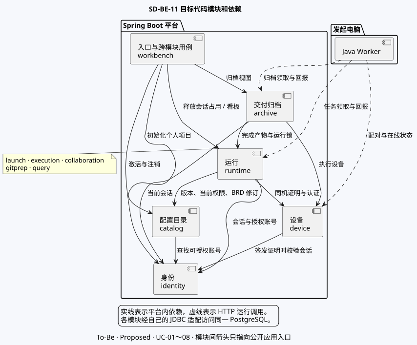

[PlantUML 源文件](diagrams/sd-be-11-code-modules.puml)

**SD-A01** 采用按业务能力划分的模块化单体。账号、目录、设备、运行和归档分别拥有自己的业务状态。启动、调度、Git 准备与聊天协作归在同一运行模块内，以便保留回报与调度、问答与续跑、正式需求变更与快照的原子提交。Java 平台和 Worker 继续由同一个 JAR 启动为各自的进程。

| 平台模块 | 归属与主要状态 | 对其他模块开放的操作 | 可依赖的业务模块 |
|---|---|---|---|
| `identity` | 注册激活、登录、会话、本人资料。维护账号和会话。 | 认证会话、查找可授权账号、撤销会话。 | 无 |
| `catalog` | 项目、需求、流程、Agent 配置、主副负责人、版本和需求仓库关联。 | 校验并锁定启动版本与权限、确认需求修订、关联已核实的仓库。 | `identity` |
| `device` | 配对、一次性证明、设备身份与心跳。 | 验证设备凭据、在调用方事务消费证明、查询设备状态。 | `identity` |
| `runtime` | 运行及快照、节点、任务、尝试、检查和修复、聊天与收件箱、仓库准备证据、运行产物。 | 发起运行、领取与回报、人工操作、授权查询、读取并锁定可归档候选。 | `identity`、`catalog`、`device` |
| `archive` | 可公开交付物的审批、归档任务、写入意图与核对结果。拥有 `artifact_archive` 的写入。 | 审批、领取、签发许可、确认结果、读取授权归档投影。 | `identity`、`device`、`runtime` |

`runtime` 内的子包按用例分为 `launch`、`execution`、`collaboration`、`gitprep`、`query`。运行用例通过窄接口复用内部规则。设备轮询和事件回报由 `execution` 统一接收，按任务类型调用 `gitprep` 或角色执行。跨模块的浏览器用例置于 `workbench`。账户激活与个人项目初始化在同一事务内调用 `identity` 与 `catalog`。注销在同一事务先撤销会话，再释放该会话持有的聊天占用。运行看板在同一个只读快照内组合 `runtime` 与 `archive` 的授权投影，归档查询只接收已通过访问校验的运行范围。

**SD-A02** 跨模块依赖只进入被依赖模块的 `api`，使用有类型的命令、查询和结果。禁止导入其他模块的 Controller、内部用例实现、JDBC 适配、数据库行类型或异常处理器。写入由表的所属模块执行，跨表只读投影需要明确归属和访问范围。编译依赖保持无环，特别是 `runtime` 禁止依赖 `archive`。依赖图的箭头是允许的直接调用。

### 模块内分层

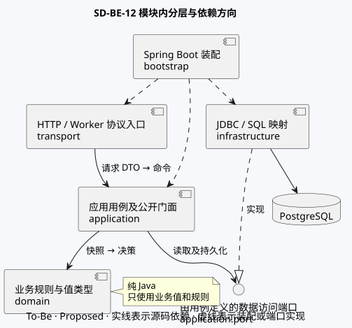

[PlantUML 源文件](diagrams/sd-be-12-code-layers.puml)

| 代码位置 | 职责与边界 |
|---|---|
| `transport` | 接收 HTTP 或 Worker 请求，读取已认证的身份，校验字段形状，将请求 DTO 转为命令，统一映射响应和错误码。 |
| `api` / `application` | `api` 暴露受控调用面。`application` 复核对象授权，处理幂等、事务及审计，调用领域规则和持久化端口。当前能力的读取和写入分别组织用例。 |
| `domain` | 持有流程合法性、阶段依赖、检查波次、节点完成及版本规则。输入为业务值和状态快照，输出为决策或状态变化。只使用纯 Java 类型。 |
| `application.port` / `infrastructure` | 按用例定义必要的读写和锁定操作。JDBC 适配封装参数化 SQL、行映射和受影响行检查，返回有类型的快照或结果。 |
| `bootstrap` | 装配 Spring Bean、事务和安全中间件，分派平台与 Worker 的启动模式。 |

**SD-A03** 领域规则与 Spring MVC、JDBC、JSON 和外部 SDK 解耦。拆分现有 `WorkflowGraph` 时，DTO 解析留在入口，图规则接收有类型的流程定义。`NodeScheduler` 和 `RepairCycle` 的决策基于快照，写入交给用例。只在存在真实边界时定义端口。简单模块可以省去独立领域包，用例仍负责业务决策。Worker 保留 `WorkerMain` 装配入口，任务执行和恢复归 Worker 用例，Codex stdio、Git、工作目录及平台 HTTP 各自为适配。把 `GitWorker.PlatformApi` 移到 Worker 自己的 HTTP 边界，供 Git、Agent 和归档用例共同使用。共享的设备证明编解码归 `agentship.protocol.device`，Worker 通过 HTTP 获取平台业务状态。

以复杂的运行模块为例，拟议 Java 包将公开契约与内部用例分开。

```text
agentship.platform.runtime
├── api
├── transport
├── application
│   ├── launch
│   ├── execution
│   ├── collaboration
│   ├── gitprep
│   ├── query
│   └── port
├── domain
└── infrastructure
```

### 运行主路径与事务

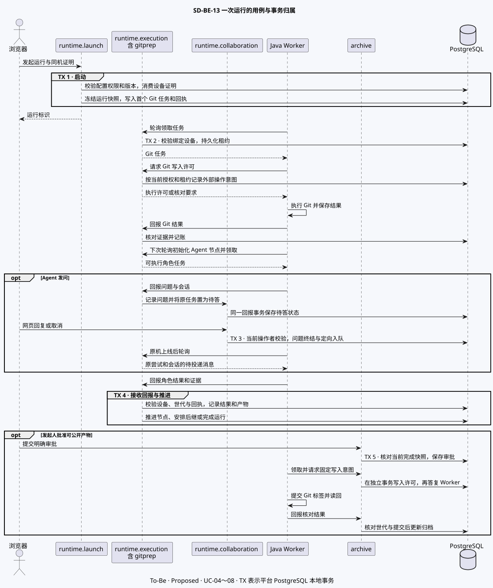

[PlantUML 源文件](diagrams/sd-be-13-code-run.puml)

**SD-A04** 由入口用例控制事务。跨模块命令加入调用方的 PostgreSQL 事务并沿用既有锁顺序。每次外部授权、执行、回报各有边界。Codex、Git 与仓库网络调用由 Worker 在数据库事务之外执行。

| 用例归属 | 原子范围、失败或重复处理 |
|---|---|
| `runtime.launch` | 启动权限与版本校验、消费同机证明、冻结运行和需求版本、创建 Git 尝试、授权和回执同事务。失败一起回滚，重复键核验原输入与当前权限后返回原回执。 |
| `runtime.execution` 与 `gitprep` | 领取、续租、回报和外部授权各由对应入口开启事务。延续配置、运行、任务的锁顺序与设备世代检查。Git 完成回报持久化仓库、分支和基线，首次 Agent 调度发生在随后可执行的轮询。Agent 结果、产物和对应的调度推进同事务。陈旧世代、重复或未知回报按既有协议裁决。 |
| `runtime.collaboration` | 聊天权限、单页租约与问题状态校验后，问题终结和定向入队原子提交。在线与离线沿用同一持久消息路径。活动 BRD 修订同时提交目录侧原需求和运行侧修订，保留在途任务的输入版本。 |
| `archive` | 审批、领取、写入许可和结果分别事务化。锁定运行后核对完成快照，写入许可提交后原机才可创建标签。未知结果只读核对原引用。审批或结果改变时通过 `runtime.api` 更新运行投影版本，和归档写入一并提交。 |

### 类迁移与回归约束

| 顺序 | 当前类 → 目标责任 | 迁移时须证明的行为 |
|---|---|---|
| 1 | `ConfigController / ConfigService / ConfigStore / WorkflowStore` → `catalog`。收敛 `IdentityService` 与 `DeviceService` 的公开入口，注销联动移到 `workbench`。 | 重名、权限、版本、登出释放、绑定设备及启动失败回滚。 |
| 2 | `RunService` 启动部分 → `runtime.launch`。`GitPlan / GitOperations / GitPreparationView` → `runtime.gitprep`。按锁、任务、回执、设备及证据拆分 `GitStore`，由各所属模块提供窄操作。 | 启动、Git 证据和 Worker 轮询保持原锁顺序、回报重放及历史记录。 |
| 3 | `GitJobService / AgentJobTasks / NodeScheduler / RepairCycle` → `runtime.execution`。`RunOperatorService / RunChatActions / RunChatView / AgentInbox` → `runtime.collaboration`。 | 核对并行依赖、修复局部暂停、失败角色重试或跳过、离线原会话问答和需求版本竞争。 |
| 4 | `RunReadModel / RunAttemptHistory` → `runtime.query`。先通过查询接口解除看板到归档写服务的依赖，再将 `ArtifactArchiveController / ArtifactArchiveService` 迁入 `archive`。 | 核对看板授权与历史分页、快照一致性、归档审批重放、旧租约、冲突与核对。 |

迁移前固化构建与回归基线，先提取边界类型、纯规则和只读投影，再迁移带锁的写路径。每批保留 Spring 事务代理、隔离级别、SQL 条件、受影响行判定及重放行为，通过既有 HTTP、隔离 PostgreSQL 与 Worker 回归后再推进。首批包边界检查覆盖原 Git 包的职责、运行与归档的依赖方向及领域层导入。SD-B05 以数据库时间判定租约，代码的部分领取、围栏和归档仍使用应用时钟。时钟行为单独验证和修订。 [包边界检查](../../platform/test/verify_runtime_boundaries.py) · [任务围栏](../../platform/src/main/java/agentship/platform/runtime/application/execution/WorkerJobService.java) · [归档校验](../../platform/src/main/java/agentship/platform/archive/application/ArtifactArchiveService.java)

启动与配置迁移复用 `verify_first_batch.py`、`verify_flow_config.py`、`verify_device.py`、`verify_run_start.py` 和 `verify_git_jobs.py`。运行和协作迁移复用 `verify_node_jobs.py`、`verify_repair_jobs.py`、`verify_repair_operator.py`、`verify_chat_jobs.py` 与 `verify_chat_pipeline.py`。归档和 Worker 迁移复用 `verify_archive_jobs.py`、`verify_agent_pipeline.py --archive --browser` 与 `verify_codex_worker.py`。 [迁移回归与历史基线](../../openspec/changes/deliver-agentship-mvp/evidence.md)

本节设计基于当前源码和既有本地验证。外部契约仍以 draft.13 为验收基线，表所有权与迁移验证按 Flyway V1～V5 和 [数据设计](SD-AgentShip-data.md) 核对。逐项技术流程继续以 [FR 专属图](AgentShip-Function-Diagrams.md) 为依据，代码模块归属见索引。真实双设备、Codex 与 GitHub 的验收仍归 OpenSpec 4.2。

## 后端功能技术图

每张图分别展示原型运行路径、SA 问题点和目标技术流程。图中的 TX 为短数据库事务，外部进程和供应商操作在事务外执行。涉及权限、并发、状态和外部核对的结果按下表验收。

| 功能图 | 查看与维护 | 模块、前置与关键约束 | 验证意图 |
|---|---|---|---|
| SD-FR-RUN-01 选择需求、工作类型与流程 | [图](diagrams/sd-fr-run-01.svg) · [源图](diagrams/sd-fr-run-01.puml) | 启动用例 / 查询与启动。已选需求 ID、明确工作类型、已有流程版本；当前权限、同机证明和请求收据。 | 缺项与越权无副作用；同键同输入返回原运行；四类共用授权列表。 |
| SD-FR-RUN-02 Git 仓库与工作分支准备 | [图](diagrams/sd-fr-run-02.svg) · [源图](diagrams/sd-fr-run-02.puml) | 启动用例 / Git 适配。运行快照、关联仓库、供应商操作键；核对成功后才提交仓库及工作分支。 | 覆盖四种类型、缺失 dev、并发建仓、未知结果和演练证据隔离。 |
| SD-FR-RUN-03 看板投影与证据定位 | [图](diagrams/sd-fr-run-03.svg) · [源图](diagrams/sd-fr-run-03.puml) | 看板读取 / 产物读取。按当前权限读取快照、事件版本和有界游标；产物按运行授权。 | 过期游标重读快照；撤权后无数据泄漏；跨设备可定位节点和 Git 证据。 |
| SD-FR-RUN-04 原设备绑定、跨设备查看与续跑 | [图](diagrams/sd-fr-run-04.svg) · [源图](diagrams/sd-fr-run-04.puml) | 设备证明 / 任务租约。运行固化原设备，续跑凭可验证检查点及当前尝试世代。 | 发起机离线时另一设备可查；其他设备不可接管；同 ID 续跑。 |
| SD-FR-RUN-05 Git 异常恢复与外部事实核对 | [图](diagrams/sd-fr-run-05.svg) · [源图](diagrams/sd-fr-run-05.puml) | 外部操作恢复（Proposed）。需要维护恢复权限、原操作引用和当前有效命令，未知事实先核对。 | 核对不到保持等待；已发生不重复写；保存历史尝试及后续处置。 |
| SD-FR-FLOW-01 具名阶段、节点与结束标记保存 | [图](diagrams/sd-fr-flow-01.svg) · [源图](diagrams/sd-fr-flow-01.puml) | 流程写入 / 配置版本。当前编辑权限和期望版本；具名阶段、节点与唯一末尾结束标记在同一版本封存。 | 缺结束标记、位置错误、给结束标记设置角色或旧页面写入均拒绝。 |
| SD-FR-FLOW-02 依赖边、阶段逆序与循环校验 | [图](diagrams/sd-fr-flow-02.svg) · [源图](diagrams/sd-fr-flow-02.puml) | 流程编译 / 依赖图。静态边限同版本，前置限同阶段或更早阶段；提交前复核循环。 | 同阶段及跨阶段有效边可回显；更晚阶段与直接、间接循环均拒绝。 |
| SD-FR-FLOW-03 阶段屏障、同阶段并行与顺序 | [图](diagrams/sd-fr-flow-03.svg) · [源图](diagrams/sd-fr-flow-03.puml) | 调度 / 任务队列。同事务受理事件与重算应执行集合；阶段屏障、依赖、共同上游和配置顺序。 | 前阶段未清空时下一阶段不启动；符合条件才并行。 |
| SD-FR-FLOW-04 实际路线汇合与运行完成 | [图](diagrams/sd-fr-flow-04.svg) · [源图](diagrams/sd-fr-flow-04.puml) | 运行收尾 / 终态。仅实际激活路线参与汇合；结束标记及运行终态同事务。 | 并行末端部分完成不结案；停止和迟到回报不会推进。 |
| SD-FR-FLOW-05 流程更新与运行快照隔离 | [图](diagrams/sd-fr-flow-05.svg) · [源图](diagrams/sd-fr-flow-05.puml) | 流程版本 / 运行快照。发起后保留已选流程、节点及角色版本引用。修改另封存新版本。 | 修改配置后旧、新运行分别沿用各自版本，旧运行仍可查询。 |
| SD-FR-FLOW-06 固定检查结果与单路激活 | [图](diagrams/sd-fr-flow-06.svg) · [源图](diagrams/sd-fr-flow-06.puml) | 检查配置 / 波次选路。封存前要求两个结果入口，按当前波次的已验收结果只激活一路。 | 两条路不同时开启；缺有效结论不选路；复查结论按新波次裁决。 |
| SD-FR-FLOW-07 检查结论无效及重新检查 | [图](diagrams/sd-fr-flow-07.svg) · [源图](diagrams/sd-fr-flow-07.puml) | 人工重查 / 波次。结论无效产生可见阻塞；重查需要当前聊天页及有效请求键。 | 复查保留运行与原节点身份，仍无结论继续等待；重复不新开波次。 |
| SD-FR-FLOW-08 自动修复计数与原节点复查 | [图](diagrams/sd-fr-flow-08.svg) · [源图](diagrams/sd-fr-flow-08.puml) | 修复调度 / 产物复查。以每个原检查节点计数、首轮为 1；复查绑定修复工件并保留历史。 | 未达上限自动续一轮，到上限且未通过只阻塞受影响路线，无关路线照常判定。 |
| SD-FR-FLOW-09 修复上限后的额外一轮或停止 | [图](diagrams/sd-fr-flow-09.svg) · [源图](diagrams/sd-fr-flow-09.puml) | 人工修复 / 停止。当前聊天页及上限状态校验，额外一轮单独记数，停止关闭后续派发。 | 同键重放不重复增加轮次；失效页拒绝；停止不丢外部核对记录。 |
| SD-FR-AG-01 选定多个子 Agent 与角色版本 | [图](diagrams/sd-fr-ag-01.svg) · [源图](diagrams/sd-fr-ag-01.puml) | 角色目录 / 版本化分派。使用权、可用角色、流程版本及运行角色快照一致；只派发明确选项。 | 至少选三个且留一个未选；持久化重开一致，未选角色不派发。 |
| SD-FR-AG-02 子 Agent 的有序或默认并行执行 | [图](diagrams/sd-fr-ag-02.svg) · [源图](diagrams/sd-fr-ag-02.puml) | 节点任务调度。角色任务带明确范围；有序模式等待前项，默认独立任务并行。 | 测试三名以上角色的两种模式，区分阶段并行与节点内部顺序。 |
| SD-FR-AG-03 角色间交接及人与角色双向通信 | [图](diagrams/sd-fr-ag-03.svg) · [源图](diagrams/sd-fr-ag-03.puml) | 角色通信 / 待答收件箱。事件带尝试、世代和连续序号；消息与目标会话、投递 ID 同事务。 | 目标实际收到交接；回复送到原发问者；超时保留待核对状态。 |
| SD-FR-AG-04 收齐角色结果与节点最终产物 | [图](diagrams/sd-fr-ag-04.svg) · [源图](diagrams/sd-fr-ag-04.puml) | 节点验收 / 产物引用。同波次所选角色成功且最终产物可引用，才写节点完成并重算下游。 | 单任务成功、产物缺失或波次不匹配都不解除依赖。 |
| SD-FR-AG-05 失败子 Agent 的重试或跳过 | [图](diagrams/sd-fr-ag-05.svg) · [源图](diagrams/sd-fr-ag-05.puml) | 人工处置 / 尝试记录。当前聊天页、失败尝试和请求键同时成立时，重试仅新增该角色尝试，跳过则在失败记录上标记处置。 | 保留原失败、原因及已成功角色；重复和迟到事件不改写。 |
| SD-FR-AG-06 本机容量不足时的任务等待 | [图](diagrams/sd-fr-ag-06.svg) · [源图](diagrams/sd-fr-ag-06.puml) | 容量分配（Proposed）。设备声明槽位且有权领取时才发租约，其余任务保持待执行。 | 以三名以上角色和较低槽位验证无丢单，并显示等待资源。 |
| SD-FR-DEL-01 产品定义产物与下游引用 | [图](diagrams/sd-fr-del-01.svg) · [源图](diagrams/sd-fr-del-01.puml) | 产品定义 / 产物归档。验收节点角色、输入需求修订和目标产物引用。 | 按权限查看目标、范围与验收要点；下游引用同一版本。 |
| SD-FR-DEL-02 前后端代码证据与工作分支 | [图](diagrams/sd-fr-del-02.svg) · [源图](diagrams/sd-fr-del-02.puml) | 代码节点 / Git 写入。外部写入前核对租约、目标分支和操作授权，提交证据关联节点波次。 | 前端和后端分别可定位实际代码；错分支或未知结果不当成交付。 |
| SD-FR-DEL-03 测试报告绑定实际被测版本 | [图](diagrams/sd-fr-del-03.svg) · [源图](diagrams/sd-fr-del-03.puml) | 测试节点 / 测试证据。报告记录结果、被测工件、提交和需求修订；失败不可满足放行。 | 失败详情可查；同提交另一构建、旧修订或演练证据不可冒充真实通过。 |
| SD-FR-DEL-04 发布放行、实际执行与证据（后续） | [图](diagrams/sd-fr-del-04.svg) · [源图](diagrams/sd-fr-del-04.puml) | 发布闸门 / 发布适配。仅匹配当前候选工件的复查、通过测试与适用放行才登记发布意图。 | 确认实际发布结果后才完成；明确失败与未知分开；不盲目重发。 |

操作名及字段以 [API v1 draft.12](contracts/agentship-v1.json) 为准。状态、关系与短事务的约束见 [数据设计](SD-AgentShip-data.md)，中间件所有权和失败验证见 [中间件设计](SD-AgentShip-middleware.md)。原型路径由图中源码支持，真实跨设备、外部服务及 Java 目标实现验收待定。
