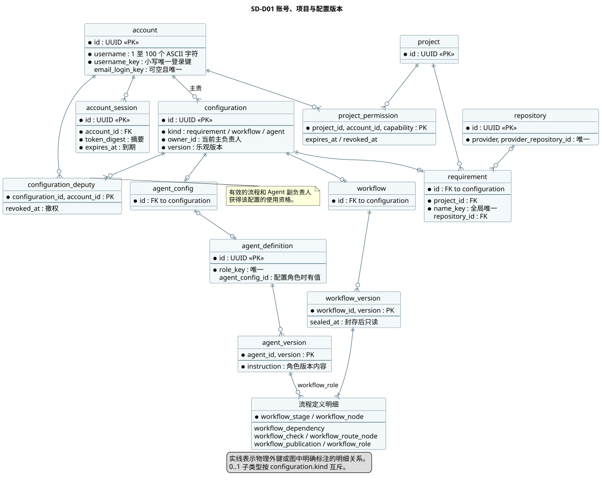
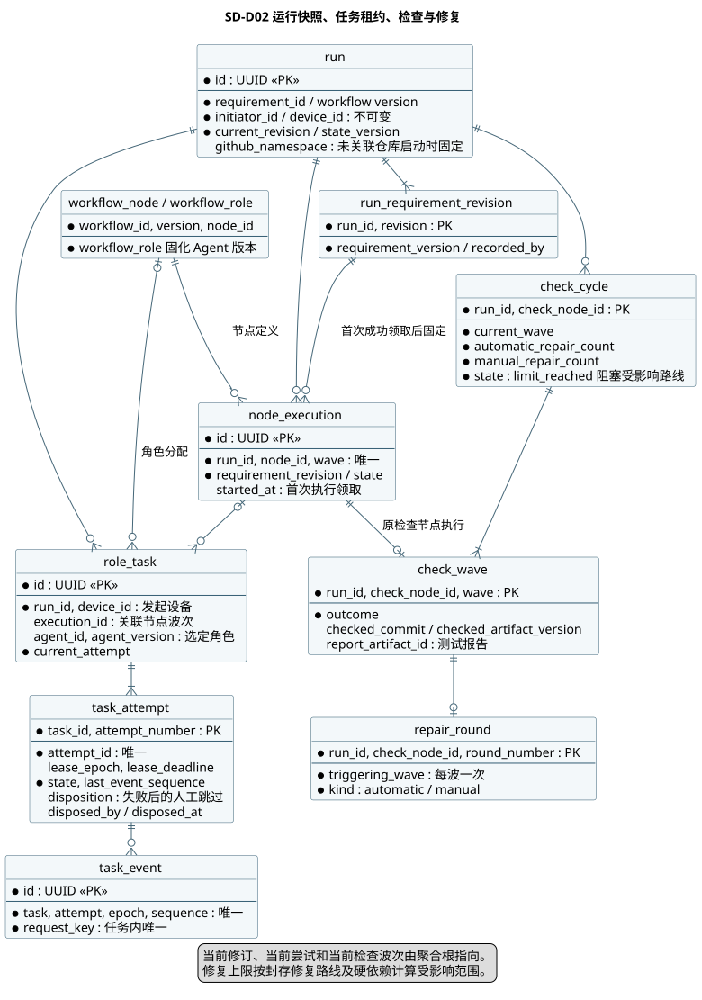
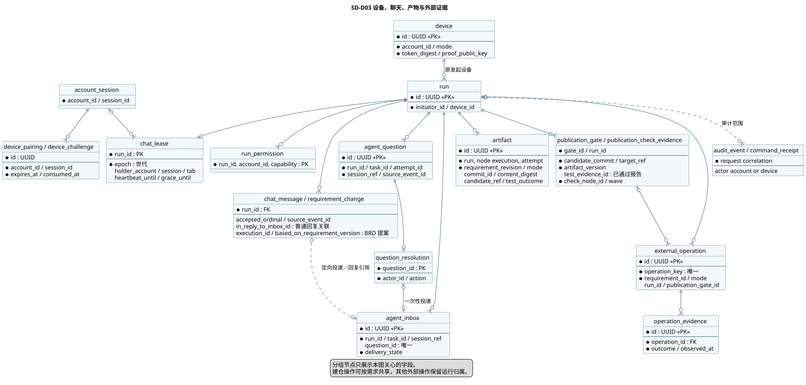
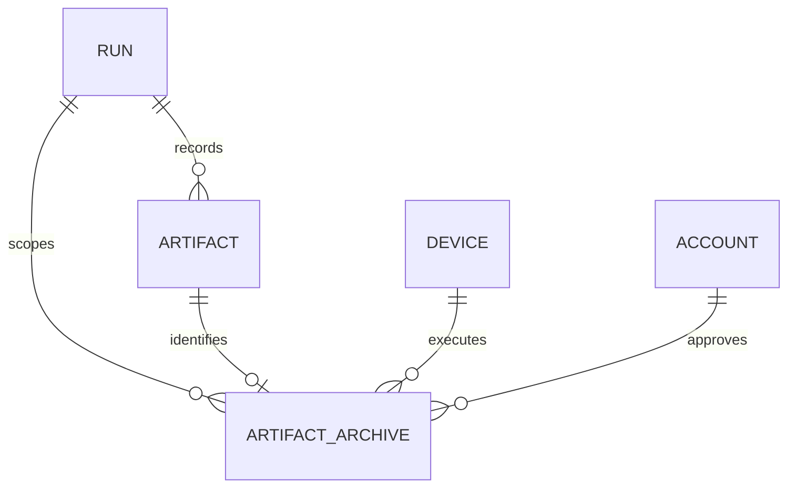

# AgentShip 数据系统设计 v0.5

状态为 Proposed。以 [BRD v0.57](../BRD/AgentShip/BRD-AgentShip.md)、[PRD v0.5](../PRD/PRD-AgentShip.md) 和 [SA v0.5](../SA/SA-AgentShip.md) 为基线。范围覆盖 UC-01～08。PostgreSQL 持有共享业务状态，设备只暂存待回报结果与本地恢复材料。本文负责物理模型和关键事务，授权与外部协议分别见 [后端设计](SD-AgentShip-backend.md) 和 [集成设计](SD-AgentShip-integration.md)。

## SD-D01 账号、项目、配置和版本



[PlantUML 源文件](diagrams/sd-data-01.puml)

账号、项目、对象权限、现任负责人和配置版本由平台维护。三种配置共享 `configuration` 行作为锁和版本边界，子表限定配置类型。通过项目权限可进入项目或建立需求，需求读写仍按当前对象权限。需求规范化名称全局唯一。用户名仅接受 1～100 个 ASCII 字母、数字、下划线和短横线，小写登录键由数据库约束核对并防止并发重复。注册以待验证账号落库。邮件登录键按不区分大小写规范化后唯一，手机号以带国家区号的统一格式保存并去重。邮箱与手机号的验证时点分别记录，最后一项验证成功时同事务激活。待验证账号由数据库受理时间起保留 24 小时。验证先锁住账号再判定有效期。注册事务可先释放与本次输入冲突的过期待验证记录，再插入新账号。后台按有界批次清理其余过期记录。旧凭证绑定原账号，不能用于重注册的账号。本人联系方式由当前会话对应账号读取，成员或项目投影不包含联系方式。首期账号停用后台留待后续。已激活账号的留存见 SA-D07。

配置编辑、撤权及转交锁定同一主记录，并在下一条语句按当时授权及提交版本更新。添加和转交使用精确用户名，通过 `find_owner_candidate` 在配置主负责人范围内解析内部账号 ID。副负责人撤权时间保留，用于向已失去权限的旧页面提供安全提示。运行只能选择有权使用的已保存流程。`configuration_can_use` 只识别现任主负责人和未撤销的副负责人。流程和 Agent 的编辑、使用按各自动作检查，移除副负责人后即失去来自该角色的使用权。首期不设独立使用权。

流程定义按版本保存阶段、节点、依赖、角色、检查及发布配置。封存时校验阶段非空、最后是结束节点、检查路线齐全、发布目标已配置、依赖无环且方向合法。封存后禁止增删改版本明细。阶段跨越、互斥路线与合流的补充规则由应用在封存前按审批口径校验，见 SA-D04。Agent 角色版本不可变，已启动运行继续引用其原始配置版本。

## SD-D02 运行、任务、检查和修复



[PlantUML 源文件](diagrams/sd-data-02.puml)

`run` 保存不可变的项目、需求、流程版本、发起人、发起设备、工作类型和模式。未关联需求启动时，冻结用户填写的 GitHub 命名空间，随首个 Git 任务传递。已关联需求直接用原仓库。创建时记录当前运行需求修订和首个 Git 任务。运行修订、当前尝试和当前检查波次使用延迟外键，在同一个短事务内创建父记录及其指针引用。历史需求修订不可修改。执行中的 BRD 节点内，由发起人确认提案后在同一事务更新原需求及本次运行修订。确认与节点开始在同一运行锁下确定顺序。首次成功领取时固定节点输入修订，同节点后续任务沿用它。确认后尚未开始的节点引用新修订。使用旧修订完成的结果显示旧版本标记，已完成节点及其他运行的快照继续保留。重跑的下游影响见 SA-D03。

`node_execution` 区分同一运行、同一节点定义的不同波次。调度器按阶段、依赖和活动分支判定就绪并排队。排队时仅记录暂定输入。`claim_tasks` 在首次成功领取事务中固定节点、所有角色和待执行检查波次的需求修订，并设置 `started_at`。角色任务外键核对运行、设备、节点、输入修订和 Agent 版本。读取 `node_revision_projection` 时，未启动节点的输入版本为空，已启动节点按固定版本与当前运行版本比较。分页的尝试历史按任务 ID 和尝试序号排序，角色名称从不可变 `agent_version` 读取。手动重试只推进未被处置的失败尝试，跳过以独立处置字段保存，失败状态和原始原因保留。节点最终产物仍须通过验收。任务领取先按设备发现候选运行，获得运行锁后才读取最新资格和锁定候选尝试，忙碌运行本轮跳过。停止或完成阻止整个运行的新领取。修复上限只阻止受影响节点，其他具备普通调度资格的工作仍可领取。

每次重新领取分配新的租约世代。事件从该世代的 1 开始按连续序号入库。回报同时验证当前尝试、设备、世代、截止时间和运行状态。已接受请求键的重放返回原收据。未接受的迟到或跳号回报不得覆盖当前状态。接收外部结果、推进节点与派发后续任务的数据库更新在同一事务提交。节点调度与角色产物汇总仍由应用领域规则负责。

`check_cycle` 按原检查节点独立计数。`check_wave` 引用同次运行中该节点的新执行波次，并保存当时需求修订、实际检查提交、不可变被检工件标识及报告。报告结论只产生一条活动路线。缺失有效结论时等待重新检查。每波最多触发一轮修复，首轮自动修复记为 1。上限暂停从封存的原检查、修复入口和活动修复路线成员沿硬依赖查找受影响节点。领取和外部写入许可均在运行锁下复核该集合。当前聊天操作者可追加一次人工修复或停止，人工次数单独保存。每轮修复完成后新建原检查的下一波。正式发布的证据表留作后续设计，首期仅在开发环境验收。

## SD-D03 设备、聊天、产物和交付证据



[PlantUML 源文件](diagrams/sd-data-03.puml)

配对码存摘要，同机挑战一次性消费并绑定登录会话和平台来源。设备私钥留在本机，数据库保存公钥、设备凭据摘要和在线观测。发起电脑关机时共享库继续持有看板、问题、回复和产物。设备离线不改变原发起设备或聊天租约。原机恢复的可续跑粒度见 SA-D08。

每个运行的聊天占用最多一行。获取、续租和释放绑定账号、登录会话、页面和世代。显式释放后保留世代水位，迟到释放无法影响新持有人。检测断网后的五分钟宽限以数据库时间计算。运行发起人可按精确用户名授权聊天来宾，撤销权限与清理来宾占用在同一事务完成。运行聊天授权的范围为聊天，当前需求副负责人不具备资格。正常关闭信号和不可观测断连的边界见 SA-D10。

问题与发问任务、尝试、会话及来源事件绑定。回复与取消争用同一终结记录，取消还需运行发起人身份。答案或继续指令入队与问题终结同一事务提交，原设备离线时仍可接受并保留。普通消息按活动节点波次解析协调角色或显式角色，消息与目标收件箱同事务入库。Agent 普通回复需通过同尝试、世代和连续序号的事件门禁，写入源事件关联及可选的收件箱回复 ID。聊天按运行内受理序号翻页。会话投递去重、未知投递核对和本机回执见 SD-I03。

产物记录来源节点、角色尝试、需求修订、模式及适用的仓库、提交、工件和内容摘要。测试产物有明确的通过、失败或未确认结论。发布闸门以候选提交和不可变工件版本共同识别交付对象，同一提交的新工件不能沿用旧检查。外部操作保留稳定键、目标及核对证据。真实写入先有显式范围授权，再复核当前任务租约和适用发布闸门。结果不明时只允许核对。终止运行后仍需处理已发生的外部影响，当前 DML 的核对样例覆盖持有有效授权与租约的任务。终止后独立的只读核对权限和过程待 SA-D08 签署，后续交付不从该核对恢复。

开发交付的归档通过 Flyway V5 增加 `artifact_archive`。每个产物最多一条归档记录，复合外键固定所属运行和发起设备。审批记录人和时间。归档领取分配新世代，首次签发写入许可前保存导出提交，回读相同引用及提交才确认成功。已保存导出提交的未知结果只做回读核对。写入前遇到可恢复的明确失败，可由发起人重新审批。每次审批和结果变化同时更新运行版本，供客户端刷新。



## 可执行 SQL 草案

| 文件 | 内容 |
|---|---|
| [数据字典](data/data-dictionary.md) | 49 张表的逐字段类型、空值、默认、数据责任、分类和审计。 |
| [DDL](data/agentship-postgresql-ddl.sql) | 在隔离 `agentship_design` schema 内建立表、索引、外键和版本封存约束。 |
| [关键 DML](data/agentship-postgresql-dml.sql) | PostgreSQL `PREPARE` 语句、参数绑定、查询与写入条件。语句注释定义参数顺序和操作前置。 |
| [DML 与查询目录](data/dml-catalog.md) | 将 39 项功能映射到 SQL 或有界仓储访问契约、事务、异常和验证。 |
| [数据断言](data/agentship-postgresql-assertions.sql) · [两连接验证](data/verify-postgresql-design.py) | 合成数据验证旧页撤权、重复启动、版本封存、聊天占用和投递、原机租约、BRD 修订、在途版本与修复上限的隔离。 |
| [事务矩阵](data/transaction-concurrency-matrix.md) · [访问路径](data/indexes-and-access-paths.md) | 锁顺序、重复及冲突、查询边界、索引与验证。 |
| [迁移与恢复设计](data/migrations/initial-and-recovery.md) | 初始结构、兼容窗口、条件回填、切换与回退。 |

2026-11-09 Git 批次新增 `repository.default_branch` 保存提供方实际默认分支，`run.git_default_branch` 固定本次观察值。两者可空以兼容未准备与历史数据，不默认回填 main/master。Java Flyway `V3__git_preparation.sql` 以加列方式升级；实际确认后写入。Git 准备完成只转为等待 Agent，完整节点调度仍归后续任务。操作意图、精确授权、租约世代与回读证据复用现有表，演练证据不更新需求的真实仓库关联。

在获准的回环环境中，选用**新建、可丢弃的 PostgreSQL 数据库**，在同一会话顺序加载三个文件。`PREPARE` 作用域是当前连接。先指定该隔离实例的端口与数据库名。

```sh
psql -X -v ON_ERROR_STOP=1 -h 127.0.0.1 \
  -p "${AGENTSHIP_DESIGN_PORT:?Set the disposable PostgreSQL port}" \
  -d "${AGENTSHIP_DESIGN_DB:?Set the disposable database name}" \
  -f output/SD/data/agentship-postgresql-ddl.sql \
  -f output/SD/data/agentship-postgresql-dml.sql \
  -f output/SD/data/agentship-postgresql-assertions.sql
```

### 事务和并发边界

| 操作 | 顺序与失败处置 |
|---|---|
| 账号与配置 | 口令在应用边界哈希并校验，事务写库只接收哈希。唯一约束冲突映射为安全提示。写配置先锁配置，再以新语句检查当前角色和预期版本。版本、撤权或查找失败时回滚。 |
| 发起运行 | 验证账号会话，查询或预留命令收据，按 ID 顺序锁定需求和流程，再锁定挑战与设备并验签。成功消费挑战、记录原设备和版本、排首个 Git 任务及审计，再提交。 |
| 聊天、回复、重试、修复 | 依次锁配置和运行。应用核验租约签名，SQL 核验当前租约及动作权限。锁问题后写一次终结和一次收件箱投递。修改检查、重试或停止时更新相应状态、追加收据与审计。 |
| 任务领取和回报 | 按运行 → 候选尝试顺序加锁，取得运行锁后用新语句快照读取修复上限与路线资格。回报查已受理收据，再按运行与任务顺序加锁和核对世代。回报、产物、状态投影及后续派发一并提交。 |
| Git、外部核对与发布 | 配置和运行之后锁外部操作。授权和核对持久化后提交，再访问供应商。成功证据与副作用引用须匹配真实身份、仓库、分支、目标和工件。未知结果保留对账，演练结果不写入真实需求关联。 |
| 产物归档 | 先锁需求配置及运行，再锁归档记录。核对原设备、世代和时限，保存导出提交后才签发创建标签许可。写入与回读发生在事务外。核对原标签与提交后更新状态。 |

SQL 使用参数绑定。服务端认证所得主体、会话、设备、公钥验签结果及供应商核对证据来自各自信任边界。浏览器或 Agent 的自报字段不足以授予权限。应用检查预期的受影响行数。预期一行时得到零行则区分不存在、撤权、版本冲突、过期租约、已处理和暂不可用，并回滚整条命令。允许为空的领取和列表返回空集合。事务隔离采用 Read Committed 和显式锁，审计随变更提交。生产账号授权、退避上限、索引计划、留存、备份恢复和容量需分别评审与验证。

当前隔离回环 PostgreSQL 17.10 已加载 49 张表和 56 条预备语句。本人资料读取、主副负责人使用权限、撤权、注册期限与修复上限双连接断言通过。归档应用事务通过平台 HTTP、隔离 PostgreSQL 和本地 Git 验证。生产规模执行计划、数据库恢复演练、真实 Codex 和 GitHub 行为仍需独立验收。系统就绪结论见 [SD 索引](SD-AgentShip-index.md)。
