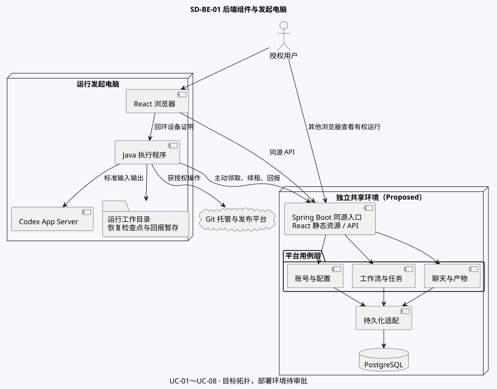

# AgentShip 系统设计索引 v0.5

首期图解设计稿。已确认 React + TypeScript、Java Spring Boot、PostgreSQL 和 Java 本机执行程序。总体状态 Proposed / Pending Approval。

按 [39 项功能图索引](AgentShip-Function-Diagrams.md) 定位专属业务图、技术图、数据、中间件和验收。参见[逐功能技术设计](SD-AgentShip-Features.md)、[SA 现状与交付主流程](../SA/SA-AgentShip.md)。

| 系统视图 | 图与边界 |
|---|---|
| As-Is 技术运行 | [SD-SYS01](diagrams/sd-as-is-runtime.svg) · [图源](diagrams/sd-as-is-runtime.puml)。根据本机原型代码和证据标记 SA-P01～08。 |
| To-Be 主运行 | [SD-SYS02](diagrams/sd-target-runtime.svg) · [图源](diagrams/sd-target-runtime.puml)。表示拟议事务、失败及恢复。 |
| To-Be 安全与数据 | [SD-SYS03](diagrams/sd-trust-boundaries.svg) · [图源](diagrams/sd-trust-boundaries.puml) · [概念数据](../SA/diagrams/sa-logical-data.svg) · [物理 ERD](SD-AgentShip-data.md)。 |
| To-Be 部署与中间件 | [部署与组件](diagrams/sd-be-01.svg) · [中间件拓扑](diagrams/sd-be-09.svg)。共享部署目标需环境批准。 |
| Java 代码架构 | [当前依赖](diagrams/sd-be-10-code-current.svg) · [目标模块](diagrams/sd-be-11-code-modules.svg) · [分层](diagrams/sd-be-12-code-layers.svg) · [运行事务](diagrams/sd-be-13-code-run.svg)。设计及迁移见 [SD-B06](SD-AgentShip-backend.md#sd-b06-代码模块与分层)。 |

## 基线与权威文档

以 [BRD v0.57](../BRD/AgentShip/BRD-AgentShip.md)、[PRD v0.8](../PRD/PRD-AgentShip.md) 和 [SA v0.5](../SA/SA-AgentShip.md) 为准。业务需求、用例与验证链见 [需求追溯矩阵](AgentShip-Traceability.md)。独立 SRS/FRS 的准入判断及业务签署待项目负责人确认。

| 设计文档 | 权威范围 | 状态 |
|---|---|---|
| [Backend SD v0.5](SD-AgentShip-backend.md) | 平台模块、权限、流程、执行、恢复及运行拓扑 | Proposed |
| [Frontend SD v0.5](SD-AgentShip-frontend.md) | React 页面、39 项前端路由、组件、状态与结果 | Proposed |
| [Integration SD v0.5](SD-AgentShip-integration.md) | 浏览器、设备、本机 Codex、Git、发布边界与行为 | Proposed |
| [数据设计 v0.5](SD-AgentShip-data.md) | ERD、字段字典、DDL/DML、事务、访问路径及迁移恢复 | Proposed |
| [中间件设计 v0.5](SD-AgentShip-middleware.md) | 组件、功能运行交互、失败、容量、安全与运维 | Proposed |
| [API v1 设计契约](contracts/agentship-v1.json) | Java 平台、React 与本机执行程序的操作、消息、类型及错误 | v1.0.0-draft.13 |

后续方案记录见 [AI Agent Office](SD-AgentShip-AI-Agent-Office.md)，涵盖办公室交互、运行数据映射和第一版验收。

## 评审与追溯

| 专业视图 | 触发条件 | 对应设计和证据 |
|---|---|---|
| 架构 · Required | 共享平台、原机、外部服务及 24 项执行类技术图 | SD-SYS01～03、SD-B01、SD-B05 |
| 接口与数据 · Required | 持久状态、授权、接口和并发 | SD-D01～03、SD-I01～04，SQL 与数据权威附录 |
| 前端设计 · Required | 39 项路由与状态对账，以及身份、配置和聊天技术图 | SD-F01～02、API v1 反馈与下方缺口 |
| 质量属性 · Required | 隐私、撤权、可见性、容量和恢复 | SD-SYS03、SD-B02、SD-B05、SA-D02～10 |
| 交付运维 · Required | 原机执行、共享状态、迁移恢复及真实环境 | SD-M01～03、迁移设计与批准条件 |
| 独立评审 · Required | 组装后的全套设计 | 评审结果见下方，正式签署待办 |

本次代码架构专项由 Architecture Agent 给出模块与分层设计，协调器归并至 [SD-B06](SD-AgentShip-backend.md#sd-b06-代码模块与分层)。接口和数据、前端、质量属性和交付运维沿用对应权威文档。本次设计待评审，现有实现的租约时钟偏差单独登记。整体设计签署与真实环境验收各自保留状态。

## 开工批次与待决事项

| 批次 | 范围 | 进入条件 |
|---|---|---|
| A 平台基础、账号和配置权限 | OpenSpec 1.1～1.4。平台、注册登录、三类配置、角色授权与前端。 | 先对齐平台基础设计及验收。注册的密码、激活和联系方式去重已确认。首批验证走本地模拟渠道，待验证注册 24 小时到期。配置权限验收覆盖选人、撤权、转交和使用候选。 |
| B 流程、设备和开发交付 | 2.1～2.6、3.1～3.2。配置、Git、调度、Codex 和开发产物。 | 确认 Git 重名和结果未知处置、角色容量、跳过的依赖影响及外部接入。 |
| C 聊天、需求修订与按需重跑 | 3.3～3.5。聊天授权、定向消息、旧版本结果与显式重跑。 | 确认重跑影响的下游范围，验证运行、需求和租约的一致性。 |
| 验收 | 4.1～4.2。可重复回归和获准的真实开发环境验收。 | 首期只收开发环境证据。正式发布用例保留在后续范围。 |

## 未决项与就绪判断

最新业务输入见 [SA 待决事项](../SA/SA-AgentShip.md#5-待决事项)。本版按最新规则修订设计与验收。历史 SQL 和原型的证据按原版本解释。正式发布移至后续，首期使用开发环境。

| 来源 | 决策和影响 |
|---|---|
| SD-A01～04 | 模块、依赖、分层和事务所有权为 Proposed。经后端维护者评审后再转 SDD。执行与归档的部分租约判定依赖应用时钟，与 SD-B05 的数据库时间约束有差异。后端维护者需核对并发与时钟边缘行为。 |
| SA-D02、SA-D09，DEC-01～05 | GitHub 用户填写归属、新建公开仓库、开发环境及交付物归档已定。分支命名、试点、权限及运营责任待细化。 |
| SA-D03，DEC-06 | BRD 节点内由发起人确认并同步原需求与本次运行。默认保留已完成节点，可由发起人按需重跑。确认时已在执行的节点保留原版本并标记旧结果，未开始节点使用新版本。重跑的下游影响待细化。 |
| SA-D04，DEC-07 | 修复可跨阶段，原检查复查，到上限仅阻塞受影响路线。修复按原检查波次归属，常规阶段门槛保持。修复完成后返回原检查，按新结论继续选路及合流。 |
| SA-D05，DEC-05、09、12 | 冲突先协调汇总再等人工，失败可重试或跳过。普通消息路由已定。角色接入、容量及恢复证据待办。 |
| SA-D06，DEC-11 | 发起人可授权或撤销聊天用户，需求副负责人仍被拒绝。补撤权、租约和旧标签页验证。 |
| SA-D07，DEC-10 | 开放注册，用户名判重忽略大小写，支持数字且最多 100 字符，双渠道验证成功后激活，联系方式各自唯一，密码 15～128 字符。首期使用本地模拟渠道，待验证注册 24 小时到期。联系方式仅本人读取，管理员查阅和停用后台留待后续。真实供应商接入和已激活账号留存待定。 |
| SA-D08，DEC-12 | 首期 macOS 与 Chrome。原会话可用则沿用，否则回最近保存点。未知结果的恢复权限待定。 |
| SA-D10，UAT-24～26 | 关闭通知送达即时释放，未送达按 5 分钟断连宽限。目标浏览器实测待办。 |
| 环境与运维批准 | 共享部署位置、允许来源、证书、网络边界、备份恢复、性能和可用性目标。当前授权范围内仅回环开发验证。 |

### 契约修订与验证状态

2026-11-09 draft.13 的本地目标栈回归覆盖账号和配置、Git、节点和检查修复、聊天问答、版本历史与产物归档。新增归档实体、DDL 和事务，见[数据设计](SD-AgentShip-data.md)。本地证据、实现边界及真实开发环境验收分别记在 [OpenSpec 验证记录](../../openspec/changes/deliver-agentship-mvp/evidence.md)。本地构建与自动化验证不改变正式设计签署状态。

| 缺口 | 影响与裁决入口 |
|---|---|
| SD-C01 负责人选人 | 添加及转交命令在授权后按忽略大小写的精确用户名解析。删除按现有成员标识。无匹配和无权场景的运行验收待执行。 |
| SD-C02 转交收据 | 转交仅返回最小收据。失权后的原调用者可重放相同成功命令，客户端清除对象缓存并按现权限重取。应用契约测试待执行。 |
| SD-C03 普通 Agent 消息 | WorkerEvent 已定义非终态普通消息、会话和可选回复引用。投递按当前节点和角色，回报按当前尝试、世代和序号。真实 Codex 回报待验。 |
| SD-C04 历史投影 | 运行快照显示输入修订和旧版本标记，尝试历史单独分页，角色名取冻结版本。应用读取权限与游标测试待执行。 |
| SD-C05 启动候选 | 流程副负责人在有权启动的运行中可选该流程，Agent 副负责人在有权编辑的流程中可选该 Agent。候选接口带当前需求或流程上下文，提交再按现权限复核。仅当前主、副负责人取得配置使用权，其他账号即使能查看项目也不能选用。撤权后的旧选项与直调请求待应用验收。 |

### 独立评审

本轮独立复核发现 GitHub 命名空间未持久化、历史缺少跳过处置及筛选，以及节点排队时可能提前固定输入修订。v0.5 已补入契约和设计 SQL，并通过下列验证。复核的就绪判定仍为 Blocked，重跑影响和适用审批待定。首批验证已选定本地模拟。

| 缺口 | 风险与验证 |
|---|---|
| SD-Q01 修复上限与外部写入竞争 | 按封存流程、当前检查波次和硬依赖计算受影响集合。领取和外部写入授权共用运行锁。隔离 PostgreSQL 双连接通过，受阻路线在上限后无法取得新的执行或写入授权，无关路线可继续。已发出的操作按原引用只读核对。应用级验证待执行。 |

[数据库验证步骤](data/transaction-concurrency-matrix.md) · [OpenSpec 验证记录](../../openspec/changes/deliver-agentship-mvp/evidence.md)

**就绪判定**。Backend-Ready、Frontend-Ready、Integration-Ready 与 Contract-Ready 均保持 Blocked 或 Pending Approval。Data-Ready 已有 SD-Q01 的隔离设计验证，实际查询计划、应用调度和恢复实测待执行。Middleware-Ready 等待运行参数、运维责任及目标环境批准。整体 SD-Ready 为 Blocked。应用实现需要正式 Apply 授权。

v0.3 的隔离 SQL 证据与 v0.4 的逐功能设计评审作为历史保留。v0.5 更新开发环境范围、契约、修订快照、路线阻塞和验收追溯。
