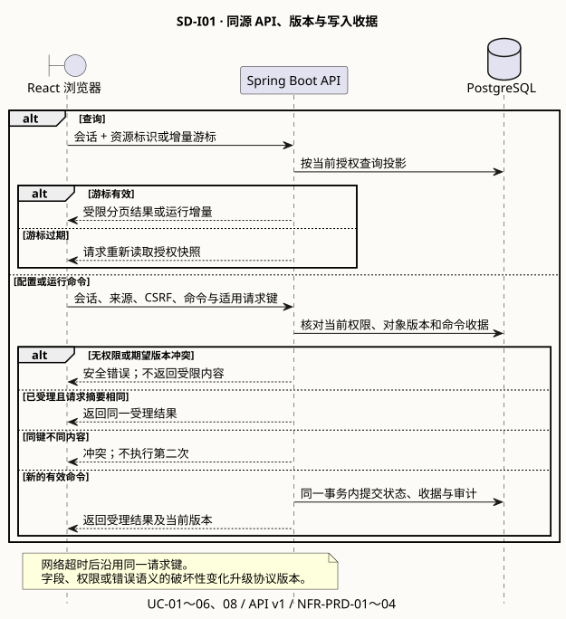
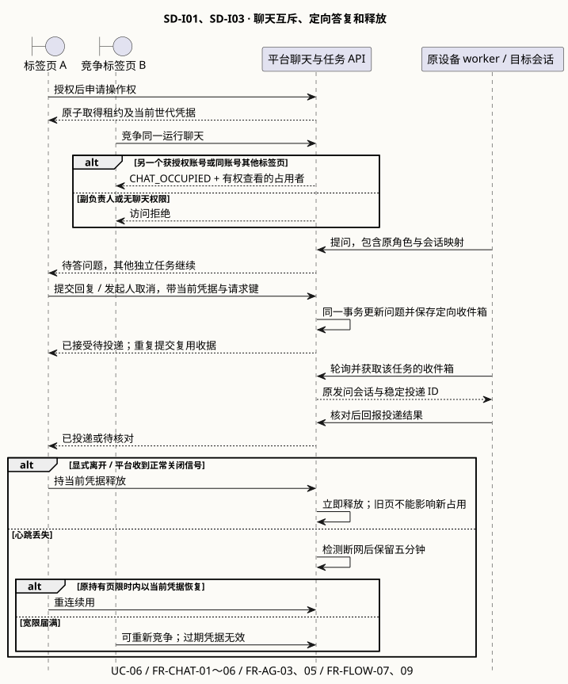
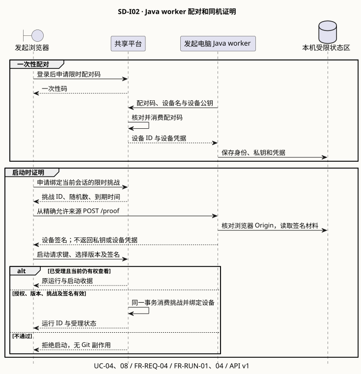
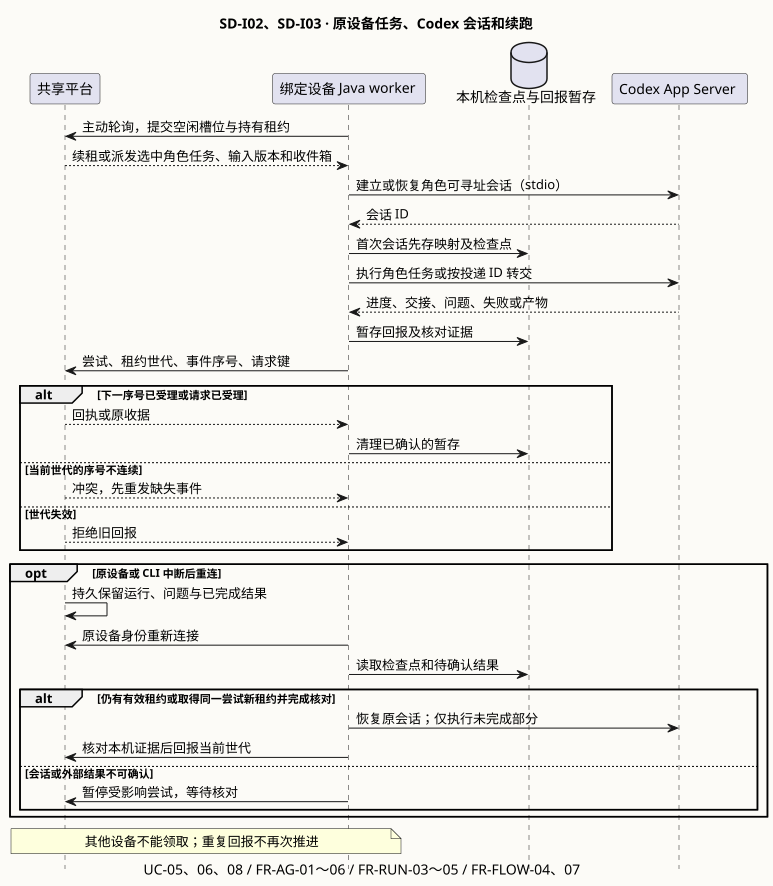
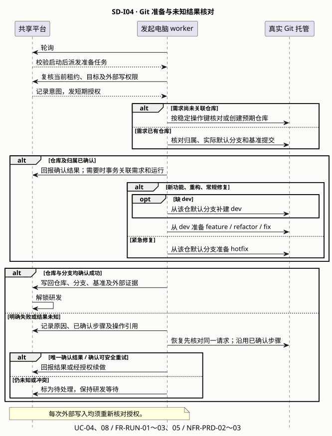
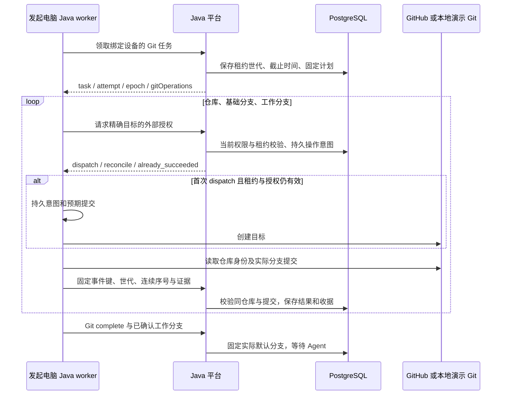
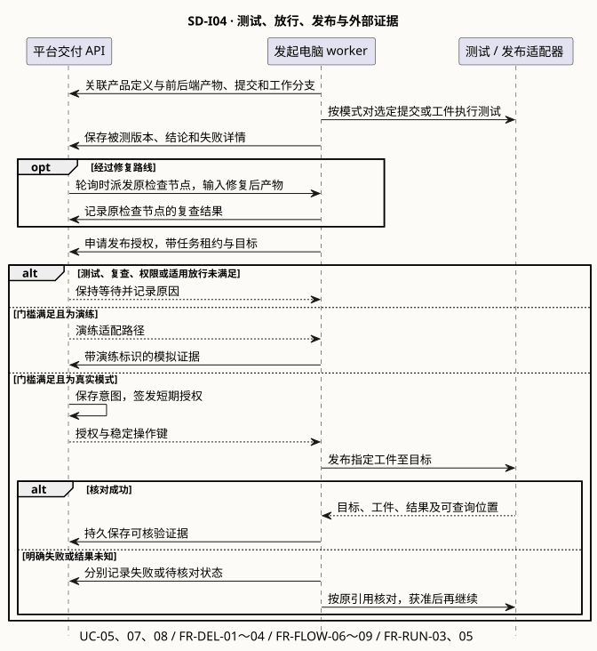

# AgentShip 集成系统设计 v0.5

Proposed。字段、路径、状态码以 [API v1.0.0-draft.13](contracts/agentship-v1.json) 为准。行为来源为 [BRD v0.57](../BRD/AgentShip/BRD-AgentShip.md)、[PRD v0.8](../PRD/PRD-AgentShip.md) 与 [SA](../SA/SA-AgentShip.md)。状态见 [设计索引](SD-AgentShip-index.md)。各图展示拟议方案，现状均指历史 Node.js/SQLite 原型。

## SD-I01 浏览器与平台

现状。原型已有 Cookie 会话、列表授权、对象版本及部分幂等。设计统一会话、来源和 CSRF 校验；列表按授权过滤分页，同名时仅有权者可选原需求，撤权提示仅面向原编辑者。

注册用户名限 100 个 ASCII 字符，字母大小写按同一身份键匹配。注册受理用 202 返回待验证状态及邮箱、手机号两条验证渠道。业务会话由登录取得。本人可经独立的本人联系方式接口读取资料。登录、会话、成员及聊天投影只含最小身份字段。两个渠道都验证后才激活。邮件忽略大小写，手机号带国家区号，规范化键分别唯一。密码按 15～128 个 Unicode 字符校验，保留输入中的空格及符号。开发环境的邮件和短信由本地模拟适配器产生。测试从隔离通道取得验证码，业务响应和日志不携带验证码。验证请求提交注册引用、渠道和验证码。引用必须不可猜测并绑定本次账号，验证码按渠道验证。所有凭证最迟在受理后 24 小时失效。过期或无效请求使用统一错误，不透露联系信息。真实发送待供应商确认。

配置保存携带期望版本。创建、转交、启动、回复、取消、变更、重试和人工恢复使用作用域内的请求键。常规收据受当前权限约束。同键同摘要取原结果，同键异内容返回冲突。已成功转交允许原发起人在相同对象、操作、键及摘要下取最小收据。该收据仅含受理状态、重复标志和不透明收据 ID。原发起人重新查询或写入按当时权限处理。收据留存窗口待定。

新增副负责人、转交与聊天授权命令在对象权限验证后解析完整用户名。未知账号和不适用账号统一返回 404 `MEMBER_UNAVAILABLE`。移除使用当前成员列表返回的账号 ID。接口没有全局用户枚举能力。

需求列表 `purpose=view` 可显示获权副负责人条目，并通过 `allowedActions` 反馈可否发起。只查可发起需求使用 `purpose=start`。可用流程绑定有权发起的 `requirementId`，四类工作类型共用一套候选。Agent 目录为流程编辑查用，编辑现有流程时传 `flowId` 并校验编辑权限，新建时校验创建权限。保存或启动按当前权限和版本复核候选。配置的使用权只来自当前主、副负责人身份。

### 聊天操作权与问答

现状。原型以主负责人和标签页判断占用。运行发起人通过独立的聊天授权接口添加或移除本次运行的获权用户，无需取得聊天租约。需求副负责人不可获得有效聊天权。获权访客可通过本次聊天链接直接竞争租约、读取会话、发送消息和回答问题。取得聊天权不增加项目、需求和运行看板的读取权，聊天入口也不依赖看板读取。其他命令另行验证操作者资格。租约绑定账号、会话、标签页及世代；只有当前凭据可续约、操作或释放。无权用户不获知占用者。退出账号或撤权立即废止原租约，并拦截旧页的新读写。

平台收到显式离开或正常关闭信号即释放；未收到关闭信号则按中断处理。从服务端检测点起保留五分钟，原持有页可带有效凭据重连；届满后重新竞争。异常关闭及目标浏览器覆盖见 SA-D10。设备在线与聊天连接分别记录。[关闭时的发送限制](https://developer.mozilla.org/en-US/docs/Web/API/Navigator/sendBeacon)

## SD-I02 本机配对、证明与任务

现状。原型以共享秘密签发时间戳证明。设计由平台消费配对码并保存公钥及设备凭据摘要。Java worker 将签名材料放在当前用户受限状态区，只接受配对配置的精确平台来源。启动时验证当前账号、会话、来源、设备及挑战，成功启动与消费挑战使用同一事务。支持浏览器的 HTTPS 回环访问需实测；当前只做回环开发验证。

**拟议签名格式**。Ed25519 输入为协议常量、设备 ID、挑战 ID、随机数和规范化平台来源，按固定顺序以换行连接并使用 UTF-8。公钥使用 Base64URL 文本表示的 SPKI DER，签名使用无填充 Base64URL。撤销、轮换及设备丢失政策待环境方批准。

2026-11-09 本批回环实现固定协议常量为 `agentship-device-proof-v1`，签名正文末尾无换行。平台来源采用小写协议与主机，去掉默认端口和根路径；不接受用户信息、查询或片段。本机桥默认 `127.0.0.1:4781`，浏览器精确 Origin 必须与配对来源相同。配对码 5 分钟、挑战 2 分钟、心跳间隔 10 秒、在线阈值 30 秒为实施默认。挑战账户、会话、来源及签名校验后，在启动事务内消费。Java worker 以 `--worker` 独立进程运行，使用受限状态目录保存密钥和设备凭据，不输出凭据，不启动平台数据库连接。当前设备功能只覆盖配对、证明与在线状态。

执行程序主动轮询。任务携带运行、节点波次、任务、尝试、租约世代、截止时间、输入修订、检查点及幂等作用域。每个租约世代的回报序号从 1 连续递增，当前世代缺号时回报冲突并提示先发送缺失事件。重复回报按请求键返回原收据。终态结果先暂存，平台受理后清理。原设备取得新世代后，可将已核对证据按新序号回报。并发、心跳、检测阈值、批次及载荷上限待环境验证。

## SD-I03 Codex 会话、消息和任务结果

原型通过标准输入输出维护独立角色会话。本批 Java worker 也使用 Codex App Server 的 stdio 协议，按流程所选角色启动独立线程。首次执行前保存会话与检查点，重连读取原线程结果，无法确认时暂停该尝试。子角色交付本机 Git 产物，协调 Agent 核对并汇总，保留同一运行的提交及引用。网页定向回复和人工处置继续由聊天批次接入。[Codex App Server 文档](https://learn.chatgpt.com/docs/app-server)

- 普通消息携带所选节点和波次，省略目标角色时发给协调 Agent。使用 `@Agent` 时客户端提交服务端候选中的稳定角色 ID。服务端只解析该波次内可投递的会话，无效或已失效目标返回 409 `CHAT_TARGET_UNAVAILABLE`。问题回复仍按原问题定位发问会话。
- 收件箱绑定任务、会话和稳定投递 ID。重复轮询去重，收到回执后标记已投递，未知时先核对检查点。普通 Agent 回复用非终态 `message` 事件回报正文、会话及可选收件箱关联。平台按设备、尝试、世代和连续序号验收，序号缺口返回 409 `EVENT_SEQUENCE_GAP`。事件与聊天记录同事务提交。看板只收内容无关的刷新通知，原始聊天和日志留在平台。
- 正式需求变更只在活动 BRD 节点内受理。发起人确认时，同时检查提案、节点波次、原需求配置版本及运行需求修订。事务更新原需求和当前运行修订。已启动节点沿用固定输入，尚未启动节点使用新修订。读端依据节点的输入修订和当前运行修订标记旧版本。历史尝试按当前权限分页，显示名取已固定的 Agent 版本。发起人主动重跑后的依赖传播与检查判定待 PRD Q-04。
- 检查只接受 `pass` 或 `repair`。无有效结论时等待人工。测试报告回传明确结论、提交及实际测试的不可变候选版本。外部消息、仓库和模型结果按不可信输入处理，完整会话留存待定。

## SD-I04 Git、发布与外部证据

### 仓库和分支准备

现状。原型包含 GitHub 与演练适配。设计按需求定位建仓操作，争用时复用已验证结果。工作分支关联稳定运行键；重试核对仓库、基准分支与提交。新建仓库时提交 GitHub 账号或组织，由系统创建公开仓库。已绑定需求沿用原仓库。命名冲突及不可访问时的反馈见 DEC-02。

启动投影用 `gitPlan` 区分待执行计划和 `git` 已验证结果。计划采用稳定标识命名，新仓库 `<namespace>/agentship-<requirementId>`，分支 `<workType>/<runId>`。hotfix 的 `baseSource` 为 `repository_default`，未查询前 `baseBranch` 和 `defaultBranch` 为空。其他类型从 dev 切分支，`ensureDev` 表示缺失时补建。`gitPreparation` 记录实际步骤证据。Java worker 通过 `--execute-git` 领取 Git 任务，完成后进入 `waiting / AGENT_EXECUTION_PENDING`。携带 `--execute-agents` 的设备随后领取节点任务。

已分派或结果未知的操作只回读；明确失败不自动重试。新仓库操作键按需求及模式共用，分支操作键按运行及模式区分。事件重放正文不得改变，旧世代不能覆盖结果。真实证据可关联需求，演练证据不能。当前默认租约 60 秒、授权最多 30 秒且不超过租约和启动授权期限，启动 Git 范围有效 24 小时；未知结果隔 30 秒只读核对。人工恢复与节点派发在后续任务接入。GitHub REST 使用官方 [仓库接口](https://docs.github.com/en/rest/repos/repos) 及 [引用接口](https://docs.github.com/en/rest/git/refs)，新仓库 `auto_init`，禁止强制覆盖分支。本批测试只用本地隔离服务；真实验收归 4.2。

### 测试、放行与发布

现状。原型历史验证使用演练适配。设计把实际提交、被测目标、工件、环境及供应商回执关联到运行。每次外部写入前核对当前租约、权限、目标和适用门槛，记录意图后签发短期授权。供应商调用在数据库事务外。开发范围验证 Git 和交付物归档。正式发布、放行、供应商发布对账及回退属后续范围。本期发布放行命令返回 `ACTION_NOT_ALLOWED`。开发环境必测项和恢复方式见 PRD Q-07。

区分明确失败与未知。按原请求标识查询，或仅接受与预期目标及工件唯一匹配的外部结果。无法确认且未证明未发生时保持 `unknown`、阻塞依赖。供应商可靠去重或可证明未发生时才可授权重试；否则交由获准维护者处理。即使停止运行，也要核对已启动的外部操作。

## 兼容性与验证

draft.3 未发布。draft.4 的浏览器和执行程序统一更新，注册受理、成员命令、消息事件和运行投影用同一版本生成夹具和客户端。领取时继续检查 worker 协议。验收覆盖现时权限、用户名判重、转交收据重放、旧页撤权、消息顺序与重复、原机续跑、修订冲突、历史分页及游标过期。真实 Codex、Git、浏览器和跨设备证据待验收。Integration-Ready 待确认。

### 网页协作与公开归档契约

API draft.13 增加按当前标签页租约读取聊天，以及通过收件箱将消息、回答和取消指令绑定到活动角色、尝试和原会话。浏览器收到旧版本或过期操作权反馈后重新读取。尝试历史附带已受理的操作人和时间，产物引用和运行事件按看板权限读取。运行事件按版本合并，只提示客户端刷新，避免携带私有聊天内容。

归档审批仅针对已完成运行当前节点的协调产物。审批携带候选提交和明确公开确认。重试需匹配当前失败记录的审批时间。原设备独立领取归档任务，租约为 75 秒，首次写入授权最多 25 秒且受租约和审批期限约束。Worker 先验证候选报告摘要和起点提交，再构造父提交只引用起点的快照。稳定标签为 `refs/tags/agentship/<runId>/<artifactId>`。仅创建标签，遇到不同提交停止并保留原引用。结果不明保留原导出提交，后续只回读。目标真实仓库和凭据由真实开发环境验收确认。 [Git 标签推送规则](https://git-scm.com/docs/git-push) · [GitHub HTTPS 访问](https://docs.github.com/en/get-started/git-basics/about-remote-repositories?apiVersion=2022-11-28)
