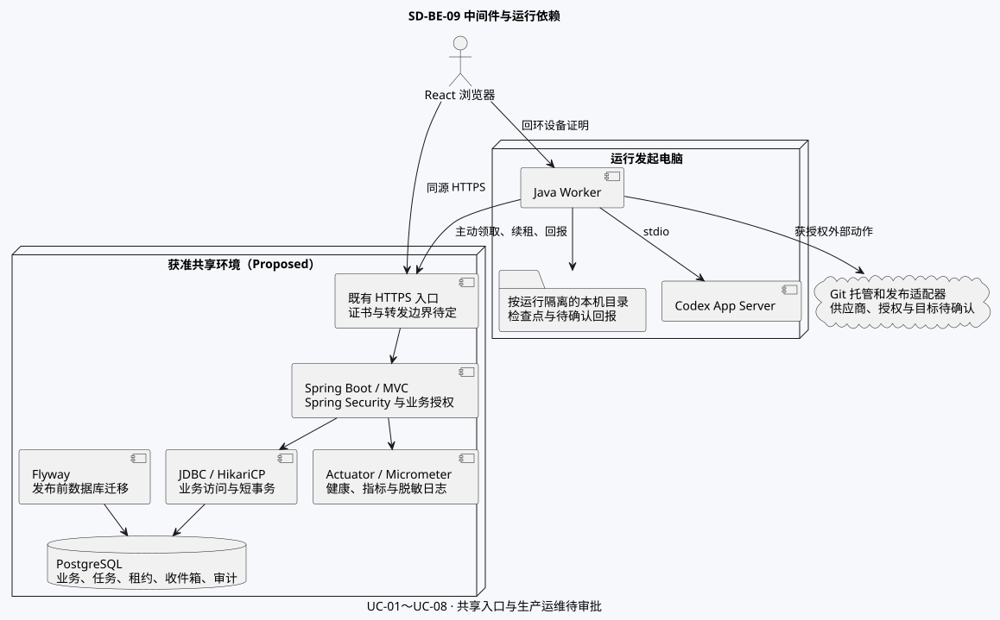
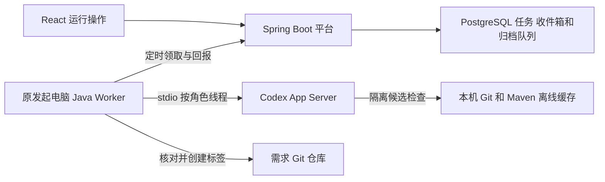

# AgentShip 中间件与运行依赖 v0.5

本视图承接 [SA v0.5](../SA/SA-AgentShip.md) 和 [后端系统设计 v0.5](SD-AgentShip-backend.md)。环境和签署状态见 [设计索引](SD-AgentShip-index.md)。

## SD-M01 组件拓扑与选型

图中实线表示调用或数据访问。覆盖 UC-01～08。React + TypeScript、Spring Boot、PostgreSQL 和 Java 本机执行程序已确认。表中具体组件为 Proposed，线上入口和供应商待定。

| 层 | 组件与决策 | 故障或验证口径 |
|---|---|---|
| HTTPS 入口 | 共享环境优先复用其已批准的 HTTPS 入口，提供证书、来源和传入请求边界。服务继续同源交付 React 静态资源与 API。回环设备证明接口仅在原机。 | 按目标环境验证证书链、原始来源和代理头信任。单独验证 HTTPS 页面访问回环所需的浏览器权限。 |
| Web 与身份 | Spring Boot + Spring MVC，Spring Security 承接会话安全、CSRF 及安全过滤链。对象授权、发起资格和租约校验由用例层承担。 | 无权接口不可由隐藏按钮绕过。验证撤权、过期会话、跨源写入与来源不符的设备证明。 [Spring Security CSRF 文档](https://docs.spring.io/spring-security/reference/servlet/exploits/csrf.html) |
| 数据访问 | PostgreSQL JDBC 驱动、Spring JDBC、HikariCP。连接池有上限，单独设置获取、语句、事务和外部调用超时。 | 验证连接耗尽、数据库重连、事务中断及超时反馈。池规模按并发和库连接预算定。 [Spring Boot SQL 数据库文档](https://docs.spring.io/spring-boot/reference/data/sql.html) |
| 数据库迁移 | Flyway 候选，版本化迁移独立于业务写权限。先以隔离库验证 DDL、关键查询和回退路径，再转入发布审批。 | 检查升级兼容、迁移锁、停机影响及恢复演练。设计 SQL 的范围见 [数据设计](SD-AgentShip-data.md)。 [Spring Boot 数据库初始化文档](https://docs.spring.io/spring-boot/how-to/data-initialization.html) |
| 任务和消息 | PostgreSQL 任务队列、收件箱、命令收据和任务租约。设备主动限量领取、续租、回报，使用 SQL 行级锁及 `FOR UPDATE SKIP LOCKED`。 | 验证双设备、重复和乱序事件、过期租约及恢复。操作状态与待分发记录在同一数据库事务提交。 [PostgreSQL SELECT 文档](https://www.postgresql.org/docs/current/sql-select.html) |
| 本机持久化 | Java Worker 使用受保护、按运行隔离的目录，暂存执行检查点、未确认回报及工作副本。SQLite 是本机持久队列可选项。 | 用进程异常退出和原电脑重启验证原子写入、重复回报去重和未确认结果保留。共享看板及租约状态以 PostgreSQL 为准。 |
| 外部适配 | Codex App Server 以标准输入输出接入。首期 GitHub 经受控 Git 适配器。GitHub Actions 作为后续发布候选。 | 区分演练和真实证据。供应商超时先按原操作键核对，首期验收真实会话、工作分支与可公开归档。 [Codex App Server 文档](https://learn.chatgpt.com/docs/app-server) |
| 可观测性 | Spring Boot Actuator + Micrometer 候选，配合结构化日志。服务健康、业务审计及任务遥测分别有访问控制。 | 核验链路可关联请求、运行、节点、尝试、设备与外部操作。日志和指标过滤身份凭据、联系方式和消息正文。 [Spring Boot Observability 文档](https://docs.spring.io/spring-boot/reference/actuator/observability.html) |

## SD-M02 部署、扩容和验收条件

| 设计选择 | 启用或重评条件 |
|---|---|
| 权限与租约查询直接使用 PostgreSQL | 先以代表性负载检查查询与锁开销。若读负载持续超过预算，再评估只缓存可重建的读投影，并验证撤权与失效行为。 |
| PostgreSQL 队列用于首期 | 以待领取任务年龄、领取延迟、事务耗时和队列表规模判断瓶颈。独立消息中间件的引入需给出容量证据、重放策略和一致性边界。 |
| 平台记录工件来源与引用 | 大工件存储和保留范围批准后，再决定获准对象存储及下载策略。运行与产物授权依旧由平台执行。 |
| 配置按环境分发 | 数据源、证书、密钥、会话、心跳和供应商模式由获准环境提供。Git、Codex 和发布凭据由本机在其授权范围使用。 |
| 发布前验证 | 校验不可变包版本、API 与 Worker 协议、数据库迁移、备份恢复和健康检查。验收分别覆盖回环开发、受批共享环境及外部供应商。 |
| 运营责任待定 | 监测数据库池饱和与锁等待、任务和聊天租约、设备离线、长时间待核对的外部动作及备份状态。告警阈值、SLO、RPO/RTO、轮值和部署责任待确认。 |

当前交付物为设计与验证口径。生产入口、组件版本、真实外部连接及运维指标以批准后的环境决策为准。

## SD-M03 中间件登记与逐功能交互

[功能图索引](AgentShip-Function-Diagrams.md)逐项标出 MW ID。[事务与并发矩阵](data/transaction-concurrency-matrix.md)定义数据库及外部动作的责任边界。[目标拓扑](diagrams/sd-be-09.svg)和[信任边界](diagrams/sd-trust-boundaries.svg)分别说明运行连接及授权。

| ID／状态 | 依赖及责任 | 数据与一致性 | 失败和恢复 | 容量、保护及监测 |
|---|---|---|---|---|
| MW-00／As-Is | 原型回环平台与 SQLite，当前工作区证据 | 原型工作区内保存运行和租约 | 原机停止时其他设备无法访问 | 本机演练证据，实际多机能力见 SA-P06／08 |
| MW-01／已选产品，拟议部署 | 平台与 PostgreSQL JDBC／HikariCP | 共享业务状态、快照和证据。授权、版本、约束同事务裁决 | 连接故障按短事务重试和可用性策略，恢复先核对已受理结果 | 连接预算、备份、权限和锁等待监测。版本与指标待批 |
| MW-02／Proposed | 获准 HTTPS 入口、Spring Security 与平台授权 | 同源身份、请求校验和当前对象权限 | 证书、会话、来源或权限失败时拒绝并给安全结果 | 连接上限、浏览器回环权限、敏感信息遮蔽及授权失败指标待验收 |
| MW-03／Proposed | PostgreSQL 队列、收件箱和审计，平台写，绑定设备领 | 任务与下一步同事务。新世代、连续序号及原收据仲裁 | 不重放未知外部动作。缺号补发、过期任务受控接管，问题按目标持久保留 | 批次、租约、退避与积压告警待定。按设备和任务授权 |
| MW-04／Proposed | 数据库迁移工具候选 Flyway，由平台交付维护 | 版本化迁移及兼容窗口 | 可逆时回退兼容程序；数据变更按批准前滚或恢复 | 最小权限、迁移锁和恢复演练。见[迁移设计](data/migrations/initial-and-recovery.md) |
| MW-05／Proposed | 原机 Java worker、受限本机存储与 Codex App Server | 设备证明、角色会话、检查点、回执及待确认结果 | 只让原设备续跑。会话及不可确认投递按检查点核对 | 任务槽位、消息尺寸、本机数据权限及设备离线监测待实测 |
| MW-06／Proposed | GitHub 适配器与后续发布候选 GitHub Actions | 稳定操作键、受控动作、实际仓库或发布证据 | 已证实动作沿用。结果未知先核对，供应商执行与数据库事务分开 | 外部配额、授权、结果核对告警和运行证据安全待审批 |
| MW-07／Proposed | Actuator、Micrometer 与结构化日志，运维责任待指定 | 请求、运行、节点、尝试和外部操作的关联 | 区分审计、健康与业务结果；采集失败需可观察 | 容量、采样、告警及留存待定，排除凭据、联系方式及原始消息 |

首期按 PostgreSQL 承担权威状态和任务持久化。独立缓存、消息代理和搜索中间件在确认负载证据与一致性要求后评估。当前业务流程可由上述拟议能力支撑。

### 网页消息和交付归档的运行交互

平台保存待答、定向收件箱和归档审批。原电脑恢复后继续领取同一运行的工作。网页运行事件只提供聚合的版本变动提示，详细状态及历史通过各自查询读取。Worker 以角色粒度保存会话及待回执结果，收到过期世代时停止回报。归档在外部调用之前持久固定导出提交。调用结果无法确定时，以原标签回读核对。首期沿用 PostgreSQL 队列，运行和消息的授权、隔离及幂等细节见 [集成契约](SD-AgentShip-integration.md)。
