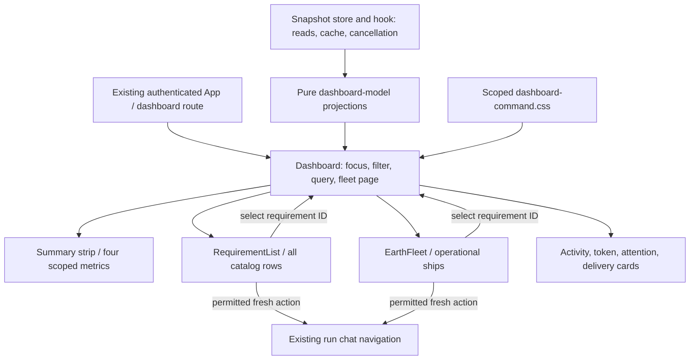
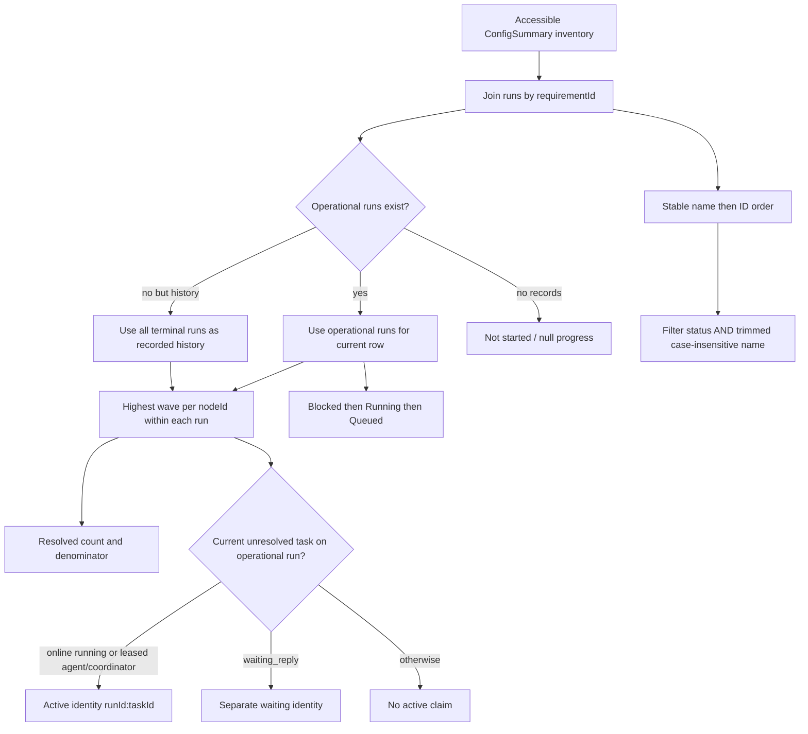
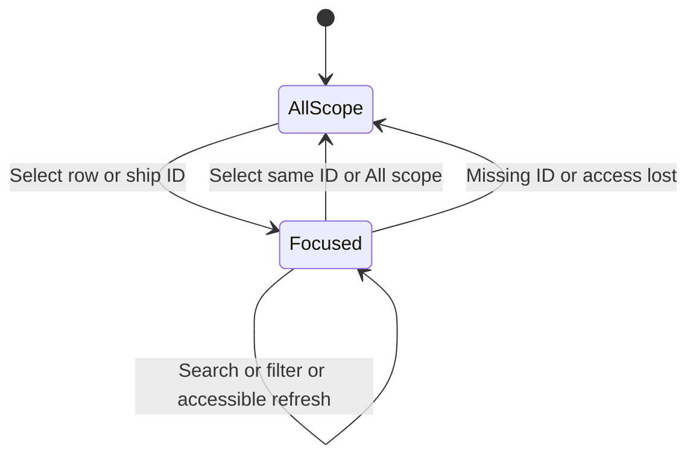
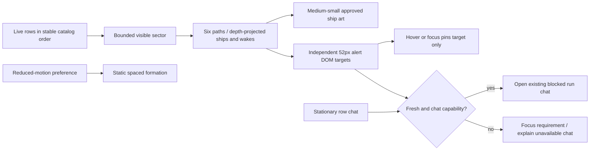
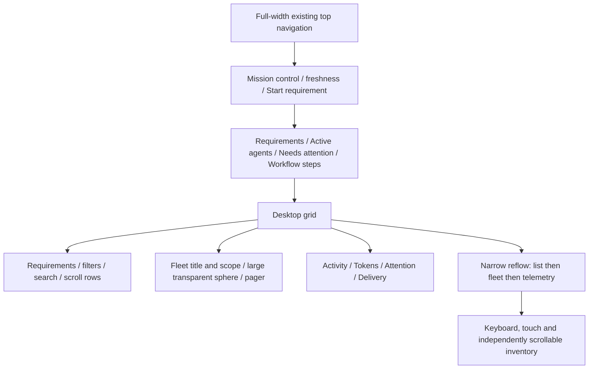
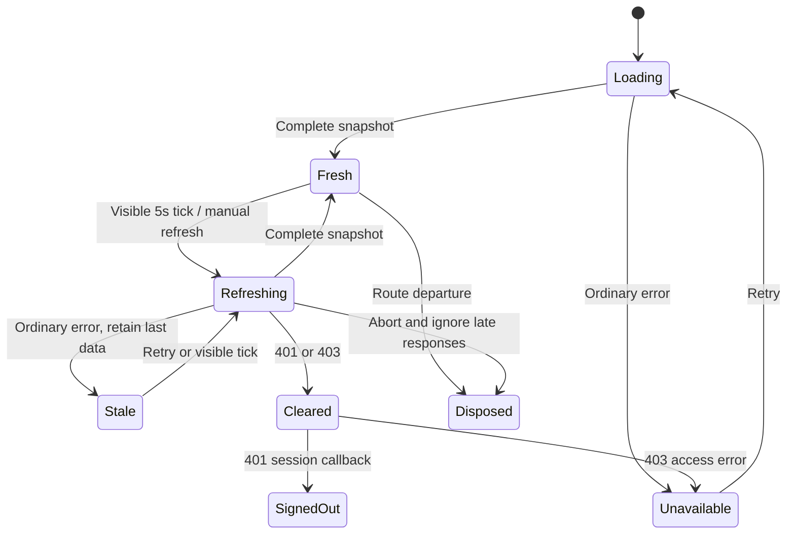

# Frontend design — Dashboard command center

Version 1.0 · 2026-11-16 · Scoped frontend increment · Design owner: dashboard design contributor. Source baseline: `472c618`. Diagram notation: Mermaid source; rendering not independently validated. Sources and readiness are maintained in [index](index.md).

## DES-D01 — Composition and ownership



DIA-D01: To-Be frontend component and runtime overview; owner dashboard design; traces SA-D00/D01/D07, F-D01–08. Arrows are data or user-event flow, not new network services. Current source evidence and problems are in SA-D00. Retain React/TypeScript, existing route/session owner, API client, canvas geometry and `/agent-ship.png`; no new package or server component.

| Component / file | Responsibility and contract |
|---|---|
| `dashboard.tsx` / Dashboard | Existing `navigate(path)` and `onUnauthorized()` props; owns ephemeral selected requirement ID, list query/filter, fleet page, fullscreen action. Composes projections; never infers server rights. |
| `requirement-list.tsx` / RequirementList | Receives projected rows, global status counts, filter/query, selected ID, freshness and callbacks. Displays semantic selection separate from chat button (no nested buttons). Named search, status tabs, independently scrollable rows; parallel execution expandable/readable. |
| `dashboard-model.ts` | Pure current-node, catalog, filter, live-fleet and scoped-metric derivation. Owns arithmetic/status semantics. No DOM, requests, selection or mutation. |
| `use-dashboard-snapshot.ts` | Extracted single load/cache owner. Store exposes data/error/pending/accessLost, refresh, subscribe/getSnapshot/dispose; hook owns five-second visible polling and subscription lifecycle. No per-frame state. |
| `earth-fleet.tsx` | Retained canvas/DOM overlay; `hideRoster?: boolean` defaults false. Dashboard passes true; removes duplicate roster and its bottom space reservation. Existing selection/navigation props remain. |
| `dashboard-command.css` | New isolated visual layer scoped under `.dashboard-command`; limited navbar overrides under `.dashboard-shell`. Imported after existing theme by main entry. Other pages retain their styles. |

The exact executable wire types remain `frontend/src/api.ts` and `run-api.ts`; frontend projection exports below are local contracts. No new global state, persisted dashboard preferences or URL format.

## DES-D02 — Catalog, agents and truthful progress



DIA-D02: To-Be projection and filtering; owner dashboard design; traces SA-D01/D02, F-D01/02/03/07, SYS-D01–05/09, DES-D02. Highest wave resolves old failure/activity state; records of superseded artifacts are not discarded from output totals.

```typescript
type CatalogStatus = 'running' | 'blocked' | 'queued' | 'not_started'
  | 'completed' | 'failed' | 'stopped' | 'history';
type CatalogFilter = 'all' | 'running' | 'blocked' | 'queued';
type CatalogAgent = {
  key: string; name: string; kind: 'agent' | 'coordinator';
  runId: string; taskId: string; roleId?: string; stage: string; node: string;
};
type CatalogExecution = {
  key: string; runId: string; stage: string; node: string; state: string;
  activeAgents: CatalogAgent[]; waitingAgents: CatalogAgent[];
};
type CatalogRow = {
  requirement: ConfigSummary; runs: RunDetail[]; historyRuns: RunDetail[];
  status: CatalogStatus; progressScope: 'live' | 'history' | 'none';
  progress: number | null; total: number; resolved: number;
  activeAgents: CatalogAgent[]; waitingAgents: CatalogAgent[];
  execution: CatalogExecution[]; alertRun?: RunDetail;
};
// Exports: currentNodes(run), catalogRows(requirements, runs),
// filterCatalogRows(rows, filter, query), catalogStatusLabels.
```

`runs` contains only operational records; `historyRuns` contains terminal records. The retained `liveFleetRows` stays a separate projection so historical/no-run entries never produce ships. Status/progress follow FRS R-D01–05 exactly. For equal node waves preserve first encountered snapshot; source node identity is required, with legacy fixture fallback permitted only to avoid accidental collapsing of missing IDs. Progress null is displayed as `—` and Progress unavailable; history is explicitly labeled, never an assumed newest run. Active names use nonempty `task.roleDisplayName`, otherwise Agent/Coordinator; assigned roles cannot imply activity. Task counts deduplicate using `runId:taskId`. Parallel contexts are preserved rather than silently choosing one agent. Waiting is explicit `waiting_reply`, never an executing count.

Artifacts are deduplicated recorded output IDs across all waves of scoped operational runs; repairs derive current check snapshots. No token estimate/chart is introduced. All metric inputs must be operational runs joined to visible catalog IDs, avoiding orphan name leakage.

## DES-D03 — Focus, filters and telemetry



DIA-D03: To-Be selection state; owner dashboard design; traces SA-D03, F-D02/04/07. State is independent of list visibility and fleet paging. Inventory/filter counts always use the whole catalog before search. Summary Requirements uses catalog size in All scope and one in focused scope; remaining cards use all visible catalog operational runs or the selected row's operational runs. Selected history/no-run shows No live run and zero live metrics after a successful load. Clearing focus preserves query/filter. Renaming preserves identity. Selecting a live requirement reveals its fleet sector without filtering the sphere to one ship. Successful refresh never discards a selected ID merely because its run ended.

## DES-D04 — Fleet depth, spacing and alert safety



DIA-D04: To-Be fleet and blocked-chat flow; owner dashboard design; traces SA-D04, F-D05/06, NFR-D03/05. `alertRun` chooses an eligible blocked run with `open_repair_control` first, otherwise first blocked run for status only; stationary and dot chat use the same choice. Stale snapshots keep last-known labels and disable direct-chat shortcuts. Unavailable chat never invokes navigation; selection remains permitted.

Keep six tilted circular paths even when fewer ships occupy them; no fabricated wakes for empty slots. Preserve 30fps and pixel-ratio cap 2, continuous normal-mode motion, rear/front depth, medium-small hulls and independent overlay z-order. Dashboard `hideRoster=true` sets its bottom reservation to zero; no old 174px phantom space. Persistent 128px nameplates replace callsigns. A deterministic layout keeps nameplates within the scene and separated, preferring proximity to their ship and clearance from alert targets. Displaced labels have connector lines; full names remain available on hover/focus and in the stable list.

Implemented density decision: `ResizeObserver` measures the actual scene, using `min(width, height)` to select six ships at 500px or more, four at 430–499px, and two below 430px. Six paths remain at every size; paging keeps all operational requirements reachable. Alerts remain 52px. Verification reported by the delivery coordinator found that six ships in a 511×468px scene approached 70.57px, failing the unchanged 75px geometry clearance oracle. The resulting four-ship sector at that scene size resolves the density constraint; a 580×552px scene retains six ships. Threshold geometry tests passed according to coordinator evidence. This supersedes viewport-width capacity assumptions and the earlier conditional density proposal; it does not claim broad browser certification.

## DES-D05 — Accepted visual system and input



DIA-D05: To-Be layout and input, owner dashboard design; traces SA-D05, F-D01/05/07, SYS-D10/11. Visual authority is [approved dashboard](../../dashboard-command-center/approved-dashboard.jpg); its example values are not fixtures or production data. Navy blue glass, cool edge bevels, mint/cyan lighting, muted secondary text and rose blockers create depth without sacrificing contrast. Layered shadows, restrained inner highlights and continuous scene motion replace flat cards. Decorative charts must not imply unknown measurements.

| Selector contract | Content / behavior |
|---|---|
| `.dashboard-command`, `.command-heading`, `.command-live`, `.command-scope` | Scoped root/header, truthful freshness, selected-name/reset scope |
| `.command-summary`, `.command-grid` | Four summary cells; three-column desktop composition |
| `.requirements-panel`, `.command-fleet`, `.command-telemetry` | Inventory, sphere and supporting cards |
| `.requirement-tabs`, `.requirement-search`, `.requirement-scroll` | Global status controls, full-width named search, visible internal scroll affordance |
| `.requirement-row[data-status][data-selected]` | Status and selected glow; readable name/context/progress |
| `.requirement-select`, `.requirement-row-title`, `.requirement-agent`, `.requirement-stage`, `.requirement-progress`, `.requirement-chat` | Separate semantic selection/chat; full text available without relying on a moving target |

Use CSS grid `minmax(0, ...)` and `min-width:0`; allow vertical page scroll at narrow sizes. No horizontal overflow at 1440×1000, 1280×800, 390×844. Preserve keyboard-visible focus, text/symbol status, pressed/current state, accessible progress label/value, named search and close/reset actions. Internal list scrolling must work with keyboard/touch; do not globally suppress its scrollbar. Progress is null until known. Loading/unavailable/stale/empty/no-matches are distinct; only valid snapshots show measured zero. Expanded execution context is available for parallel work. English strings only. Approved user theme, reduced-motion preference and semantic controls are retained together.

## DES-D06 — Refresh lifecycle and protected state



DIA-D06: To-Be snapshot lifecycle; owner dashboard design; traces SA-D06, F-D08, SYS-D12, SEC-D01. Store owns one in-flight load; hook owns timer/visibility listeners and cleanup. Detailed request contract is in [integration](integration.md). Data publishes atomically only after all reads. Pending refresh preserves view controls and data; ordinary failure marks last-success time and suppresses executable chat until recovery. 401/403 clear protected snapshot/cache and selected ID, not just the error banner. Disposed/generation-invalid work cannot reintroduce data. Manual refresh and visibility return use the same loader; no parallel competing caches.

## Decisions, verification and scoped delivery

| Decision | Driver / consequence | Status / owner |
|---|---|---|
| DES-D01 | Extract testable store, keep pure model and one view state owner; no framework expansion | Confirmed bounded choice / UI owner |
| DES-D02 | Latest-node-wave and actual-task projections eliminate repair/history inflation | Confirmed SRS/FRS / model owner |
| DES-D03 | Catalog focus independent of filtering preserves browsing and explicit history focus | Confirmed / UI owner |
| DES-D04 | Preserve scene engine and fixed alerts; replace duplicate roster with stationary inventory; actual scene dimension selects 6/4/2 ships at 500/430px thresholds | Implemented density decision / UI and visual owners; coordinator-reported threshold geometry checks passed |
| DES-D05 | Isolated stylesheet preserves other pages; screenshots decide actual visual quality | Confirmed / visual owner |
| DES-D06 | Atomic refresh and explicit stale/access states retain trustworthy data and permissions | Confirmed / UI owner |

Planned checks: projection arithmetic/lifecycle/parallel tasks; filter and focus transitions; store partial failure/recovery/denial/disposal; alert permission and route mapping; geometry at actual scene sizes; rendered desktop/mobile/keyboard/reduced-motion checks; frontend typecheck/build and relevant existing regression. The density evidence above is reported by the delivery coordinator; this design author did not execute runtime tests. React text rendering remains the escaping boundary; no `dangerouslySetInnerHTML`, new sensitive logging, storage or network collector. Existing static build/release remains; rollback is reverting this scoped frontend increment. Backend migrations, new infrastructure and broad browser certification are Not Applicable. Remaining visual acceptance belongs to the user after implementation evidence.
