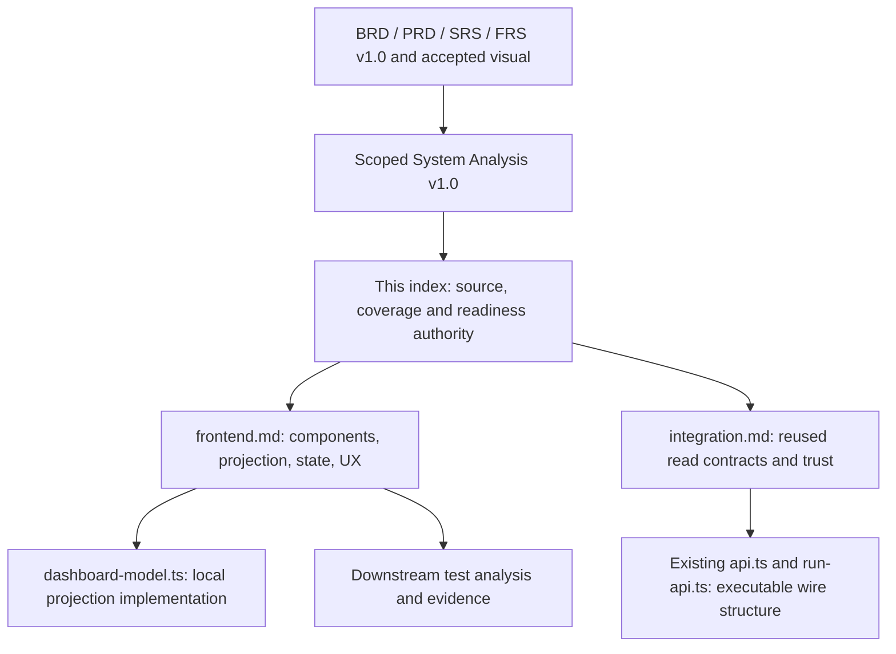

# System design index — Dashboard command center

Version 1.0 · 2026-11-16 · Source baseline `472c618` · Branch `codex/dashboard-command-center` · Scope owner: requesting user; design owner: dashboard design contributor. User authorized the approved dashboard through testing; production release and final user visual acceptance are separate.

DIA-X01: To-Be document/authority navigation; owner dashboard design; traces the full scoped increment. Mermaid source is provided; no renderer validation is claimed. This set uses the standalone system-design standard for a bounded frontend-only change, not an unrelated full-platform redesign.

## Source and artifact register

| Artifact | Version / role / readiness |
|---|---|
| [BRD](../../BRD/AgentShip-Dashboard/BRD-AgentShip-Dashboard.md) | v1.0 user-authorized scoped business baseline, BR-D01–11 |
| [PRD](../../PRD/PRD-AgentShip-Dashboard.md) | v1.0 product baseline, PR-D01–12 |
| [SRS](../../SRS/SRS-AgentShip-Dashboard.md) | v1.0 system baseline, SYS-D01–12, NFR-D01–06, SEC-D01 |
| [FRS](../../FRS/FRS-AgentShip-Dashboard.md) | v1.0 functional baseline, F-D01–08 and R-D01–08 |
| [SA](../../SA/SA-AgentShip-Dashboard.md) | v1.0 scoped logical analysis, SA-F01–06 / SA-D00–07 |
| [Approved image](../../dashboard-command-center/approved-dashboard.jpg) | User-selected appearance/composition; illustrative sample data only |
| [Frontend SD](frontend.md) | v1.0 DES-D01–06; local projection/API, component, visual, state authority |
| [Integration SD](integration.md) | v1.0 DES-I01–02; unchanged read contracts and failure boundary |
| Existing API TypeScript | `frontend/src/api.ts`, `run-api.ts`; unchanged wire structure authority |

Historical MVP documents are context only; this increment does not claim their broad approval or completion. Current source evidence: original dashboard inventory is operational-only; old execution rows infer assigned roles; old fleet has duplicate roster/bottom reserve; refresh already has pages, four detail workers, terminal caching and five-second visibility timer. SA-D00 records the affected problems; SD preserves proven behavior while changing the scoped presentation/projections.

## Feature and diagram traceability

| BRD obligation | PRD / SRS | FRS | SA | Design diagram / owner | Planned verification |
|---|---|---|---|---|---|
| BR-D01 all inventory | D01 | F-D01 | SA-F01 | DIA-D01/02/05 / design | Mixed lifecycle list, scroll, empty |
| BR-D02 search/filter | D02 | F-D02 | SA-F01 | DIA-D02/03 / design | Combined query/filter/counts/reset |
| BR-D03 current work/progress | D03–05 | F-D03 | SA-F02 | DIA-D02 / design | Waves, actual agents, history, unknown denominator |
| BR-D04 shared focus | D06 | F-D04 | SA-F03 | DIA-D03 / design | Row/ship/focus/refresh/filter independence |
| BR-D05 fleet motion | D07 | F-D05 | SA-F04 | DIA-D04/05 / design | Six paths, actual-width spacing, reduced motion |
| BR-D06 blocked chat | D08 | F-D06 | SA-F04 | DIA-D04/I03 / design | Same permitted blocked run, pinned 52px target |
| BR-D07 telemetry | D09 | F-D07 | SA-F02/03 | DIA-D02/03/05 / design | Live-only scope, dedupe, no token fabrication |
| BR-D08 accepted visual | D10 | F-D07 | SA-F05 | DIA-D05 / design | Screenshots and approved asset comparison |
| BR-D09 accessible responsive | D11 | F-D01/05/07 | SA-F05 | DIA-D04/05 / design | Keyboard, scroll, mobile/no overflow |
| BR-D10 reliable refresh | D12 | F-D08 | SA-F06 | DIA-D06/I02 / design | First failure/stale/recovery/atomicity/abort |
| BR-D11 permissions | D08/12 | F-D06/08 | SA-F04/06 | DIA-I01/03/D06 / design | Capability, stale disabled, 401/403 clear |

In the second column Dxx denotes matching PR-Dxx/SYS-Dxx. Coverage covers all in-scope business requirements and all eight functional features. No backend capability, role policy or durable data feature is added.

## Routing and workflow outcomes

| Step / profile | Outcome |
|---|---|
| 1 Baseline | Confirmed source versions, approved image, repository evidence and scoped authorization; no unrelated historical gate imported |
| 2 Coverage/routes | BR-D01–11 reconciled through product/SA. Frontend architecture, component/state, experience and quality concerns handled sequentially in this bounded artifact; UI/model/visual implementation owners receive exact contracts |
| 3 Architecture/contracts | Existing SPA/read APIs retained. Local CatalogRow contract fixed with model/UI owners. Wire contracts unchanged, no new OpenAPI proposal |
| 4 Affected design | Every feature has target technical flow; current problems in SA; composition, derivation, focus, scene/input and error/access states included |
| 5 Handoff | Source semantics reconciled with product and implementation contributors. Class contract fixed; isolated CSS; no backend edits. Projection source is current-node wave and actual tasks |
| 6 Traceability | Coverage table above maps every obligation to diagram and planned verification |
| 7 Quality gate | Scope, source/version, diagrams, component/state, permissions, responsive/motion, live-data honesty and failure recovery reviewed; no material unresolved design choice |
| 8 Readiness | Frontend/integration scoped design ready for authorized implementation/testing. Runtime/rendered visual verification remains downstream; no test or release approval asserted |
| Backend/data/middleware | Not Applicable: no backend payload, durable model, query, migration, authentication policy, cache service or broker change; retain current platform |
| Operations/security | Existing build/deploy retained; scoped rollback by revert. Existing escaping and server permissions retained; no new sensitive storage/telemetry or external transfer |

## Readiness, risks and ownership

Contract readiness: **Ready for reused read contract and local frontend projection**. Frontend readiness: **Ready for scoped implementation**. Integration readiness: **Ready for unchanged read/navigation boundaries**. Data/middleware/backend readiness: **Not Applicable to this increment**. Scoped SD readiness: **Ready under existing user authorization**; this is not overall platform approval, completed testing or production release approval.

No unresolved material source decision remains. DES-D04 has been reconciled to the implemented actual-scene density thresholds: six ships when the shorter scene dimension is at least 500px, four at 430–499px, two below 430px; six paths and 52px alerts remain. The delivery coordinator reported the initial six-ship 511×468px clearance failure (70.57px versus the retained 75px oracle), resulting density correction and passing threshold geometry checks. This is attributed implementation evidence, not a test executed by this design author. Remaining browser behavior and final visual acceptance depend on delivery verification. Particular risks are glow reducing text legibility, multi-run identity collisions, repairs reopening steps, and revoked stale data. Planned checks and mitigations are in DES-D02/04/05/06 and test analysis. Rendering diagrams was not run; readable Mermaid sources are provided with scope/owner/source metadata. Final implementation evidence and any necessary design corrections must be reconciled before reporting completion to the user.
