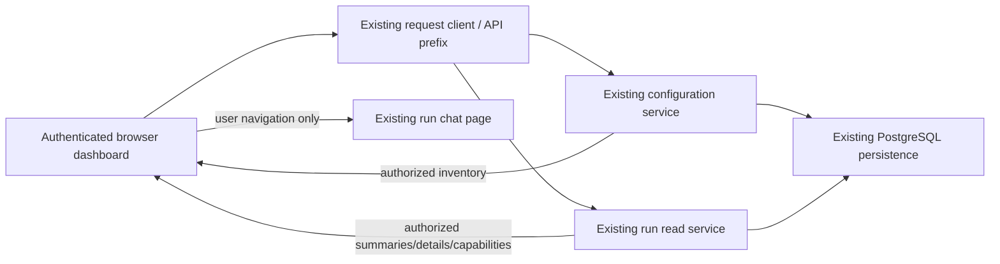
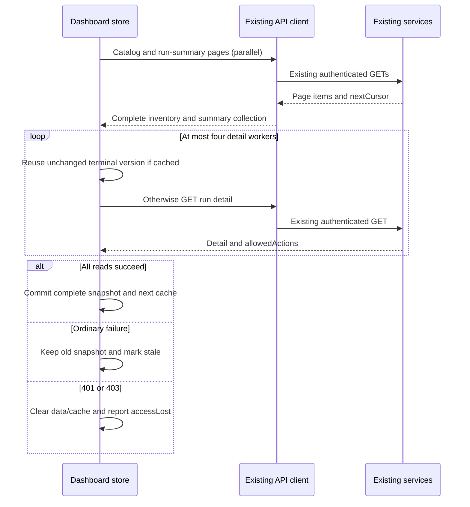
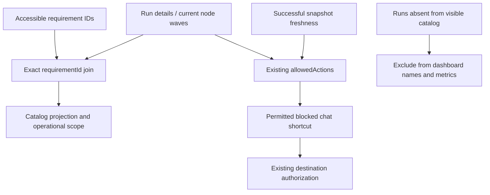

# Integration design — Dashboard command center

2026-11-20 addendum: the [bottom-layout delivery](../../dashboard-command-center/bottom-layout-delivery.md) adds optional `RunDetail.recentActivity` to the authorized detail response. It defines the persisted sources, kinds, timestamps, bounded history and client compatibility. The original unchanged-contract description below applies to the earlier baseline only.

Version 1.0 · 2026-11-16 · Existing read contracts only · Owner: dashboard design contributor. Machine-readable authority: current `frontend/src/api.ts` and `frontend/src/run-api.ts` at source baseline `472c618`; no endpoint/payload change.

DIA-I01: Existing deployment/trust topology retained; owner dashboard design; traces SA-D07, F-D01/06/08, SEC-D01. Backend owns authentication, authorization and persistence; the dashboard derives read-only display. This view confirms existing responsibilities, not a new database access path from the browser.

## DES-I01 — Snapshot read protocol

DIA-I02: To-Be preserved load behavior with explicit failure authority; owner dashboard design; traces DES-D06, F-D08, NFR-D01/02. Request paths below are passed to the existing API client, which owns the application API prefix and credentials. No replacement OpenAPI contract is invented for unchanged endpoints.

| Existing read / authority | Fields consumed / handling |
|---|---|
| `configPath('requirements')` (`/objects/requirements`) → `Page<ConfigSummary>` | ID/name and existing configuration metadata; all pages, `pageSize=100`, follow nextCursor |
| `/runs` → `Page<RunSummary>` | ID, requirementId, state, version, deviceStatus, allowed actions; all pages |
| `/runs/{id}` → `RunDetail` | Stages/nodes/waves/tasks, check snapshots, artifacts, device and capability fields; at most four concurrent reads |
| Existing `/runs/{id}/chat` client route | Navigate only for fresh blocked row and existing `open_repair_control` action; destination rechecks access |
| Existing `/requirements/new` client route | Retain Start requirement navigation; no dashboard mutation |

Repeated pagination cursor is an error, not an infinite loop or partial success. Unchanged terminal detail versions may reuse cache; current summary deviceStatus overrides cached deviceStatus. Keep next cache private until complete success. Abort on departure; late responses cannot publish. Poll only when visible at five seconds; visibility return and manual retry use the same non-overlapping loader. 401 invokes existing session callback after clearing; 403 clears snapshot/cache/selection and displays access failure. Ordinary failure preserves explicit last-known data but does not retain executable chat shortcuts.

## DES-I02 — Identity and contract compatibility

DIA-I03: To-Be trust and association rules; owner dashboard design; traces SA-D07, F-D03/06/07/08. Stable IDs, not display names, join records. No inferred newest run from unspecified ordering. Data semantics/projection types are owned by [frontend DES-D02](frontend.md#des-d02--catalog-agents-and-truthful-progress), with FRS R-D01–08 as governing behavior. API TypeScript definitions remain executable structure authority; local derived fields are not server payload additions.

Contract compatibility: existing clients/providers require no deploy coordination or migration. No new retries, queues, cache service, broker, persistent storage, credentials, token collection, cross-service transaction or sensitive diagnostic event. Existing server enforcement remains authoritative even after a fresh client capability check. Integration verification covers pagination, concurrency, terminal reuse, permission denial, partial-load atomicity, abort/late result and fresh-only route actions. Tests verify consumed boundaries; no provider contract change is claimed.
