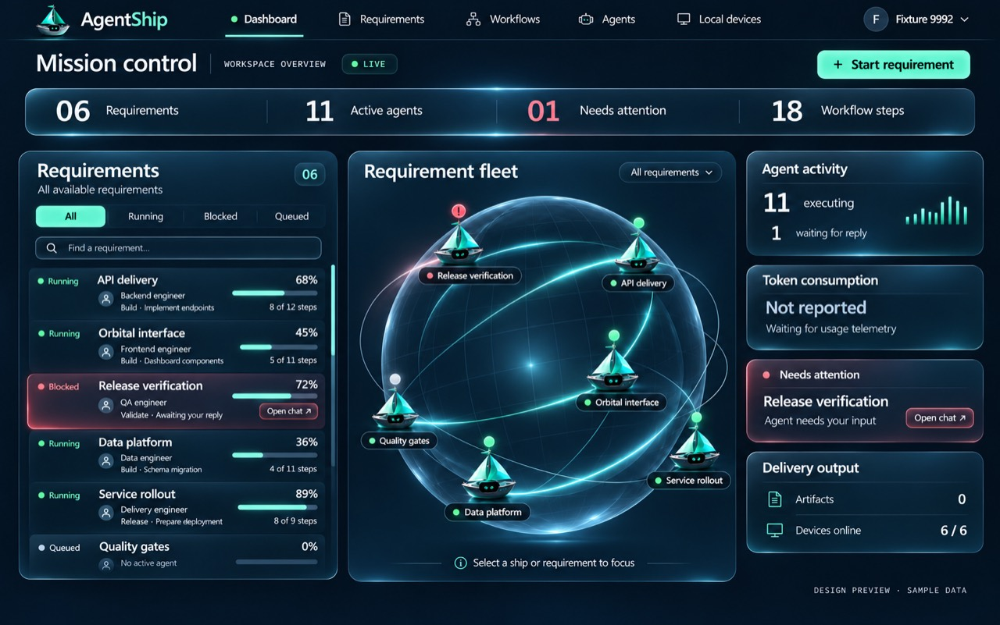
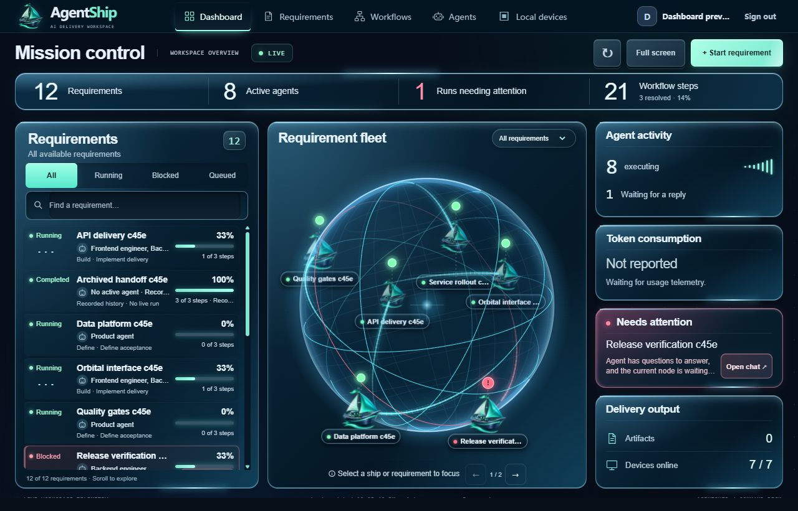

# Dashboard command center delivery

**Current increment:** [Bottom requirements table and six-card layout](bottom-layout-delivery.md), branch `codex/dashboard-bottom-requirements`. This supersedes the layout and branch/status statements in the historical baseline report below.

Branch: `codex/dashboard-command-center`
Baseline: `472c6182229912f1c4aab1eb9eda559896127b1f`
Started: 2026-11-16
Scope owner: requesting repository user; implementation and local testing authorized in this conversation.

The user selected this image with: “Fine.. I prefer this. Create a new branch and start brd, prd until testing”. This is the governing visual reference for this increment. Its sample names, counts and percentages are illustrative, not data to insert into the product. Earlier whole-platform documents remain historical context; this increment does not claim their pending business or deployment approvals are resolved.

## Delivery stages

| Stage | Artifact | Status |
|---|---|---|
| Business requirements | [BRD](../BRD/AgentShip-Dashboard/BRD-AgentShip-Dashboard.md) | Complete |
| Product / software / functional requirements | [PRD](../PRD/PRD-AgentShip-Dashboard.md), [SRS](../SRS/SRS-AgentShip-Dashboard.md), [FRS](../FRS/FRS-AgentShip-Dashboard.md) | Complete |
| Analysis and design | [SA](../SA/SA-AgentShip-Dashboard.md), [SD](../SD/dashboard-command-center/index.md) | Complete; reconciled to implementation |
| Test analysis | [24-case plan](test-analysis.md) | TA-Ready; execution below |
| Implementation | [Model](model-implementation.md), [UI](ui-implementation.md), [visual](visual-implementation.md) evidence | Complete |
| Testing | [Verification report](verification.md), [automated log](evidence/frontend-tests.log) | Scoped checks passed; coverage limits recorded |

## Delivered website

The approved dashboard is implemented on this branch and packaged into the current Java application. The local website is running at http://127.0.0.1:4173. The test account was signed out and its synthetic active runs retired. No remote push, merge or production deployment was performed.

The subsequent visual correction restores the reference's blue glass surfaces, compact rows, bright sphere rim and persistent ship labels. See the [theme correction and verification](theme-correction.md) for the latest implementation, screenshots and ten-suite test evidence. The original verification report remains the earlier functional baseline.

The catalog defaults to All, including unstarted and historical requirements. Selecting a requirement scopes live telemetry without removing other catalog entries. Current activity, progress, blocked-chat access, stale data and unavailable token usage use recorded API data. The fleet retains six paths; measured scene size controls whether six, four or two ships are displayed per sector to keep ships and alerts separated.

Ten frontend suites, TypeScript, Vite and Java packaging passed after the theme correction. The earlier browser checks cover the local Java/PostgreSQL site at desktop, tablet and phone widths, real refresh transitions, both chat shortcuts and session expiry. The correction report records the additional visual checks. These scoped checks are not an external-agent or production-release certification.

## Scope boundaries

Deliver a prominent scrollable requirements list, current execution/progress, summary metrics, persistent six-path agent fleet and right-side telemetry using the selected navy/mint dimensional design. Retain the approved agent-ship artwork and permission-gated direct chat. The default list includes the accessible requirements catalog; a focused requirement scopes telemetry without removing other catalog entries.

Reuse the React/TypeScript frontend, existing Java/PostgreSQL read APIs and current permission model. Do not invent token consumption, active agents, workflow completion, or queued state where no run exists. No production deployment, remote push, database migration or external agent execution is included in this increment.
