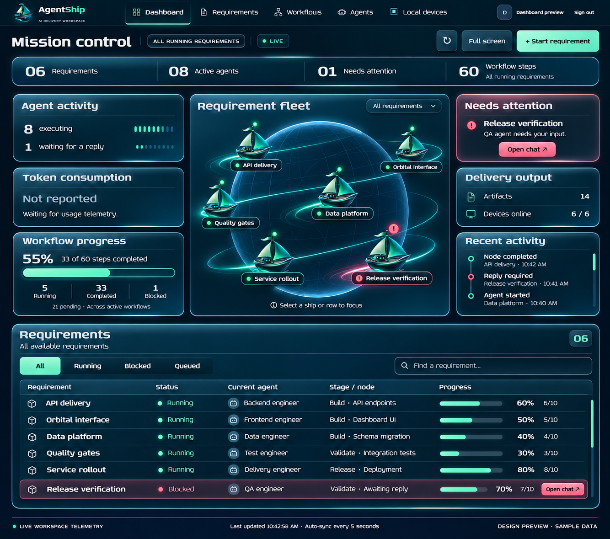

# Dashboard bottom inventory — delivery addendum

2026-11-20 · Branch `codex/dashboard-bottom-requirements`

This increment implements the user's latest preview and explicit request to create a branch and push the code. It includes the previously uncommitted command-center baseline, theme correction, Genos typography and requirement-name motion. Earlier reports describe their historical delivery state; this addendum governs the final layout.

## Requirements and acceptance

| ID | Business / product intent | Implemented behavior |
|---|---|---|
| BL-01 | Compare available requirements without squeezing their names beside the fleet | Full-width bottom table; current agent, status, stage/node, weighted progress and chat action; All by default; status filters and name search; bounded vertical scroll and horizontal scroll on narrow screens |
| BL-02 | Preserve the central fleet and recognizable visual identity | Centered transparent sphere, existing ship artwork, six tilted paths, continuous wakes, responsive sectors, independent alert targets; original navy/blue glass, mint/cyan and rose signals; Genos weights |
| BL-03 | Understand concurrent execution at a glance | Left: Agent activity, Token consumption, Workflow progress. Right: Needs attention, Delivery output, Recent activity |
| BL-04 | Focus without losing workspace context | Ship, table-name or activity click scopes live telemetry; selector returns to All; the full catalog remains available and selected rows are highlighted |
| BL-05 | Keep progress and activity truthful | Resolved current-wave nodes / total current-wave nodes; remaining count; actual recorded activity with timestamp and requirement name; no synthetic token usage |
| BL-06 | Reach every blocker | Scrollable attention list includes all blocked runs; direct chat requires fresh data and existing `open_repair_control` capability |

Historical and unstarted requirements remain visible. Their table progress is labeled history or unavailable. Live metrics do not count historical tasks. When a focused requirement has no current run, Recent activity shows its recorded history; when there are no live runs globally it shows workspace history. A normal failed refresh retains labeled stale data and disables chat; access loss clears protected data.

## Design and implementation

The existing snapshot store owns authorized API data; `dashboard-model.ts` owns aggregation and event ordering; `DashboardView` owns selection/filter presentation; `RequirementList` owns the semantic table and measured overflowing-name animation. Layout styles load after the existing dimensional theme and Genos typography. Native table headers, named scroll regions, pressed selection state and independent buttons retain keyboard/screen-reader semantics. Mobile keeps the sphere first, stacks telemetry cards, and contains table overflow within its scroll region.

`GET /api/runs/{id}` additively returns `recentActivity: [{id, kind, time}]`, up to 30 persisted records newest first, with ID tie-breaking. Sources are `task_event.created_at`, `run.created_at` and `run.finished_at`. Kinds are started, completed, stopped, progress, message, question, complete and failure. The existing authorized-run check precedes this query. No event message bodies, credentials, additional endpoint or migration are introduced. The frontend tolerates absent activity on older responses, merges/deduplicates events by run and event ID, and displays the newest 30 across the selected scope. The existing polling notification endpoint is not used as an event history.

## Clean-code workflow record

1. Established behavior from the accepted bottom-table preview and existing scope rules.
2. Kept projection, snapshot, presentation and persistence responsibilities separate.
3. Reused existing contracts/components with one optional read-model field; no new framework.
4. Used explicit event mapping and current-wave counting rather than a new abstraction hierarchy.
5. Implemented the scoped layout, table and recorded timeline; retained unrelated workspace behavior.
6. Updated this addendum, integration contract notes and local development instructions.
7. Ran frontend checks, Java packaging, real PostgreSQL/API verification and local browser review; evidence below.

## Verification

- TypeScript and Vite production build passed.
- Eleven frontend test suites passed: catalog lifecycle, aggregation, current tasks/waves, selection data, stale access, snapshot paging/cache, orbital geometry/clearance, motion cleanup, workflow dependencies and rendered UI. New checks cover timestamp ordering/deduplication, weighted progress, all attention entries and semantic bottom-table structure.
- Java 21 Maven packaging passed. Maven currently has no Java test sources; backend verification uses the repository's Python HTTP/PostgreSQL harness.
- `verify_dashboard_activity.py` compares API event IDs/kinds/timestamps against actual persisted records, confirms stable repeat reads, and verifies anonymous 401 and cross-account 404.
- Browser review and final evidence are recorded in the delivery completion note below.

Limits: token telemetry remains unavailable; sample preview numbers are not product data. Local fixtures simulate recorded runs without invoking external agents or GitHub execution. A branch push is authorized; production deployment and merging are outside this change.

### Delivery completion evidence

The native Arc browser displayed the local Java website with twelve synthetic requirements, seven operational runs, six visible ships in the first sector, eight executing tasks and one blocked run. Searching `Release` returned one of twelve requirements. Selecting it changed the scope to one requirement and 1/3 resolved steps (33%). Its table action opened the expected `/runs/{id}/chat` route and Agent chat heading without submitting a reply. The empty/no-live and recorded-history states were also inspected. The fixtures were retired after verification.

The final progress-card spacing and explicit tablet/mobile grid placement received production-build and source review after the interactive check. New phone/tablet visual checks were not completed; the prior screenshots in this directory belong to the earlier layout and are not evidence for the new bottom-table arrangement. Browser control reported concurrent user input during the final reload, so no further UI input was attempted. The final packaged asset was verified over local HTTP.

Automated evidence: [eleven-suite output](evidence/bottom-layout-tests.log). The final PostgreSQL/API check passed for 18 persisted records, repeated reads and both access-isolation cases. Java packaging and the final Vite build passed. Existing Java deprecation/varargs warnings remain outside this change.
